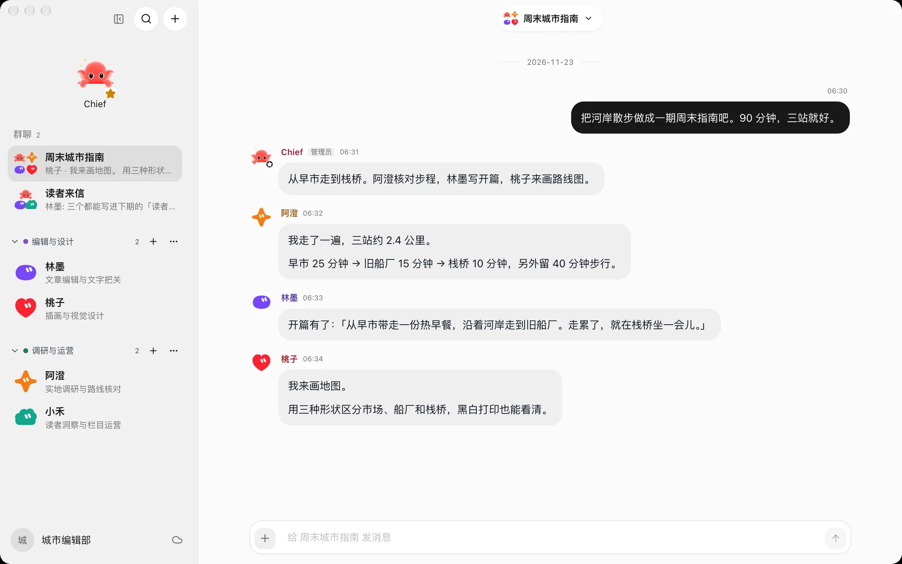
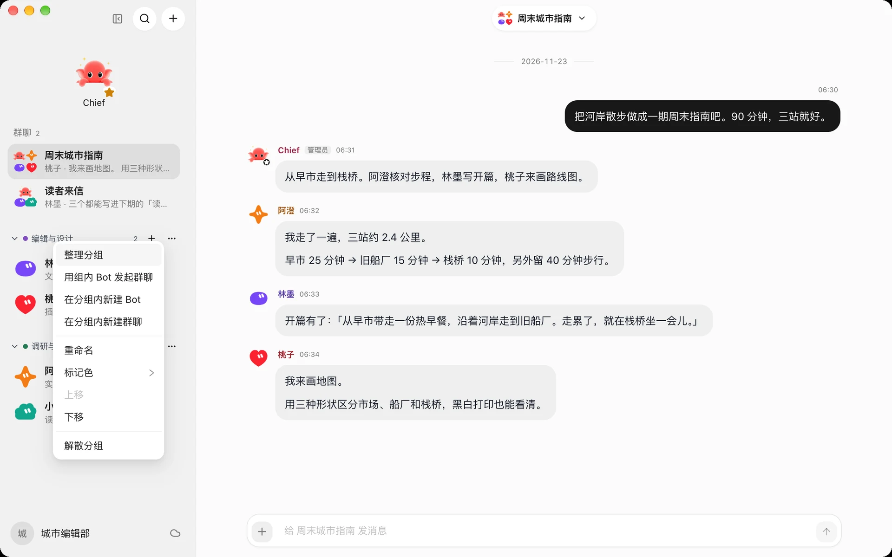
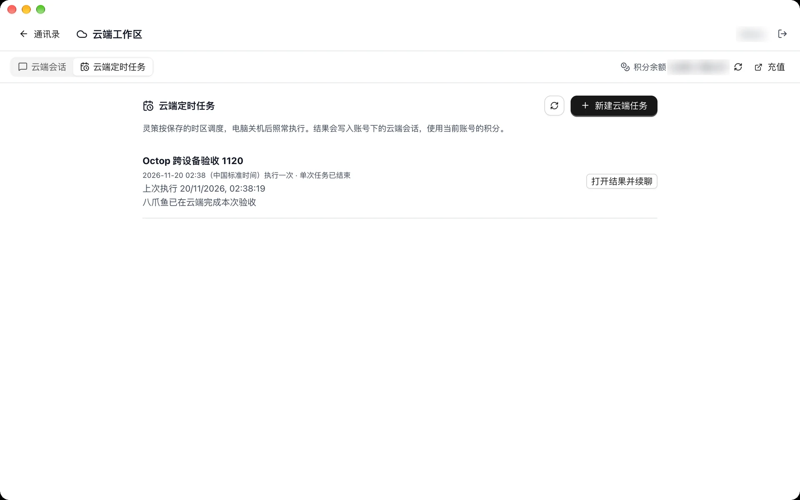
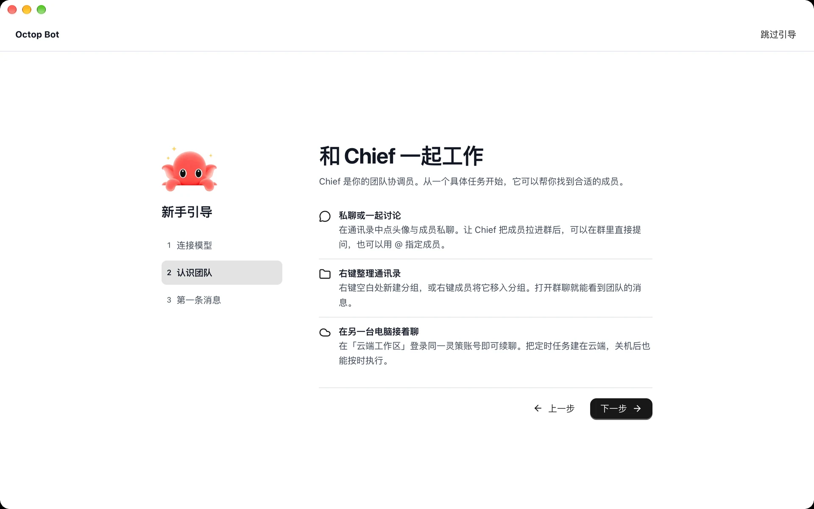
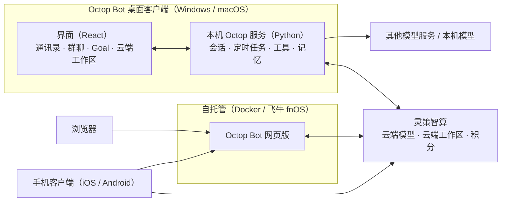

<div align="center">


# Octop Bot

**一句话，组建你的 AI 团队。**

告诉八爪鱼助手 Chief 你想完成什么。它会找来合适的 Bot，拉进同一个群聊，<br/>分工、接力、验收，直到把事情做完。

[](https://github.com/alison-xx/octop-bot/releases)
[](https://octop-bot.lynxce.cn/download.html)
[](LICENSE)
[](https://github.com/alison-xx/octop-bot)
[](https://github.com/TencentCloud/Octop)

[**下载客户端**](https://octop-bot.lynxce.cn/download.html) · [产品官网](https://octop-bot.lynxce.cn/) · [功能一览](https://octop-bot.lynxce.cn/features.html) · [快速上手](https://octop-bot.lynxce.cn/guide.html) · [更新日志](CHANGELOG.md) · [English](README_EN.md)

</div>

https://github.com/user-attachments/assets/c591e4cd-08b3-424f-b82c-663afdb273c6

<p align="center"><sub>30 秒宣传片 · 动画由灵策智算 HappyHorse 1.1 生成 · 打开声音观看</sub></p>

## 它是怎么工作的

| 1. 说出你要的结果 | 2. Chief 组队分工 | 3. 团队接力交付 |
| --- | --- | --- |
| 像跟同事交代工作一样说一句话，不用写提示词，也不用搭流程。 | Chief 查找已有成员，补建缺少的专家，再拉一个群聊，把任务拆给每个人。 | 成员在群里接力，每一步都看得见。最后由 Chief 对照目标逐项验收。 |
| *「把河岸散步做成一期周末指南。90 分钟，三站就好。」* | *「阿澄核对步程，林墨写开篇，桃子来画地图。」* | *「我来画地图，用三种形状区分市场、船厂和栈桥。」* |

**32 秒介绍片：** 跟 Chief 说一句，阿澄去走路线，林墨写开篇，桃子画地图；定好的任务放到云端，电脑关了也照常跑。

https://github.com/user-attachments/assets/bc79dce7-db0e-4f15-81d4-e76899e68eb9

<sub>有配音，建议打开声音观看。</sub>

## 亮点

- **群里接力。** 用 `@` 点名分工，大家围绕同一份群附件协作，定下来的事写进群笔记。每位成员仍保留自己的私聊和工作目录。
- **能验收的 Goal。** 把一句模糊的需求写成分工、阶段和验收标准，Chief 按阶段逐项核对。之后重开群聊，也能回看每一步的依据。
- **关机也在干活。** 用灵策账号登录云端工作区，云端定时任务在电脑关机后照常执行，换一台电脑也能接着聊。
- **文件留在本机。** 本机 Bot 直接处理这台电脑上的文件、脚本和应用。附件、工具记录和思考过程默认不出本机。
- **模型随你选。** 登录灵策智算账号，用 API Key 接入其他服务商，或者直接用本机模型，对话中随时切换。
- **能力全都带上。** MCP 连接器、技能、知识库、长期记忆、飞书 / 企业微信 / Telegram 等 IM 频道，以及 Claude Code、OpenCode、Qwen Code 等外部 Agent，都可以装给任意一位 Bot。
- **随叫随到。** `Ctrl+K`（Mac 用 `⌘K`）搜遍成员、群聊和历史私聊；桌面悬浮球让 Chief 一直在手边；关闭窗口后可留在托盘继续跑本机定时任务。
- **哪里都能用。** 除了 Windows 和 Mac 客户端，还可以部署到 Docker 或飞牛 NAS 用浏览器打开，或者用 iOS、Android 原生客户端随身聊。

## 客户端实拍

<table>
  <tr>
    <td width="50%"></td>
    <td width="50%"></td>
  </tr>
  <tr>
    <td align="center"><sub><b>团队群聊</b> · 一份需求，多位成员在群里接力</sub></td>
    <td align="center"><sub><b>团队通讯录</b> · 按项目分组，右键就能建群</sub></td>
  </tr>
  <tr>
    <td width="50%"></td>
    <td width="50%"></td>
  </tr>
  <tr>
    <td align="center"><sub><b>云端任务</b> · 电脑关机，定时任务照常执行</sub></td>
    <td align="center"><sub><b>新手引导</b> · 挑一个示例，改一改就能发给 Chief</sub></td>
  </tr>
</table>

<sub>截图来自 macOS 客户端，城市编辑部、聊天内容和云端任务均为演示数据。</sub>

## 安装

| 你想怎么用 | 选择 | 说明 |
| --- | --- | --- |
| 在 Windows 电脑上用 | [安装版 EXE 或免安装 ZIP](https://octop-bot.lynxce.cn/download.html) | Windows 10 / 11 x64。EXE 按向导安装；ZIP 完整解压后打开 `Octop Bot.exe`，保留同目录的资源文件。 |
| 在 Mac 上用 | [磁盘映像 DMG](https://octop-bot.lynxce.cn/download.html) | Apple 芯片（M1 及更新）。打开 DMG，把 **Octop Bot** 拖进「应用程序」，再从那里启动。 |
| 部署在 NAS 或服务器上，用浏览器打开 | [Docker 或飞牛 fnOS（FPK）](docs/octop-bot-nas.md) | 首次打开直接用灵策智算账号登录，或设置登录密码后自己配置模型，不需要向导口令。 |
| 在手机上用 | [iOS 和 Android 客户端](mobile/README.md) | 用灵策账号直接对话，或连接自己部署的 Octop Bot。目前需要自行构建。 |
| 改代码或自己打包 | [从源码运行](#从源码运行) | 见本文末尾。 |

桌面安装包自带 Python 和本地 Octop 服务，不需要另装依赖，留出 2 GB 以上空闲空间即可。安装包由灵策 OSS 分发，下载页为每个文件列出了 SHA-256，每个版本也附有 `SHA256SUMS.txt`，下载后比对一下就能确认文件完整。暂未提供 Linux 和 Intel Mac 安装包，这两类设备可以用 Docker 部署网页版。

## 快速上手

1. **连接一个模型。** 首次启动后选择「登录灵策智算账号」「自己配置模型」或「稍后配置」，不需要注册本机账号。
   - 灵策智算：在系统浏览器完成授权，回到客户端选一个模型并保存，用量从账号积分扣除。还没有账号的话，点「注册灵策智算账号」，在[灵策官网](https://admin.lynxce.cn/profile/login)选「注册」标签。
   - 其他来源：填入云服务的 API Key、自定义兼容地址，或选择本机模型。
2. **把第一件事交给 Chief。** 新手引导会带你认识私聊、分组和云端工作区。挑一个建团队、做计划或分配工作的示例，点「在 Chief 对话中编辑」，改好后发送。以后可以从「账号与模型 → 新手引导」重新打开。
3. **让 Chief 组队。** 想复现截图里的城市编辑部，把下面这段贴给 Chief，再换成你自己的项目。自动建队需要支持工具调用的模型。

   > 请帮我创建「周末城市指南」群。邀请一位调研员核对路线，一位编辑写开篇，一位设计师画地图。第一期是 90 分钟的河岸散步，请先给我三个候选站点。

连接灵策后，「账号与模型」里会显示积分余额，点「充值」会在浏览器打开该账号的充值页。以前只授权过聊天的账号，第一次充值时先点「授权充值」。

## 使用指南

### 和团队一起工作

| 你想做什么 | 从哪里开始 |
| --- | --- |
| 和某位 Bot 继续聊 | 单击通讯录成员恢复最近的私聊。点对话顶部的名字打开资料，调整头像、角色或模型。工作中可以用 `/side` 私下追问。 |
| 让几位成员一起交付 | 在「＋」里新建群聊，或请 Chief 建群。在群里发需求，用 `@` 点名成员。复杂任务在 Goal 里写下验收条件、阶段和负责人。 |
| 整理项目成员 | 右键通讯录空白处新建分组或批量移组；右键成员移入已有分组；右键分组标题可以改名、设颜色、调顺序，或用组内 Bot 发起群聊。解散分组不会删除成员和聊天。 |
| 找回上次说过的话 | `Ctrl+K`（Mac 用 `⌘K`）搜索成员和分组，切到「历史私聊」输入标题或关键词。私聊里还可以用「引用对话」插入之前的原话。 |

### 换成自己的项目

| 工作场景 | 可以怎样开场 | 最后拿到什么 |
| --- | --- | --- |
| 项目复盘 | 在群里附上会议记录，让记录员摘出决定和待办，复核员核对负责人和日期。 | 一张带原文依据的清单，材料里没写清的事项标为「待确认」。 |
| 工作日晨会 | 把最新工作记录交给简报 Bot，在它的资料面板设一个工作日定时任务，整理昨日进展、今日优先和待跟进问题。 | 每天一份可以继续追问的简报。本机调度需要 Octop 服务在运行；云端调度需要材料放在云端能读到的地方。 |
| 读书会招募 | 在群 Goal 里写：策划给三个角度，你选定后写手交付一段 80–120 字的招募文案。 | Chief 逐项核对面向谁、何时举行、如何报名，按阶段汇总各成员的回复。 |

### 给 Bot 装上能力

在「账号与模型」顶部打开「能力」，或在 Bot 资料面板点「技能与连接器」。Octop 的全部能力都集中在这里，进入时默认选中当前 Bot。

| 分组 | 可以做什么 |
| --- | --- |
| 技能与连接器 | 连接 MCP 服务和内置连接器，安装、启用技能和技能包。 |
| 知识与记忆 | 建知识库给 Bot 检索，查看和清理 Bot 的长期记忆。 |
| 通道与插件 | 把 Bot 接到飞书、企业微信、Telegram 等 IM，管理插件。 |
| 智能体与自动化 | 接入 Claude Code、OpenCode、Qwen Code 等外部 Agent，统一查看定时任务。 |

### 本机还是云端

打开通讯录底部的**云端工作区**，单独登录灵策账号。云端可用的模型、执行权限和积分取决于这个账号。

| 这件事 | 交给谁 |
| --- | --- |
| 要用这台电脑上的文件、脚本或已安装的应用 | **本机 Bot。** 需要反复执行就在 Bot 资料的「定时任务」里设工作日或每周，到点时保持电脑唤醒、Octop Bot 在后台运行。 |
| 有固定时间、材料在云端也能读到（比如晨间简报） | **云端定时任务。** 填写指令、时间和时区，电脑关机也照常执行。完成后点「打开结果并续聊」。 |
| 想在另一台设备接着聊 | **把当前私聊带到云端。** 点私聊顶部的名字，选「把当前私聊带到云端」，预览后确认。最多带走最近 20 条可见文字，附件、工具记录和思考过程留在本机。 |

把已有的本机定时任务搬到云端时，先在 Bot 资料的「定时任务」里暂停原任务，再选「用此配置创建云端任务」，避免重复执行。

Windows 客户端默认把本机工作区放在 `%USERPROFILE%\.octop-bot`。群文件、共享笔记、头像和电脑控制等更多操作见[完整使用指南](docs/octop-bot.md)。

## 架构

Octop Bot 是一个 Electron 桌面应用，里面跑着完整的本地 Octop 服务。网页版、NAS 版和手机客户端连接的是同一套服务。



| 目录 | 内容 |
| --- | --- |
| [`desktop/src`](desktop/src/) | Electron 主进程、预加载脚本、启动、自动更新与打包 |
| [`dashboard/src/pages/OctopBot`](dashboard/src/pages/OctopBot/) | 通讯录、群聊、Goal、账号与云端工作区界面 |
| [`src/octop`](src/octop/) | Python 服务：会话、Bot 群组、定时调度、灵策接口 |
| [`mobile`](mobile/) | iOS（SwiftUI）和 Android（Jetpack Compose）原生客户端 |
| [`fnos`](fnos/)、[`deploy/docker`](deploy/docker/) | 飞牛 FPK 与 Docker 部署 |
| [`website`](website/) | 产品官网源码 |
| [`tests`](tests/) | 后端单元与集成测试 |

Agent 循环、IM 协议、记忆和浏览器控制分别来自 [octop-harness](https://github.com/TencentCloud/octop-harness)、[octop-gateway](https://github.com/TencentCloud/octop-gateway)、[octop-memory](https://github.com/TencentCloud/octop-memory) 和 [octop-browser](https://github.com/TencentCloud/octop-browser)。

## 从源码运行

准备 Git、[uv](https://docs.astral.sh/uv/)、Node.js 24 和 pnpm 12.15.0，在 Windows PowerShell 中运行：

```powershell
git clone https://github.com/alison-xx/octop-bot.git
cd octop-bot
uv sync --frozen --python 3.12 --extra browser --extra computer-use --extra desktop
npm --prefix dashboard ci
pnpm --dir desktop/src install --frozen-lockfile
.\desktop\src\scripts\run-dev.ps1 -Bot
```

脚本会构建 Electron，启动本地 Octop 服务和前端开发服务器。开发版使用独立的数据目录 `desktop/src/.dev-runtime/windows/bot-home`，不会碰到已安装客户端的数据。

<details>
<summary><b>构建 Windows x64 安装包</b></summary>

在装好上述依赖的 Windows x64 环境中，从仓库根目录运行：

```powershell
uv run --frozen python desktop/src/scripts/package-bot-windows.py
```

脚本会编译前端、构建 Octop wheel，并随包附上 Python 运行时。安装程序、免安装 ZIP 和解包后的客户端位于 `desktop/src/release/octop-bot/`。

发布带 Authenticode 签名的版本时，先把环境变量 `OCTOP_BOT_SIGN_CERT_SHA1` 设为发布者证书在 Windows 证书存储中的指纹。打包程序会用 SHA-256 和 RFC 3161 时间戳签署客户端、卸载程序和安装程序。

</details>

<details>
<summary><b>运行测试</b></summary>

```bash
make all                       # 格式化 + lint + 类型检查 + 测试
uv run pytest -m "not live"    # 只跑测试，不调用真实模型
cd dashboard && npx tsc -b     # 前端类型检查
```

提交前请先运行一次 `make install-hooks`，之后每次 `git commit` 都会自动跑 `make all`。贡献流程见 [CONTRIBUTING.md](CONTRIBUTING.md)，安全问题请按 [SECURITY.md](SECURITY.md) 私下报告。

</details>

## 常见问题

<details>
<summary><b>Octop Bot 收费吗？</b></summary>

客户端免费，并以 MIT 协议开源。模型用量取决于你连接的服务：灵策智算和其他服务商按各自的规则计费，本机模型不额外收费。

</details>

<details>
<summary><b>我的聊天和文件存在哪里？</b></summary>

本机 Bot 的会话、附件和工作文件都在你的电脑上（Windows 默认在 `%USERPROFILE%\.octop-bot`）。只有你主动登录云端工作区、创建云端任务或把私聊带到云端时，相应内容才会交给灵策处理；带到云端的只是最近最多 20 条可见文字。

</details>

<details>
<summary><b>为什么 Chief 没有帮我建群？</b></summary>

建群、补建成员需要模型调用工具。请在输入框里换一个支持工具调用的模型再试。

</details>

<details>
<summary><b>有 Linux 或 Intel Mac 版本吗？</b></summary>

暂时没有安装包。可以用 [Docker 部署网页版](docs/octop-bot-nas.md)，在浏览器里使用 Chief、群聊和「能力」中的大部分功能；桌面悬浮球和设备自动登录只有 Windows、macOS 客户端提供。

</details>

<details>
<summary><b>Octop Bot 和 Octop 是什么关系？</b></summary>

Octop Bot 基于腾讯云开源的 [Octop](https://github.com/TencentCloud/Octop) 打造，保留了它的提交历史和 MIT 许可证。Octop 是面向多用户、多智能体的自托管平台；Octop Bot 把它做成一个人就能上手的桌面客户端，加上 Chief、Bot 群聊、Goal 验收和灵策云端工作区。想部署原版多用户平台，请阅读 [Octop 的说明](https://github.com/TencentCloud/Octop/blob/976803d6292dfb2e28e525823aa28d2e33a755a8/README_CN.md)。

</details>

还有问题？看看[官网的常见问题](https://octop-bot.lynxce.cn/guide.html#faq)，或者带上复现步骤[提交 Issue](https://github.com/alison-xx/octop-bot/issues)。

## 加入微信交流群

想和其他用户聊聊 Octop Bot 的用法？用微信扫描下方二维码加我为好友，申请时备注「Octop Bot」，通过后我会邀请你进群。


## 致谢与许可

- 基于 [TencentCloud/Octop](https://github.com/TencentCloud/Octop/tree/976803d6292dfb2e28e525823aa28d2e33a755a8) 开发，以 [MIT 许可证](LICENSE) 发布。
- 部分角色图形改编自 DS Bot（[声明](dashboard/public/licenses/ds-bot.txt)），公式渲染使用了 Deep View 的代码（[声明](dashboard/public/licenses/deep-view.txt)）。
- 宣传片配乐 “Carefree”、介绍片配乐 “Inspired” 均出自 Kevin MacLeod（[incompetech.com](https://incompetech.com)），以 [CC BY 4.0](https://creativecommons.org/licenses/by/4.0/) 授权。

如果 Octop Bot 帮你省下了时间，欢迎点一个 ⭐，让更多人看到它。
