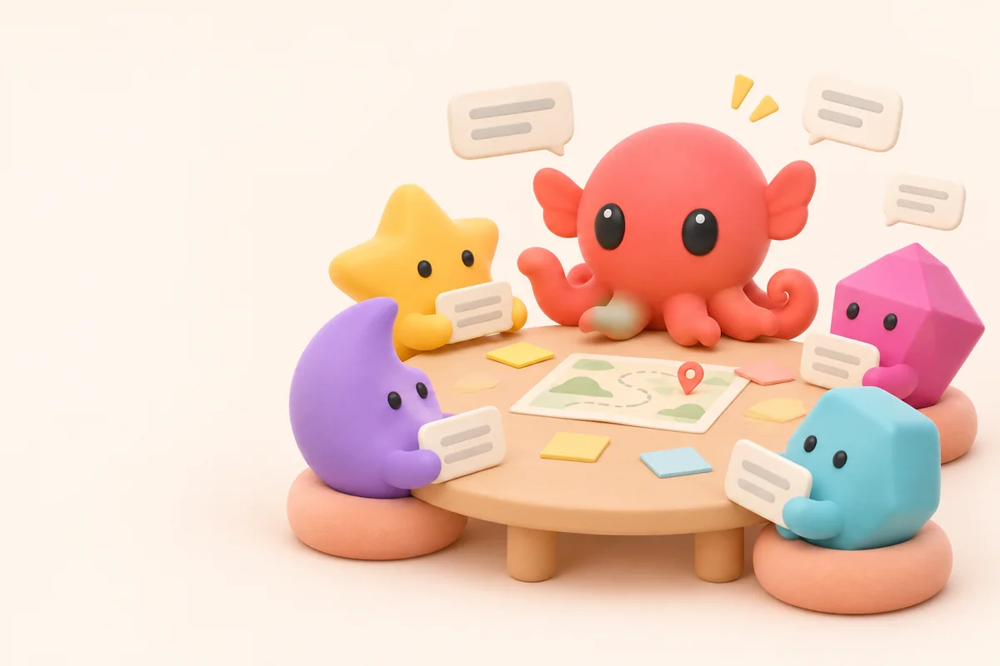
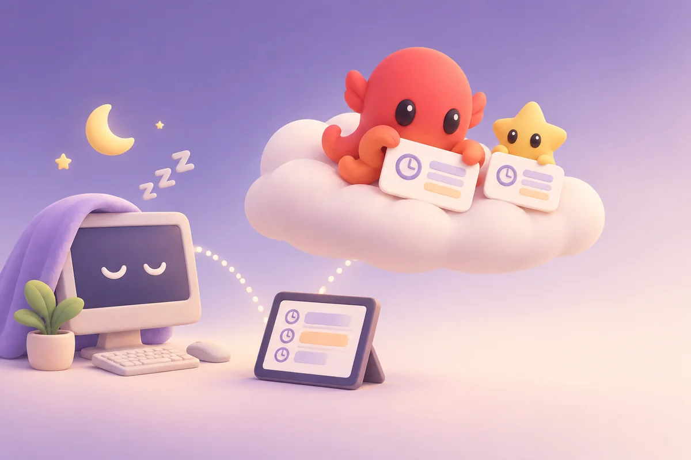

# Octop Bot

[简体中文](README.md) · [English](README_EN.md) · [Product website](https://octop-bot.lynxce.cn/)

Octop Bot is a desktop app for Windows and Apple Silicon Macs for working with a team of AI assistants. Tell Chief, your octopus assistant, what you want to make. Chief can create Bots with different jobs and bring them into a group chat. You can also keep a one-to-one conversation with any member, or send a job to Lynxce Cloud when it needs to run while your PC is off.

Watch Chief put a book club’s invitation together with a planner and writer in the **30-second product film**. Choose the [English film](https://octop-bot.lynxce.cn/media/intro-en.mp4), [Chinese film](https://octop-bot.lynxce.cn/media/intro-zh.mp4), or [interactive walkthrough](https://octop-bot.lynxce.cn/#demo).

[Docker and fnOS installation guide (FPK)](docs/octop-bot-nas.md). The web build signs you in with your Lynxce account on first open — no setup passcode.



## Desktop downloads

[Get Octop Bot and its SHA-256 checksums from the official download page](https://octop-bot.lynxce.cn/#download). Choose the package for your computer. The page lists the current version and serves the release files from Lynxce OSS.

| Computer | Package | How to install |
| --- | --- | --- |
| Windows x64 | Installer (EXE) | Run the installer, follow the setup wizard, then open Octop Bot. |
| Windows x64 | Portable archive (ZIP) | Extract the entire ZIP to a folder, then open `Octop Bot.exe` from that folder. |
| Mac with Apple Silicon (M series) | Disk image (DMG) | Open the DMG, drag **Octop Bot** to **Applications**, then launch it there. |

Version **1.0.3-beta.7** is available for both platforms. The packages include Python and the local Octop service. To verify a download, compare the SHA-256 digest of your file with the checksum listed for that filename on the download page.


*These screenshots show the Windows app. The City Desk team, conversations, and cloud schedules use sample data.*

## Join the WeChat group

To join other Octop Bot users on WeChat, scan the QR code below and add me as a contact. Include “Octop Bot” in your friend request so I can invite you to the group.


## Get started

1. **Choose how to connect.** On first launch, pick **Lynxce account**, **Other model sources**, or **Set up later** right away — no local account to create. Your own Chief appears in the team directory.
2. **Connect a chat model.** Choose **Lynxce account**, authorize in your system browser, then return to the app to select and save an available model. Model calls use credits from that account. **Other model sources** lets you connect your own cloud provider, a compatible endpoint, or a local model. Choose **Set up later** to explore the team first, then connect a model before sending a message.
3. **If you need a Lynxce account,** select **Create a Lynxce account**, open the **Register** tab on the official site, and complete registration. Return to the app and sign in or authorize from the same screen. [Lynxce account site](https://admin.lynxce.cn/profile/login)
4. **Send Chief your first message.** The getting-started guide introduces private chats, directory sections, and the cloud workspace. Choose an example for building a team, planning a project, or assigning work, and select **Edit in Chief’s chat**. Edit the draft and send it when you’re ready. To reopen the guide, choose **Account and models → Getting started** at the bottom of the directory.


After connecting Lynxce, open **Account and models** to view your credit balance. **Top up** opens that account’s Lynxce checkout in your system browser. If your earlier authorization covered chat only, choose **Authorize top-ups** and approve the request on Lynxce to continue. After reconnecting the account, select and save a chat model from its list of available models. Your balance refreshes when you return to the app, or you can use the refresh icon beside it.

To try the City Desk from the screenshots, paste this prompt into Chief’s chat and adapt it to your project. Chief needs a model with tool-calling support to create the team.

> Create a group called “Weekend City Guide.” Invite a researcher to check the route, an editor to write the opener, and a designer to draw the map. The first issue is a 90-minute riverfront walk. Start by suggesting three stops.

## Work with your team

| What you want to do | Where to start |
| --- | --- |
| Pick up a private chat | Select a member in the directory to resume your latest conversation. Click their name at the top to open their profile and change their avatar, role, or model. Use `/side` to ask a follow-up while the main task runs. |
| Work on a shared deliverable | Choose **+** to create a group chat, or ask Chief to create one. Send the brief to the group or mention a member with `@`. For larger jobs, use a Goal to agree on acceptance criteria, stages, and owners. |
| Organize a project | Right-click an empty part of the directory to create a section or move items in bulk. Right-click a member to move it into an existing section. Right-click a section heading to rename, recolor, reorder, or start a group chat with its Bots. Dissolving the section preserves its members and chats. |
| Find an earlier conversation | Press `Ctrl+K` (or `⌘K` on Mac) to search for members and sections. Switch to private chat history and search by title or message text to open the original conversation. |


### Try another brief

| Workflow | First message | What to look for |
| --- | --- | --- |
| Project review | Upload the meeting notes to a group. Ask one Bot to extract decisions and another to check owners and dates. | A checklist that quotes its sources and marks the open questions. |
| Weekday stand-up | Give a briefing Bot the latest work notes. In its profile, schedule a weekday task to summarize yesterday’s progress, today’s priorities and open questions. | A brief you can follow up on. Local schedules need the Octop service running; cloud schedules need inputs the cloud can access. |

[Copy a complete prompt from the website](https://octop-bot.lynxce.cn/#scenarios).

## Give your Bots capabilities


Open **Capabilities** from the top of **Account and models**, or choose **Skills & connectors** in a Bot's profile. Every upstream Octop capability lives here, scoped to the current Bot:

| Group | What you can do |
| --- | --- |
| Skills & connectors | Connect MCP servers and built-in connectors; install and enable skills and skill packages. |
| Knowledge & memory | Build knowledge bases for Bots to search; review and clean up long-term memory. |
| Channels & plugins | Put Bots on Feishu, WeCom, Telegram and other IM apps; manage plugins. |
| Agents & automation | Bring in external agents such as Claude Code, OpenCode and Qwen Code; see every schedule in one place. |

## Keep working while your computer is off



Open **Cloud workspace** at the bottom of the directory and sign in separately with your Lynxce account. Start a cloud chat or create a schedule. Sign in with the same account on another PC to check accepted jobs, read their results, and continue the conversation. Your account determines the available cloud models, permissions, and credits. The workspace shows the signed-in cloud account’s balance at the top. Select **Top up** to add credits to that account.

- **Bring an existing conversation.** Click the Bot’s name at the top of a local private chat and choose **Continue this local chat in the cloud**. Review the preview and confirm. Each import includes up to the latest 20 visible text messages. Attachments, tool records, and reasoning stay on your PC.
- **Schedule cloud work.** Under **Cloud schedules**, enter the instructions and time. A saved cloud schedule runs in its configured time zone, even when your PC is off. Use **Continue in result chat** to follow up.
- **Move a local schedule.** Pause the original under **Scheduled tasks** in the Bot’s profile. Choose the option to create a cloud schedule from its configuration, review the instructions and time, and save. Local files, scripts, and installed apps stay on your PC. Run jobs that need them locally, with the PC awake and Octop Bot running in the background.


The standalone Windows app stores its local workspace in `%USERPROFILE%\.octop-bot` by default. For group files, shared notes, avatar settings, and computer control, see the [user guide in Chinese](docs/octop-bot.md).

## Run from source

Install Git, uv, Node.js 24, and pnpm 12.15.0. Run these commands in Windows PowerShell.

```powershell
git clone https://github.com/alison-xx/octop-bot.git
cd octop-bot
uv sync --frozen --python 3.12 --extra browser --extra computer-use --extra desktop
npm --prefix dashboard ci
pnpm --dir desktop/src install --frozen-lockfile
.\desktop\src\scripts\run-dev.ps1 -Bot
```

The script builds Electron and starts the local Octop service and frontend development server. The development build uses its own data directory at `desktop/src/.dev-runtime/windows/bot-home`.

### Build the Windows x64 installer

On a Windows x64 machine with the dependencies above, run the following from the repository root.

```powershell
uv run --frozen python desktop/src/scripts/package-bot-windows.py
```

The script builds the frontend and the Octop wheel, then bundles the Python runtime. The installer, portable ZIP, and unpacked app appear in `desktop/src/release/octop-bot/`. To create an Authenticode-signed release, set `OCTOP_BOT_SIGN_CERT_SHA1` to the publisher’s certificate thumbprint in the Windows certificate store before building. The packager signs the app, uninstaller, and installer with SHA-256 and an RFC 3161 timestamp.

## Source and licenses

| Directory | Contents |
| --- | --- |
| [desktop/src](desktop/src/) | Electron main process, preload scripts, startup, and packaging |
| [dashboard/src/pages/OctopBot](dashboard/src/pages/OctopBot/) | Directory, group chats, account settings, and cloud workspace UI |
| [src/octop](src/octop/) | Python service, conversations, scheduling, and Lynxce integration |
| [tests](tests/) | Backend unit and integration tests |

This project retains Octop’s upstream Git history and MIT license. Some character graphics are adapted from DS Bot, and formula rendering includes code from Deep View. [Upstream Octop](https://github.com/TencentCloud/Octop/tree/976803d6292dfb2e28e525823aa28d2e33a755a8) · [MIT license](LICENSE) · [DS Bot notice](dashboard/public/licenses/ds-bot.txt) · [Deep View notice](dashboard/public/licenses/deep-view.txt)
