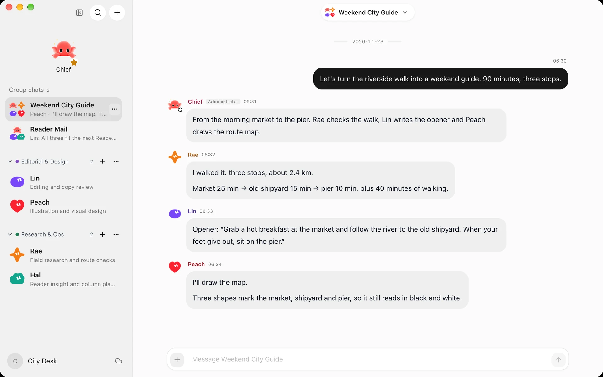
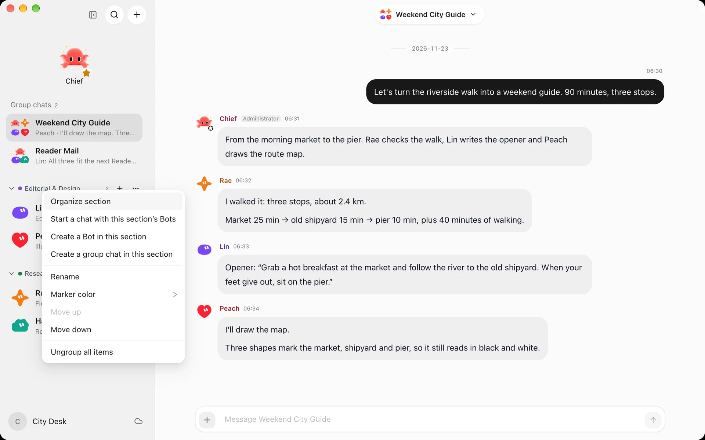
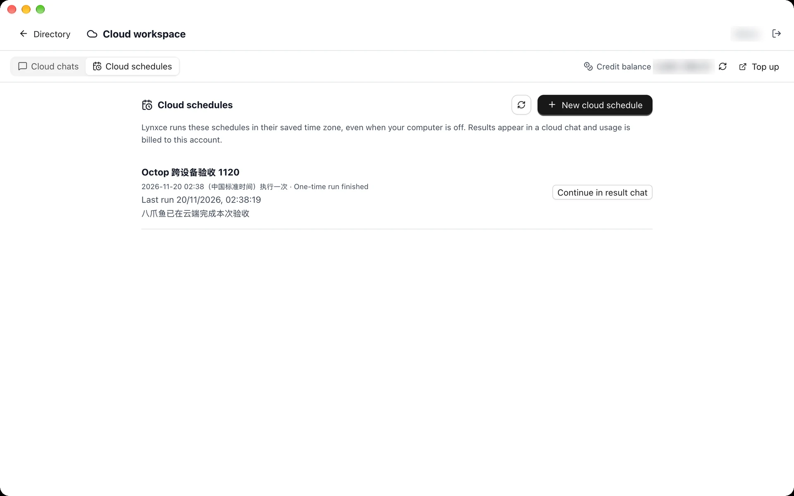
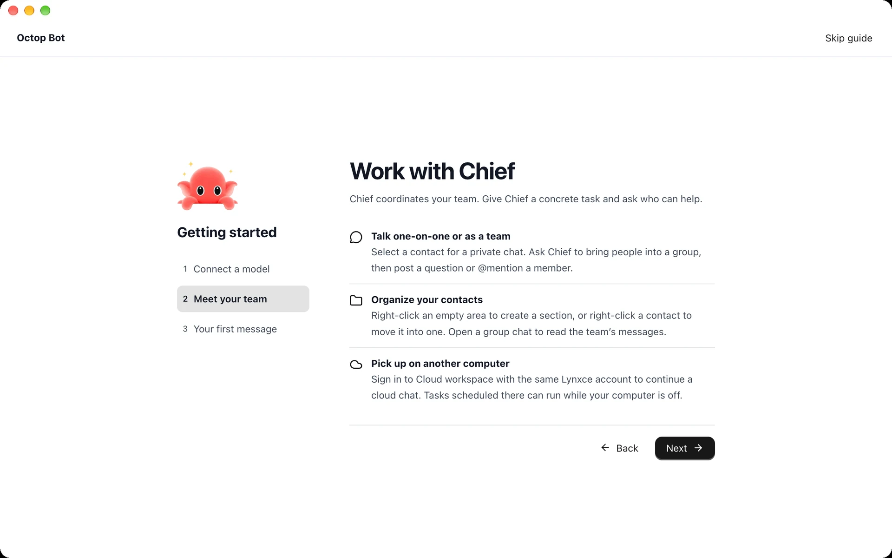
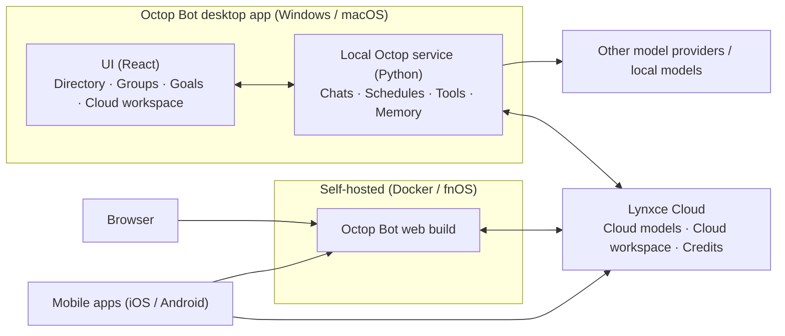

<div align="center">


# Octop Bot

**One sentence. A whole AI team.**

Tell Chief, your octopus assistant, what you want done. Chief finds the right Bots, brings them into one group chat,<br/>splits the work, hands it along and checks the result until the job is finished.

[](https://github.com/alison-xx/octop-bot/releases)
[](https://octop-bot.lynxce.cn/download.html)
[](LICENSE)
[](https://github.com/alison-xx/octop-bot)
[](https://github.com/TencentCloud/Octop)

[**Download**](https://octop-bot.lynxce.cn/download.html) · [Website](https://octop-bot.lynxce.cn/) · [Features](https://octop-bot.lynxce.cn/features.html) · [Quick start](https://octop-bot.lynxce.cn/guide.html) · [Changelog](CHANGELOG.md) · [简体中文](README.md)

</div>

https://github.com/user-attachments/assets/5e4d2cd3-881b-4f85-8d45-67c7e8c46660

<p align="center"><sub>30-second promo · animated with Lynxce HappyHorse 1.1 · turn the sound on</sub></p>

## How it works

| 1. Say what you want | 2. Chief builds the team | 3. The team delivers |
| --- | --- | --- |
| One sentence, the way you'd brief a colleague. No prompt engineering, no workflow builder. | Chief looks for existing members, creates the specialists that are missing, opens a group chat and assigns each part. | Members hand work to each other in the group, every step in plain view. Chief checks the result against the goal. |
| *"Let's turn the riverside walk into a weekend guide. 90 minutes, three stops."* | *"Rae checks the walk, Lin writes the opener and Peach draws the route map."* | *"Three shapes mark the market, shipyard and pier, so it still reads in black and white."* |

**32-second intro film:** tell Chief once. Rae walks the route, Lin writes the opener, Peach draws the map, and scheduled work keeps running in the cloud with your computer off.

https://github.com/user-attachments/assets/7da8ded6-3612-43c6-9c3a-3b8ac402f155

<sub>With voice-over; turn the sound on.</sub>

## Highlights

- **Hand work along in a group.** Assign with `@`, work from the same group attachments, and write decisions into group notes. Each member keeps their own private chat and working folder.
- **Goals you can check off.** Turn a vague request into owners, stages and acceptance criteria. Chief checks each stage, and you can reopen the group later to see what every answer was based on.
- **Keeps working when your PC is off.** Sign in to the cloud workspace with a Lynxce account. Cloud schedules run while your computer is off, and you can pick up the chat on another computer.
- **Your files stay on your computer.** Local Bots work directly with the files, scripts and apps on this machine. Attachments, tool records and reasoning stay local by default.
- **Bring any model.** Sign in to Lynxce, add an API key from another provider, or use a local model. Switch models from the message box at any time.
- **Every capability, for any Bot.** MCP connectors, skills, knowledge bases, long-term memory, IM channels such as Feishu, WeCom and Telegram, and external agents such as Claude Code, OpenCode and Qwen Code.
- **Always within reach.** `Ctrl+K` (`⌘K` on Mac) searches members, groups and past chats. A floating desktop orb keeps Chief one click away, and the tray keeps local schedules running after you close the window.
- **Runs where you are.** Besides the Windows and Mac apps, deploy it to Docker or an fnOS NAS and open it in a browser, or chat on the go with the native iOS and Android apps.

## Screenshots

<table>
  <tr>
    <td width="50%"></td>
    <td width="50%"></td>
  </tr>
  <tr>
    <td align="center"><sub><b>Group chat</b> · one brief, several members taking turns</sub></td>
    <td align="center"><sub><b>Team directory</b> · sections per project, group chats from a right-click</sub></td>
  </tr>
  <tr>
    <td width="50%"></td>
    <td width="50%"></td>
  </tr>
  <tr>
    <td align="center"><sub><b>Cloud schedules</b> · they run while your computer is off</sub></td>
    <td align="center"><sub><b>Getting started</b> · pick a sample, edit it, send it to Chief</sub></td>
  </tr>
</table>

<sub>Screenshots from the macOS app. The City Desk team, chats and cloud tasks are demo data.</sub>

## Install

| How you want to use it | Get | Notes |
| --- | --- | --- |
| On a Windows PC | [Installer (EXE) or portable ZIP](https://octop-bot.lynxce.cn/download.html) | Windows 10 / 11 x64. Run the EXE and follow the wizard, or extract the whole ZIP and open `Octop Bot.exe`, keeping the resource files beside it. |
| On a Mac | [Disk image (DMG)](https://octop-bot.lynxce.cn/download.html) | Apple silicon (M1 or later). Open the DMG, drag **Octop Bot** to **Applications** and launch it from there. |
| On a NAS or server, in the browser | [Docker or fnOS (FPK)](docs/octop-bot-nas.md) | On first open, sign in with a Lynxce account or set a password and configure your own models. No setup passcode. |
| On your phone | [iOS and Android apps](mobile/README.md) | Chat with a Lynxce account, or connect to your own Octop Bot deployment. Build them yourself for now. |
| Hack on it or package it | [Run from source](#run-from-source) | See the end of this page. |

The desktop packages include Python and the local Octop service, so there is nothing else to install; keep at least 2 GB free. Packages are served from Lynxce OSS. The download page lists a SHA-256 checksum for every file and each release ships a `SHA256SUMS.txt`, so you can verify what you downloaded. There are no Linux or Intel Mac packages yet; on those machines, run the web build with Docker.

## Quick start

1. **Connect a model.** On first launch, choose **Lynxce account**, **Other model sources** or **Set up later**. No local account to create.
   - Lynxce: authorize in your system browser, then return to the app and save a model. Usage is billed in credits from that account. No account yet? Choose **Create a Lynxce account** and use the **Register** tab on the [Lynxce site](https://admin.lynxce.cn/profile/login).
   - Other sources: enter an API key for a cloud provider, a compatible endpoint, or pick a local model.
2. **Give Chief your first job.** The getting-started guide introduces private chats, directory sections and the cloud workspace. Pick an example for building a team, planning a project or assigning work, select **Edit in Chief's chat**, adjust it and send. Reopen the guide any time from **Account and models → Getting started**.
3. **Let Chief build the team.** To recreate the City Desk from the screenshots, paste this into Chief's chat, then adapt it to your own project. Creating a team needs a model with tool calling.

   > Create a group called "Weekend City Guide." Invite a researcher to check the route, an editor to write the opener, and a designer to draw the map. The first issue is a 90-minute riverside walk. Start by suggesting three stops.

With Lynxce connected, **Account and models** shows your credit balance, and **Top up** opens that account's checkout in your browser. If you only authorized chat before, choose **Authorize top-ups** the first time.

## Using Octop Bot

### Work with your team

| What you want to do | Where to start |
| --- | --- |
| Pick up a private chat | Select a member in the directory to resume your latest chat. Click their name at the top to change their avatar, role or model. Use `/side` to ask a follow-up while the main task runs. |
| Deliver something together | Choose **+** to create a group chat, or ask Chief to. Post the brief and mention members with `@`. For larger jobs, write acceptance criteria, stages and owners into a Goal. |
| Organize a project | Right-click an empty part of the directory to create a section or move items in bulk; right-click a member to move it into a section; right-click a section heading to rename, recolor, reorder or start a group chat with its Bots. Dissolving a section keeps its members and chats. |
| Find something said earlier | Press `Ctrl+K` (`⌘K` on Mac) to search members and sections, then switch to past private chats and search by title or text. In a private chat, **Quote conversation** inserts an earlier message word for word. |

### Try it on your own work

| Workflow | How to start | What you get |
| --- | --- | --- |
| Project review | Upload meeting notes to a group. Ask one Bot to pull out decisions and to-dos, and another to check owners and dates. | A checklist that cites the notes, with anything unclear marked as open. |
| Weekday stand-up | Give a briefing Bot the latest work notes and schedule a weekday task in its profile to cover yesterday's progress, today's priorities and open questions. | A daily brief you can ask follow-ups on. Local schedules need the Octop service running; cloud schedules need inputs the cloud can read. |
| Book club invitation | Write a group Goal: the planner offers three angles, and after you pick one, the writer delivers an 80–120 word invitation. | Chief checks who it's for, when it happens and how to sign up, and sums up each stage. |

### Give your Bots capabilities

Open **Capabilities** at the top of **Account and models**, or choose **Skills & connectors** in a Bot's profile. Every Octop capability lives here, scoped to the current Bot.

| Group | What you can do |
| --- | --- |
| Skills & connectors | Connect MCP servers and built-in connectors; install and enable skills and skill packages. |
| Knowledge & memory | Build knowledge bases for Bots to search; review and clean up long-term memory. |
| Channels & plugins | Put Bots on Feishu, WeCom, Telegram and other IM apps; manage plugins. |
| Agents & automation | Bring in external agents such as Claude Code, OpenCode and Qwen Code; see every schedule in one place. |

### Local or cloud?

Open **Cloud workspace** at the bottom of the directory and sign in with a Lynxce account. That account determines which cloud models, permissions and credits you have.

| The job | Who should do it |
| --- | --- |
| Needs files, scripts or apps on this computer | **A local Bot.** For repeat runs, add a weekday or weekly task under **Scheduled tasks** in the Bot's profile, and keep the computer awake with Octop Bot running in the background. |
| Runs on a schedule and its inputs are reachable from the cloud (a morning brief, say) | **A cloud schedule.** Enter the instructions, time and time zone; it runs even when your PC is off. Use **Continue in result chat** to follow up. |
| Needs to continue on another device | **Bring the chat to the cloud.** Click the name at the top of a private chat, choose **Continue this local chat in the cloud**, review and confirm. Up to the latest 20 visible messages go along; attachments, tool records and reasoning stay local. |

When moving an existing local schedule to the cloud, pause the original under **Scheduled tasks** first, then create the cloud task from its configuration so it doesn't run twice.

The Windows app keeps its local workspace in `%USERPROFILE%\.octop-bot` by default. For group files, shared notes, avatars and computer control, see the [full user guide (Chinese)](docs/octop-bot.md).

## Architecture

Octop Bot is an Electron desktop app with a complete local Octop service inside. The web build, NAS build and mobile apps talk to the same service.



| Directory | Contents |
| --- | --- |
| [`desktop/src`](desktop/src/) | Electron main process, preload scripts, startup, auto-update and packaging |
| [`dashboard/src/pages/OctopBot`](dashboard/src/pages/OctopBot/) | Directory, group chats, Goals, account and cloud workspace UI |
| [`src/octop`](src/octop/) | Python service: chats, Bot groups, scheduling, Lynxce integration |
| [`mobile`](mobile/) | Native iOS (SwiftUI) and Android (Jetpack Compose) apps |
| [`fnos`](fnos/), [`deploy/docker`](deploy/docker/) | fnOS FPK and Docker deployment |
| [`website`](website/) | Product website source |
| [`tests`](tests/) | Backend unit and integration tests |

The agent loop, IM protocols, memory and browser control come from [octop-harness](https://github.com/TencentCloud/octop-harness), [octop-gateway](https://github.com/TencentCloud/octop-gateway), [octop-memory](https://github.com/TencentCloud/octop-memory) and [octop-browser](https://github.com/TencentCloud/octop-browser).

## Run from source

Install Git, [uv](https://docs.astral.sh/uv/), Node.js 24 and pnpm 12.15.0, then run in Windows PowerShell:

```powershell
git clone https://github.com/alison-xx/octop-bot.git
cd octop-bot
uv sync --frozen --python 3.12 --extra browser --extra computer-use --extra desktop
npm --prefix dashboard ci
pnpm --dir desktop/src install --frozen-lockfile
.\desktop\src\scripts\run-dev.ps1 -Bot
```

The script builds Electron and starts the local Octop service and the frontend dev server. The dev build uses its own data directory, `desktop/src/.dev-runtime/windows/bot-home`, so it never touches an installed app's data.

<details>
<summary><b>Build the Windows x64 installer</b></summary>

On a Windows x64 machine with the dependencies above, run from the repository root:

```powershell
uv run --frozen python desktop/src/scripts/package-bot-windows.py
```

The script builds the frontend and the Octop wheel, then bundles the Python runtime. The installer, portable ZIP and unpacked app land in `desktop/src/release/octop-bot/`.

For an Authenticode-signed release, set `OCTOP_BOT_SIGN_CERT_SHA1` to the publisher certificate's thumbprint in the Windows certificate store first. The packager signs the app, uninstaller and installer with SHA-256 and an RFC 3161 timestamp.

</details>

<details>
<summary><b>Run the tests</b></summary>

```bash
make all                       # format + lint + type check + tests
uv run pytest -m "not live"    # tests only, no real model calls
cd dashboard && npx tsc -b     # frontend type check
```

Run `make install-hooks` once so every `git commit` runs `make all`. See [CONTRIBUTING.md](CONTRIBUTING.md) for the contribution flow, and report security issues privately as described in [SECURITY.md](SECURITY.md).

</details>

## FAQ

<details>
<summary><b>Does Octop Bot cost anything?</b></summary>

The app is free and MIT-licensed. Model usage depends on what you connect: Lynxce and other providers bill by their own rules, and local models cost nothing extra.

</details>

<details>
<summary><b>Where are my chats and files stored?</b></summary>

Local Bots keep their chats, attachments and working files on your computer (`%USERPROFILE%\.octop-bot` on Windows by default). Content reaches Lynxce only when you sign in to the cloud workspace, create a cloud task or bring a chat to the cloud, and a chat brought to the cloud carries at most its latest 20 visible messages.

</details>

<details>
<summary><b>Why didn't Chief create a group for me?</b></summary>

Creating groups and new members requires tool calling. Switch to a model that supports it in the message box and try again.

</details>

<details>
<summary><b>Is there a Linux or Intel Mac version?</b></summary>

Not as an installer yet. You can [run the web build with Docker](docs/octop-bot-nas.md) and use Chief, group chats and most of **Capabilities** in a browser; the floating orb and automatic device sign-in are only in the Windows and macOS apps.

</details>

<details>
<summary><b>How does Octop Bot relate to Octop?</b></summary>

Octop Bot is built on [Octop](https://github.com/TencentCloud/Octop), the open-source project from Tencent Cloud, and keeps its Git history and MIT license. Octop is a self-hosted platform for many users and agents; Octop Bot turns it into a desktop app one person can pick up, and adds Chief, Bot group chats, Goals and the Lynxce cloud workspace. To deploy the original multi-user platform, read [Octop's README](https://github.com/TencentCloud/Octop/blob/976803d6292dfb2e28e525823aa28d2e33a755a8/README.md).

</details>

More questions? Check the [FAQ on the website](https://octop-bot.lynxce.cn/guide.html#faq), or [open an issue](https://github.com/alison-xx/octop-bot/issues) with steps to reproduce.

## Join the WeChat group

To talk with other Octop Bot users, scan the QR code below and add me on WeChat. Include "Octop Bot" in your request and I'll invite you to the group.


## Credits and license

- Built on [TencentCloud/Octop](https://github.com/TencentCloud/Octop/tree/976803d6292dfb2e28e525823aa28d2e33a755a8) and released under the [MIT license](LICENSE).
- Some character graphics are adapted from DS Bot ([notice](dashboard/public/licenses/ds-bot.txt)); formula rendering includes code from Deep View ([notice](dashboard/public/licenses/deep-view.txt)).
- Music in the promo ("Carefree") and the intro film ("Inspired") by Kevin MacLeod ([incompetech.com](https://incompetech.com)), licensed under [CC BY 4.0](https://creativecommons.org/licenses/by/4.0/).

If Octop Bot saves you time, a ⭐ helps more people find it.
