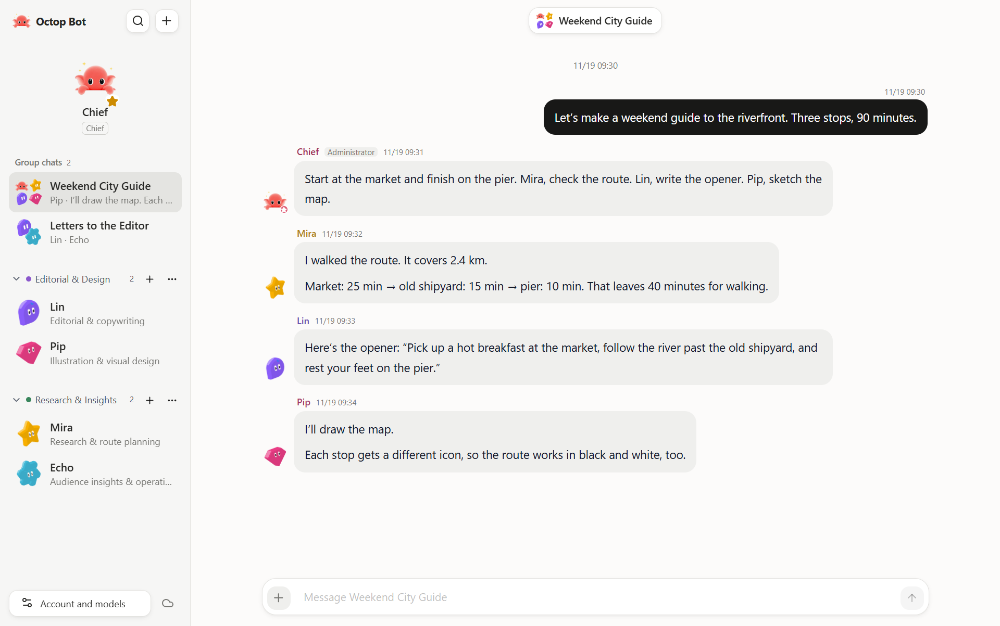
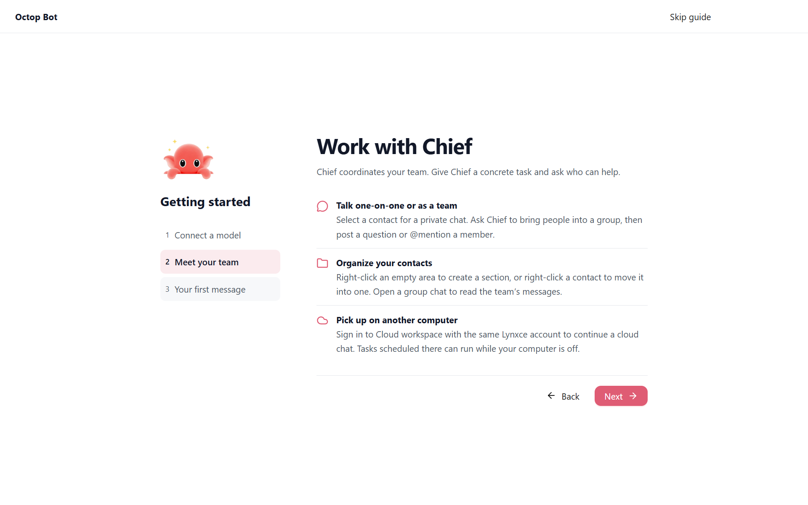
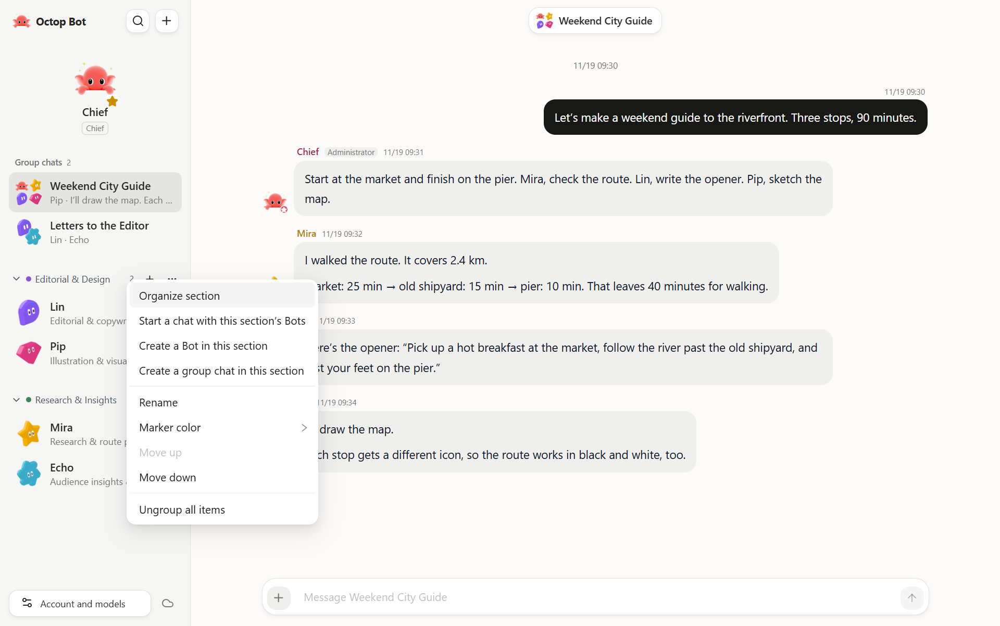
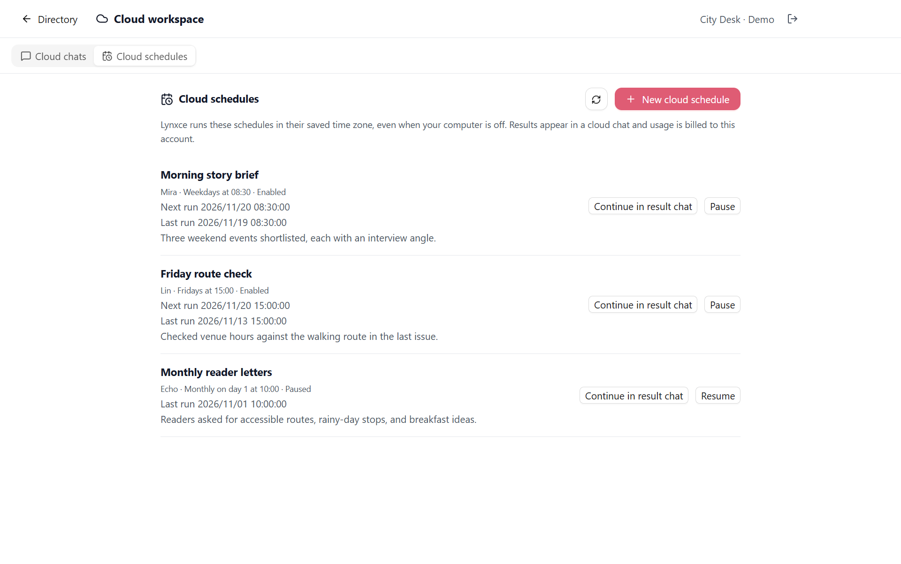

# Octop Bot

[简体中文](README.md) · [English](README_EN.md)

Octop Bot is a Windows desktop app for working with a team of AI assistants. Tell Chief, your octopus assistant, what you want to make. Chief can create Bots with different jobs and bring them into a group chat. You can also keep a one-to-one conversation with any member, or send a job to Lynxce Cloud when it needs to run while your PC is off.

**Download for Windows x64**　[Installer](https://github.com/alison-xx/octop-bot/releases/download/octop-bot-v1.0.3-beta.7/Octop-Bot-Setup-1.0.3-beta.7-x64.exe) · [Portable ZIP](https://github.com/alison-xx/octop-bot/releases/download/octop-bot-v1.0.3-beta.7/Octop-Bot-1.0.3-beta.7-x64.zip) · [Release notes and SHA-256 checksums](https://github.com/alison-xx/octop-bot/releases/tag/octop-bot-v1.0.3-beta.7)



*These screenshots show the Windows app. The City Desk team, conversations, and cloud schedules use sample data.*

## Get started

1. **Open the app.** Run the installer, or extract the ZIP and double-click `Octop Bot.exe`. On first launch, choose **Get started** to open your local workspace. The Windows download includes Python and the Octop service.
2. **Connect a chat model.** Choose **Lynxce account**, authorize in your system browser, then return to the app to select and save an available model. Model calls use credits from that account. **Other model sources** lets you connect your own cloud provider, a compatible endpoint, or a local model. Choose **Set up later** to explore the team first, then connect a model before sending a message.
3. **If you need a Lynxce account,** select **Create a Lynxce account**, open the **Register** tab on the official site, and complete registration. Return to the app and sign in or authorize from the same screen. [Lynxce account site](https://admin.lynxce.cn/profile/login)
4. **Send Chief your first message.** The getting-started guide introduces private chats, directory sections, and the cloud workspace. Choose an example for building a team, planning a project, or assigning work, and select **Edit in Chief’s chat**. Edit the draft and send it when you’re ready. To reopen the guide, choose **Account and models → Getting started** at the bottom of the directory.



After connecting Lynxce, open **Account and models** to view your credit balance. **Top up** opens that account’s Lynxce checkout in your system browser. If your earlier authorization covered chat only, choose **Authorize top-ups** and approve the request on Lynxce to continue. After reconnecting the account, select and save a chat model from its list of available models. Your balance refreshes when you return to the app, or you can use the refresh icon beside it.

To try the City Desk from the screenshots, paste this prompt into Chief’s chat and adapt it to your project. Chief needs a model with tool-calling support to create the team.

> Create a group called “Weekend City Guide.” Invite a researcher to check the route, an editor to write the opener, and a designer to draw the map. The first issue is a 90-minute riverfront walk. Start by suggesting three stops.

## Work with your team

| What you want to do | Where to start |
| --- | --- |
| Pick up a private chat | Select a member in the directory to resume your latest conversation. Click their name at the top to open their profile and change their avatar, role, or model. Use `/side` to ask a follow-up while the main task runs. |
| Work on a shared deliverable | Choose **+** to create a group chat, or ask Chief to create one. Send the brief to the group or mention a member with `@`. For larger jobs, use a Goal to agree on acceptance criteria, stages, and owners. |
| Organize a project | Right-click an empty part of the directory to create a section or move items in bulk. Right-click a member to move it into an existing section. Right-click a section heading to rename, recolor, reorder, or start a group chat with its Bots. Dissolving the section preserves its members and chats. |
| Find an earlier conversation | Press `Ctrl+K` to search for members and sections. Switch to private chat history and search by title or message text to open the original conversation. |



## Keep working with your PC off

Open **Cloud workspace** at the bottom of the directory and sign in separately with your Lynxce account. Start a cloud chat or create a schedule. Sign in with the same account on another PC to check accepted jobs, read their results, and continue the conversation. Your account determines the available cloud models, permissions, and credits. The workspace shows the signed-in cloud account’s balance at the top. Select **Top up** to add credits to that account.

- **Bring an existing conversation.** Click the Bot’s name at the top of a local private chat and choose **Continue this local chat in the cloud**. Review the preview and confirm. Each import includes up to the latest 20 visible text messages. Attachments, tool records, and reasoning stay on your PC.
- **Schedule cloud work.** Under **Cloud schedules**, enter the instructions and time. A saved cloud schedule runs in its configured time zone, even when your PC is off. Use **Continue in result chat** to follow up.
- **Move a local schedule.** Pause the original under **Scheduled tasks** in the Bot’s profile. Choose the option to create a cloud schedule from its configuration, review the instructions and time, and save. Local files, scripts, and installed apps stay on your PC. Run jobs that need them locally, with the PC awake and Octop Bot running in the background.



The standalone Windows app stores its local workspace in `%USERPROFILE%\.octop-bot` by default. For group files, shared notes, avatar settings, and computer control, see the [user guide in Chinese](docs/octop-bot.md).

## Run from source

Install Git, uv, Node.js 24, and pnpm 12.15.0. Run these commands in Windows PowerShell.

```powershell
git clone https://github.com/alison-xx/octop-bot.git
cd octop-bot
uv sync --frozen --python 3.12 --extra browser --extra computer-use --extra desktop
npm --prefix dashboard ci
pnpm --dir desktop/src install --frozen-lockfile
.\desktop\src\scripts\run-dev.ps1 -Bot
```

The script builds Electron and starts the local Octop service and frontend development server. The development build uses its own data directory at `desktop/src/.dev-runtime/windows/bot-home`.

### Build the Windows x64 installer

On a Windows x64 machine with the dependencies above, run the following from the repository root.

```powershell
uv run --frozen python desktop/src/scripts/package-bot-windows.py
```

The script builds the frontend and the Octop wheel, then bundles the Python runtime. The installer, portable ZIP, and unpacked app appear in `desktop/src/release/octop-bot/`. To create an Authenticode-signed release, set `OCTOP_BOT_SIGN_CERT_SHA1` to the publisher’s certificate thumbprint in the Windows certificate store before building. The packager signs the app, uninstaller, and installer with SHA-256 and an RFC 3161 timestamp.

## Source and licenses

| Directory | Contents |
| --- | --- |
| [desktop/src](desktop/src/) | Electron main process, preload scripts, startup, and packaging |
| [dashboard/src/pages/OctopBot](dashboard/src/pages/OctopBot/) | Directory, group chats, account settings, and cloud workspace UI |
| [src/octop](src/octop/) | Python service, conversations, scheduling, and Lynxce integration |
| [tests](tests/) | Backend unit and integration tests |

This project retains Octop’s upstream Git history and MIT license. Some character graphics are adapted from DS Bot, and formula rendering includes code from Deep View. [Upstream Octop](https://github.com/TencentCloud/Octop/tree/976803d6292dfb2e28e525823aa28d2e33a755a8) · [MIT license](LICENSE) · [DS Bot notice](dashboard/public/licenses/ds-bot.txt) · [Deep View notice](dashboard/public/licenses/deep-view.txt)
