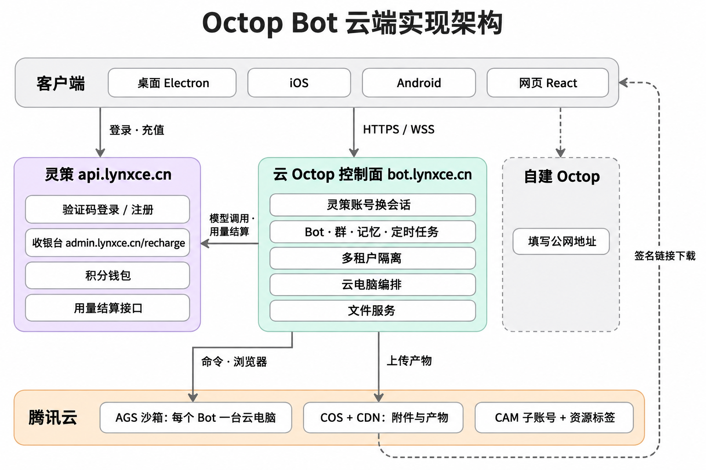
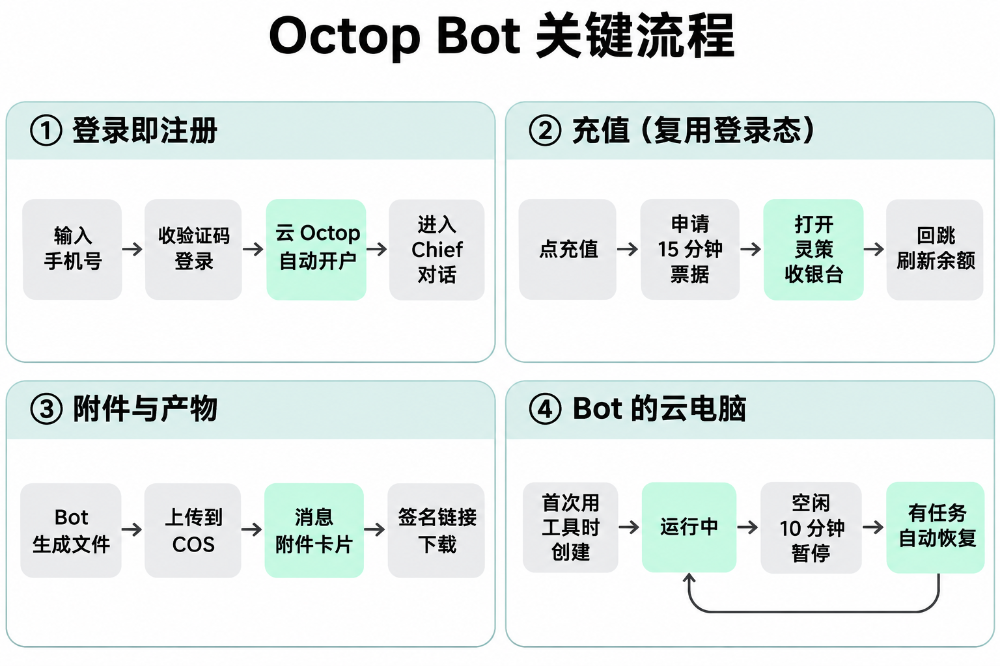
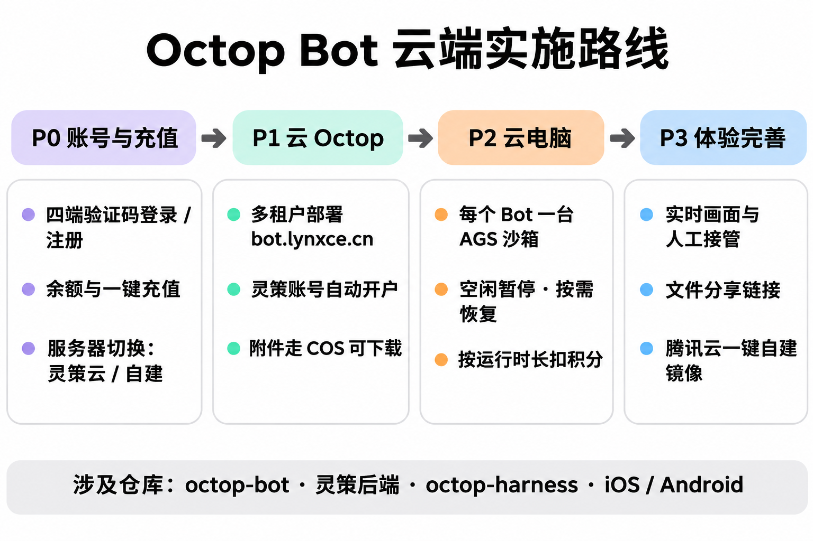

# Octop Bot 云端方案：灵策账号 × 云 Octop × 腾讯云电脑

> 状态：设计稿（2026-11-24），尚未实现。涉及三个仓库：本仓库 octop-bot、灵策 `ai-employee-node`、上游 `octop-harness`。







## 0. 结论先行

1. **用户只管登录。** 打开 App，用手机号或邮箱收验证码登录（第一次即注册），不需要配模型、装服务或填 Key。登录后 Chief 和自己的 Bot 已在云端待命，桌面、iOS、Android、网页四端看到同一个团队。
2. **云端分三层。** 控制面是灵策运营的多租户「云 Octop」，负责 Bot、群聊、记忆和定时任务。执行面让每个 Bot 拥有一台腾讯云「Agent 沙箱」（AGS）云电脑，有 Ubuntu 桌面、浏览器和终端，空闲时暂停，需要时毫秒级恢复，只按运行时长付费。文件面是腾讯云 COS，存放附件和产物，客户端用短时签名链接直接下载。
3. **钱只走灵策积分。** 腾讯云账单由你承担。用户消耗的模型、云电脑时长和存储都折成积分，从灵策钱包扣除（1 元 = 100 积分）。单价在灵策后台按「腾讯云成本 × 加价系数」配置，对外只展示积分，不展示成本。
4. **充值复用登录态。** App 向灵策申请 15 分钟一次性收银票据，打开 `https://admin.lynxce.cn/recharge?token=<票据>`，无需再次登录。这条链路桌面端已经实现，手机和网页端照搬即可。iOS 有 App Store 支付审核风险，见 §8.3。
5. **自建是同一个 App 的另一种「服务器」。** 用户填写自己的公网 Octop 地址后，客户端协商能力并按服务器能力显示功能。腾讯云轻量服务器可以出一键镜像，让自建也只需几步。

参照对象是 xAI 的 Grok Bot。我们照搬它的「每个 Bot 都有电脑、关机后继续干活、密码和验证码由人接管」，并补上它没有的三样：文件统一落 COS 可下载、积分透明扣费、可自建。

## 1. 参照 Grok Bot：抄什么，改什么

| Grok Bot 的做法（2026-08 上线） | 本方案 |
|---|---|
| 每个用户一台持久云虚拟机，名下所有 Bot 共用，每个 Bot 占一块「屏幕」并行干活。官方文档明说 Bot 之间不是安全边界 | 每个 Bot 一台 AGS 沙箱（VM 级隔离），真正做到营销里说的「Bot 有自己的电脑」。暂停的实例不收计算费，所以 N 个 Bot 的成本取决于实际干活的时长，而不是 Bot 数量。团队共享文件通过挂载 COS 前缀实现，不靠共用一台机器 |
| `/workspace` 持久，登录态和浏览器会话保留，装的软件视为可丢 | 同样处理。工作目录做快照，系统盘可随时重置 |
| 合上电脑后 Bot 照常工作 | 控制面常驻。云电脑空闲后暂停，有任务时自动恢复 |
| 遇到密码、2FA、验证码或支付时由人接管，完成后交还 | 同样提供，四端都能看实时画面并接管 |
| 优先走连接器，最后才用浏览器操作电脑 | 沿用 Octop 现有连接器和 MCP，`browser_use` 兜底 |
| 订阅附带每周额度，超出按 token 计费，没有公开配额 | 统一积分钱包。会员每月送积分，超出部分直接扣钱包。每项单价公开到「积分/小时」「积分/GB」 |
| 文件留在云机里，没有下载链路 | 产物进 COS，聊天里显示成附件卡片，可预览、下载和分享 |
| 只有托管版 | 托管版与自建版共用一套客户端 |

资料来源：[developersdigest](https://www.developersdigest.tech/blog/grok-bot-computer-primitive-explained)、[Digital Applied](https://www.digitalapplied.com/blog/grok-bot-ai-teammates-launch-cloud-computer-2026)、[Kingy](https://kingy.ai/blog/grok-bot-ai-teammate-price-security/)。这些是第三方解读，引用的官方文档原文未经本方核验。

## 2. 现状（2026-11-24，`main`）

| 能力 | 桌面 | 网页/NAS | iOS | Android |
|---|---|---|---|---|
| 灵策登录 | 密码、WorkBuddy、验证码（`origin/main` PR #17） | 灵策账号（仅限第一个认领实例的账号）或本地密码 | 密码、验证码 | 密码、验证码 |
| 注册 | 跳转外部网页 | 跳转外部网页 | 跳转 `www.lynxce.cn` | 跳转 `lynxce.cn` |
| 余额与充值 | 有（`lynxce_wallet.py`，票据跳转） | 无（`bot_desktop.py` 只允许本机回环） | 无 | 无 |
| 云端工作区 | 灵策 cloud-work 托管执行，Bot 只是附加在任务上的角色说明 | 隐藏 | 直连灵策聊天代理 | 同 iOS |
| 附件 | 本机工作目录 | 工作目录 | 灵策模式下图片以 base64 内联；自建模式上传到 `/upload` | 同 iOS |
| Bot 产物下载 | 本机文件 | 无 | 只显示文件名 | 只显示文件名 |
| 自建服务器 | 不支持，固定使用本机 sidecar | 本身就是自建 | 支持 | 支持 |

可以直接复用的底座：

- 灵策：验证码登录即注册（`auth.controller.ts` `phone-login`，支持邀请码）、Apple 登录、`POST /api/billing/recharge/checkout-link` 票据、cloud-work 的「预扣再结算」积分账本（`cloud-work.billing.ts`）、S3 兼容存储加签名下载（`storage.service.ts`）、`appId` 产品命名空间。
- Octop：多用户、PostgreSQL、Agent 级 `backend` 配置；harness 自带 `opensandbox`、`docker`、`cos` 后端，均实现 `BaseSandbox` 的 `execute/upload/download` 三个原语；`octop-browser` 通过 CDP 控制 Chrome。

## 3. 总体架构

```
            ┌──────────── 客户端：桌面 / iOS / Android / 网页（同一套「服务器配置」）────────────┐
            │  登录·注册·充值 ──► 灵策账号 api.lynxce.cn                                      │
            │  聊天·Bot·群·文件 ─► 服务器 = 灵策云 bot.lynxce.cn ｜ 自建 https://my-octop.com      │
            └───────────────┬──────────────────────────────────────────────┬───────────────┘
                            │ HTTPS / WSS（Octop JWT）                     │ 签名 URL 直传直下
             ┌──────────────▼──────────────┐                     ┌─────────▼─────────┐
             │ 云 Octop 控制面（多租户）    │  ── 产物上传 ──────►│ 腾讯云 COS + CDN   │
             │ Bot / 群 / 记忆 / Cron / 计量 │                     │ files.lynxce.cn    │
             └───┬──────────────┬──────────┘                     └───────────────────┘
      模型调用 + 计量│              │ 沙箱 API（execute / 文件 / CDP / 画面）
   ┌──────────────▼───┐   ┌──────▼──────────────────────────────────────────────┐
   │ 灵策模型网关 + 钱包 │   │ 腾讯云 AGS：每个 Bot 一台沙箱（Chief / 文案 / 设计 …）    │
   │ 积分预扣 / 结算     │   │ Ubuntu 桌面 + Chrome + 终端，空闲暂停，/mnt/team 挂 COS   │
   └──────────────────┘   └─────────────────────────────────────────────────────┘
```

请求链路：客户端发消息 → 云 Octop 跑 Agent 循环 → 模型调用经灵策网关并按用户计费 → 工具调用落到这个 Bot 的云电脑 → 产物上传 COS → 消息带附件卡片推回客户端。

## 4. 账号：一个灵策账号走到底

### 4.1 登录与注册（四端统一，原生界面）

1. 输入手机号（海外区可用邮箱），点「获取验证码」，调用 `POST /api/auth/phone-code`（邮箱调用 `email-code`）。
2. 输入验证码，调用 `POST /api/auth/phone-login`。新号码自动注册，可带 `inviteCode`。请求头带 `X-Lynxce-Client: mobile|desktop|web` 和 Octop Bot 专属 `appId`，灵策据此记录注册来源。
3. 还提供两种登录方式：**密码登录**；iOS 上的 **Sign in with Apple**（灵策已有 `apple-sign-in` 接口）。WorkBuddy 等第三方登录一旦上 iOS，Apple 审核规则 4.8 要求同时提供 Apple 登录。
4. 首次登录后立即弹出协议同意（用户协议、隐私政策、云电脑使用规范），随后直接进入 Chief 对话。不再出现「选模型」步骤，默认模型由服务端套餐决定。
5. 「设置 → 账号」提供改密码、退出登录和**注销账号**（App Store 规则 5.1.1(v)：支持应用内注册，就必须支持应用内注销）。注销调用灵策注销接口，并同时清理云 Octop 数据、云电脑和 COS 文件。

客户端拿到灵策 `accessToken/refreshToken` 后，只做一件事：用它换取云 Octop 的会话（§4.2）。之后聊天全部走云 Octop。灵策令牌只用于余额、充值和换票。

### 4.2 灵策令牌换云 Octop 会话

在云 Octop 新增 `POST /api/auth/lynxce/session`：

- 入参是灵策 `accessToken`。服务端调用灵策 `GET /api/user/profile` 校验，或使用新增的服务间内省接口，取得稳定的 `user.id`。
- 用 `lynxce:<user.id>` 查找 Octop 用户，不存在就自动创建：普通角色，个人工作区，种子 Chief。去掉现有 `lynxce_owner.py` 中「第一个账号认领实例」的限制，该限制只在 NAS/自建模式下保留。
- 返回 Octop JWT 和刷新令牌。客户端沿用现有的 `X-Octop-Access-Token` 续期机制。
- 云 Octop 自身**不保存**用户的灵策密码或刷新令牌。模型计费走服务间通道（§7.2）。

这样网页、NAS 和手机上的 `bot_desktop.py` 本机回环限制可以放开。云模式下，钱包和充值接口改用服务间通道，按当前 Octop 用户映射到对应的灵策用户。

### 4.3 多端同步

所有数据保存在云 Octop，四端登录同一灵策账号就看到同一个团队。桌面端现有的「本机工作区」保留为第二个服务器（§9），用户可以在通讯录顶部切换「云端 / 本机 / 自建」。

## 5. 云 Octop（控制面）

- **部署**：上游 Octop 原样加本仓库 Bot 层，以 `OCTOP_BOT_CLOUD=1` 启动多租户模式。PostgreSQL 用腾讯云 TDSQL-C 或云数据库 PostgreSQL，应用跑在 TKE 或 CVM 弹性伸缩组上，域名 `bot.lynxce.cn` 需完成 ICP 备案。
- **多租户护栏**（云模式强制开启）：
  - 禁止 `local_shell`、`filesystem` 后端和宿主机目录。每个 Agent 的 `backend` 一律解析为这个 Bot 的云电脑（§6）。
  - 关闭 Admin 页面、插件安装、ACP 外部工具、宿主机 `browser`/`desktop`/`mobile` 控制面，以及上游 `infra/cloud/tencent.py` 运维云标签页。
  - 每用户配额：Bot 数、群数、Cron 数、并发回合数、单回合最长时长。
  - 记忆、知识库和连接器凭证按用户隔离（上游已按用户隔离，上线前做一轮越权测试）。
- **定时任务**：由控制面调度，执行时唤醒云电脑。取代现在的灵策 `scheduled-tasks` 托管方案。
- **与现有「云端工作区」的关系**：新方案上线后，旧的 cloud-work 会话转为只读并提供「迁移到云 Octop」入口（复用 `bot_import.py`）。之后不再新建旧式云会话。

## 6. 云电脑（执行面）

### 6.1 形态：每个 Bot 一台，空闲即暂停

| 层级 | 内容 |
|---|---|
| 机器 | 每个 Bot 一台 AGS 沙箱实例，首次用到工具时创建。规格随套餐：免费版只能对话，没有电脑；标准版和专业版分配不同规格。自定义镜像基于 Ubuntu 桌面，预装 Chrome、Python、Node、LibreOffice、中文字体和常用 CLI |
| Bot 工作目录 | `/workspace`，保存在实例磁盘上，暂停和恢复时保留，并定期快照 |
| 共享目录 | `/mnt/team` 挂载 COS 前缀 `u/<userId>/team/`，`/mnt/groups/<groupId>` 挂载群文件前缀，与现有「团队笔记」「群文件」语义一致。Bot 只能看到自己所在群的目录 |
| 登录态 | 每个 Bot 的浏览器登录态各自独立。如果需要几个 Bot 共用某个网站登录，由用户在「连接器」里授权一次，而不是共享浏览器会话。比 Grok 的共享模式更安全 |

为什么不学 Grok「每人一台共用」：Grok 那样做是因为整机虚拟机贵、启动慢。AGS 可以按实例暂停和恢复，暂停期间不收计算费（以 AGS 商务确认为准），每 Bot 一台的成本和每人一台基本一样，同时得到 VM 级隔离，也符合你说的「每个 Bot 配云电脑」。如果商务确认暂停实例仍要收较高费用，就退回 Grok 的做法：每人一台，Bot 分屏（每个 Bot 独立 Xvfb 显示、Chrome profile 和 Linux 用户）。见 §14 Q1。

### 6.2 腾讯云产品选型

| 产品 | 结论 | 理由 |
|---|---|---|
| **Agent 沙箱服务 AGS**（Agent Runtime，产品 1814） | **首选** | 专为 AI Agent 设计，VM 级隔离，宣称约 100ms 启动，支持暂停/恢复和快照，兼容 E2B（迁移只需换域名和 Key）。类型有 `browser`、`code-interpreter`、`osworld`（Ubuntu 桌面）、`waa`（Windows Server 2025 桌面）、`mobile`、`custom`（自带镜像）。可挂载 COS。2026-07-14 起商业计费 |
| CVM 按量计费 + 关机不收费 | 备选 | 完整 Windows/Linux 整机，自己装 VNC。开机要几分钟，单机成本高一个量级，重新开机可能因库存不足失败。只在 AGS 不满足时用作「独享整机」 |
| Lighthouse 轻量服务器 | 不用于 Bot 电脑 | 创建接口只支持包年包月，不能按秒计费，也不能关机停费。但适合 §10.4 的「一键自建」镜像 |
| 云桌面 VDI（产品 1291） | 不用 | 给人用的桌面，没找到开放 API |
| Cube Sandbox（开源） | 远期 | 腾讯开源的 MicroVM 沙箱，兼容 E2B，可以自己部署在 CVM 上压低成本。规模上来、有运维能力后再考虑 |

主要 AGS 接口：`CreateSandboxTool`（定义镜像和规格，一种规格一个 Tool）、`StartSandboxInstance`（带 `ToolId`、`Timeout`）、`PauseSandboxInstance`、`ResumeSandboxInstance`、`StopSandboxInstance`、`CreateSandboxSnapshot`、`AcquireSandboxInstanceToken`（为单个实例签发访问令牌）、`DescribeQuotaOverview`。大部分接口限 20 次/秒，按「接口 + 地域 + 子账号」计算。实例只能通过 API 创建。

上线前要向腾讯云商务或工单确认：AGS 单价（运行中、暂停中、快照、磁盘分别多少）、单账号实例配额、单实例最长存活时间、`osworld` 是否提供 VNC/noVNC 画面流、暂停实例能保留多久。

竞品提示：腾讯自己的 LightVela（基于 Hermes 的托管个人助理）10 月上线了「云电脑」Beta，可查看和接管桌面，是 Octop Bot 云版的直接竞品。

资料来源：[AGS 概述](https://cloud.tencent.com/document/product/1814/123811)、[AGS 类型](https://cloud.tencent.com/document/product/1814/132209)、[AGS FAQ](https://cloud.tencent.com/document/product/1814/123828)、[AGS API](https://cloud.tencent.com/document/api/1814/124833)、[CVM 关机不收费](https://cloud.tencent.com/document/product/213/19918)、[Lighthouse CreateInstances](https://www.tencentcloud.com/document/api/1103/45859)、[CubeSandbox](https://github.com/TencentCloud/CubeSandbox)、[LightVela 报道](https://eu.36kr.com/zh/p/4073960952141449)。

### 6.3 生命周期

```
无 ──首次需要工具──► 创建中 ──► 运行中 ──空闲 10 分钟──► 暂停（Pause，不收计算费，磁盘保留）
                                ▲   │                     │
                                └───┴──有新回合/定时任务──────┘
                         余额 ≤ 0：不再唤醒；欠费 30 天：快照工作目录后释放机器，再过 90 天删快照
```

- 只有对话时不唤醒电脑，第一次调用 `execute`、文件、浏览器等工具时才唤醒。用户在界面上能看到「电脑启动中…」。
- 每天对活跃实例做一次快照（`CreateSandboxSnapshot`），保证实例被回收后可以恢复。
- Bot 资料页的「云电脑」面板提供：查看画面、开机/暂停、重置系统（保留 `/workspace`）、本月运行时长和积分、升级规格。删除 Bot 时释放实例和快照。

### 6.4 接入 Octop：放在哪个仓库

- **Agent 执行**：新增一个通用的 **E2B 兼容沙箱后端** `e2b`，实现 `BaseSandbox` 的 `execute`、`upload_files`、`download_files`，参照现有 `opensandbox_sandbox.py`，约 200 行。AGS、E2B 官方和 Cube Sandbox 都能用它，只需换域名和 Key，上游也更容易接受。按 AGENTS.md 规定，后端归 **octop-harness** 仓库，走上游 PR（你已有向 TencentCloud 提 PR 的流程）。上游合并前，本仓库可以先通过「named backend」注册的方式临时挂载。
- **浏览器**：沙箱里的 Chrome 暴露 CDP，经 `AcquireSandboxInstanceToken` 签发的令牌走 WSS 连到控制面，`octop-browser` 按「远程 CDP 端点」接入。若 octop-browser 尚不支持远程端点，同样提交上游 PR。
- **电脑管理**（创建、暂停、恢复、释放、配额、计量）属于平台编排，放本仓库：新建 `src/octop/infra/cloud/computers/` 存放 `manager.py`（状态机）、`ags.py`（腾讯云 AGS API，用已有的 `tencentcloud-sdk-python`）和 `repo`；新增 migration 建表 `cloud_computers`（`computer_id`、`user_id`、`bot_id`、`provider_instance_id`、`spec`、`state`、`last_active_at`、`snapshot_id`）。
- **腾讯云账号**：主账号不发 API 密钥。建一个「编排服务」子账号或 CAM 角色，只授予 AGS 和指定 COS 前缀的 STS 权限。每个实例打上 `octop:user`、`octop:bot`、`octop:env` 标签用于对账和清理。实例启动请求在控制面排队限速，不超过接口频控。
- **实时画面与接管**：沙箱桌面运行 noVNC 网关（若 `osworld` 自带 VNC 流则直接用），控制面签发 5 分钟有效的观看令牌，客户端内嵌页面显示。接管时 Bot 暂停操作，用户点「交还」后继续。密码和验证码只经过画面输入，不进入模型上下文。沙箱端口不直接暴露到公网，统一由控制面反向代理。
- **审批**：沿用 Octop 工具审批。云模式下新增默认规则：支付、删除 `/workspace` 外的文件、对外发信需逐次确认。

## 7. 积分与成本：你对接腾讯云，用户消耗积分

### 7.1 原则

- 腾讯云账单由你承担，全部资源挂在你的主账号（或专用子账号）下。按 `octop:user`、`octop:bot` 打标签，便于对账。
- 用户只看到积分。单价 = 腾讯云成本 × 加价系数，向上取整到 0.01 积分。系数和单价在灵策后台配置，对外接口不返回成本字段（避免重蹈 `pricing-credits-entitlements-2026-11.md` P0-1 成本泄露的问题）。
- 计费沿用灵策已有的「预扣 → 结算 → 退差」账本（`cloud-work.billing.ts`），不新造一套钱包。

### 7.2 计量项

| 计量项 | 计量方式 | 计费时点 | 说明 |
|---|---|---|---|
| 模型 token | 灵策网关按模型价目（已有） | 每次调用 | 云 Octop 用平台服务密钥调用灵策网关，带签名头 `X-Lynxce-Bill-To: <userId>`，扣该用户钱包。需要灵策新增「代扣」通道 |
| 云电脑运行时长 | 按规格「积分/分钟」，以 AGS 实例「运行中」时长为准，暂停不收 | 每 5 分钟预扣一次，暂停时结算 | 恢复实例前预扣 5 分钟，余额不足就拒绝唤醒 |
| 云电脑存储 | 「积分/GB·天」，含实例磁盘、暂停保留和快照 | 每日结算 | 套餐内含额度。按 AGS 实际收费项定价 |
| COS 文件存储 | 「积分/GB·月」 | 每日结算 | 套餐内含额度（灵策套餐已有 `storageQuotaBytes`、`storageRetentionDays` 字段，直接复用） |
| 下载流量 | 「积分/GB」，走 CDN 计价 | 每日结算 | 套餐内含额度 |
| 高配电脑 | 同运行时长，规格单独定价（含 Windows 桌面 `waa`） | 同上 | |

灵策需新增两个内部接口，供云 Octop 使用服务密钥调用：

- `POST /internal/octop/usage/reserve`：入参 `userId`、`kind`、`units`、`idempotencyKey`，返回 `reservationId`；余额不足返回 402。
- `POST /internal/octop/usage/settle`：入参 `reservationId`、实际 `units`，多退少不补，差额由平台吸收并记为 `platformAbsorbed`。

### 7.3 单价示例

成本取自腾讯云公开价目（广州）。AGS 自 2026-07-14 起商业计费：运行中 CPU 0.000081 元/核·秒、内存 0.000025 元/GiB·秒，运行时有 15 GiB 免费系统盘；暂停期间不收 CPU 和内存费，只按存储收 0.0021 元/GiB·小时（[计费说明](https://cloud.tencent.com/document/product/1814/133249)）。

| 项目 | 成本 | 系数 | 对用户单价 |
|---|---|---|---|
| 标准电脑（OSWorld 4 核 8G，16G 盘） | 约 1.89 元/小时（1.17 元 CPU + 0.72 元内存） | ×2 | 约 380 积分/小时（约 6.3 积分/分钟） |
| 专业电脑（OSWorld 8 核 16G，32G 盘） | 约 3.78 元/小时 | ×2 | 约 760 积分/小时 |
| 暂停时的磁盘（20 GiB） | 约 0.042 元/小时 | ×2 | 约 8 积分/小时 |
| COS 标准存储 | ¥0.118/GB·月 | ×3 | 36 积分/GB·月 |
| CDN 下载流量 | ¥0.21/GB（0–2TB 阶梯） | ×2 | 42 积分/GB |

OSWorld 桌面沙箱只有 4C8G 和 8C16G 两档固定规格（2026-11-24 在控制台确认）；要更便宜的规格，需要用自定义沙箱自带镜像。算一笔账：一个标准版用户有 5 个 Bot，每天合计让电脑干活 2 小时，每月约 60 小时 × 380 积分 = 22800 积分（228 元），成本约 113 元。暂停期间只收少量磁盘费，Bot 个数基本不影响这笔账。实际单价在灵策后台配置（§12.2）。

### 7.4 余额用完时

1. 余额低于 100 积分：客户端顶部提示「余额不足」，并给出「充值」按钮。
2. 余额为 0：正在执行的回合跑完当前步骤后停止，消息里显示「积分不足，充值后点继续」。云电脑不再唤醒，已运行的立即暂停。文件和对话可以照常查看和下载。
3. 欠费 30 天：释放云电脑，保留快照；欠费 120 天：删除快照，COS 文件按套餐保留期清理。每个节点前 7 天发站内信和推送。

## 8. 充值

### 8.1 链路（复用登录态）

```
App ──POST /api/billing/recharge/checkout-link（Bearer 灵策 accessToken）──► 灵策
    ◄──────────────── { token: "x.…", 15 分钟有效 } ──────────────────────
App 打开 https://admin.lynxce.cn/recharge?token=<token>&tab=boost&from=octop-bot
    ──► 收银台用票据换收银会话（RechargeClient.initSession 已支持）──► 支付
App 回到前台 → 刷新余额（灵策 GET /api/user/quota 读 creditsRemaining）
```

- 票据格式与有效期校验沿用 `lynxce_wallet.py` 中的规则：URL 必须精确匹配，有效期不超过 16 分钟。手机端在 Swift/Kotlin 中复刻同样的校验，防止被篡改为钓鱼地址。
- 打开方式：桌面用系统浏览器；iOS 用 `SFSafariViewController`；Android 用 Custom Tabs。不要用内嵌 WebView，以免支付宝、微信支付跳转失败。
- 支付完成后，收银台跳回 `octopbot://recharge/done`（需要灵策把该 scheme 加入回跳白名单），App 收到后立即刷新余额。
- 余额读取钱包的 `creditsRemaining`，与充值对应。`effectiveCreditsRemaining` 对企业成员是月度额度，不放在「充值」旁边。

### 8.2 界面入口

- 通讯录底部的账号卡片：头像、余额、「充值」按钮。
- 设置 → 账号与积分：余额、本月消耗明细（模型 / 电脑 / 存储 / 流量）、「充值」「升级会员」。明细由灵策账单接口按 `appId=octop-bot` 过滤。
- 余额不足的拦截弹窗：说明还需要多少积分，并提供「充值」按钮。

### 8.3 iOS 审核风险（需要你决定）

App 内消耗的积分属于数字商品。App Store 规则 3.1.1 要求这类商品使用 IAP。外链充值只在部分店面允许：美国店面自 2025 年起允许放外部购买链接；其他地区需要申请 External Purchase Link 权利，并向 Apple 支付佣金。我们的 iOS 版目前上架 174 个地区（不含中国大陆）。可选方案：

- A. iOS 只显示余额，不放充值按钮和链接，文案为「请在灵策官网或桌面端充值」。最稳妥，审核风险最低。
- B. 美国店面显示外链，其他店面按方案 A 处理。
- C. 接入 IAP 积分包，Apple 抽成 15–30%，需要灵策后端校验 Apple 收据。

建议先上 A，等 iOS 用户量起来后再评估 C。Android 安装包在 dl.lynxce.cn 分发、不走 Google Play，可以直接外链充值。

## 9. 文件：附件与产物统一走 COS

### 9.1 存储布局

- Bucket：`octop-bot-files-<appid>`，私有读写，开启版本控制，地域与云电脑相同。
- Key：`u/<userId>/b/<botId>/t/<threadId>/<fileUlid>/<文件名>`；群文件用 `u/<userId>/g/<groupId>/…`。
- CDN 域名 `files.lynxce.cn`，回源鉴权，开启 URL 鉴权。客户端只能拿到 10 分钟有效的签名链接。
- 生命周期：30 天后转低频存储；按套餐的 `storageRetentionDays` 删除；删除对话或 Bot 时级联删除。

### 9.2 上下行链路

- **产物（Bot → 用户）**：Agent 在工作目录生成文件，并通过现有附件约定（消息中的 `MEDIA:` 行或工具返回的附件路径）声明。云 Octop 从云电脑 `download_files` 取回内容，上传 COS 并写入 `files` 表（`file_id`、`owner`、`thread_id`、`key`、`size`、`mime`、`sha256`）。消息里只带附件对象，不带文件内容。
- **附件（用户 → Bot）**：客户端调用 `POST /api/files/uploads` 获取预签名 PUT 地址，直接上传 COS，再用 `file_id` 发消息。云 Octop 在回合开始前把文件放进 Bot 工作目录 `inbound/`。这与现有 `api/common/attachments.py` 的约定一致，只把存储从本地目录换成 COS。
- **下载**：`GET /api/files/{file_id}/url` 校验归属后返回 CDN 签名链接（`response-content-disposition=attachment`）。手机端下载后可以保存到「文件」或相册，或调起系统分享。
- **分享**：「生成分享链接」创建一条有效期 1/7/30 天的外链，可随时撤销，下载流量计入分享者。

### 9.3 协议变更（`mobile/PROTOCOL.md`）

消息体新增 `attachments: [{file_id, name, size, mime, thumb_url?, kind: "image"|"file"|"video"}]`。客户端渲染成卡片：图片显示缩略图，文档显示图标、文件名和大小，点击后预览（iOS 用 QuickLook，Android 用 Intent）。替换现在只显示 `📎 文件名` 的做法。

### 9.4 腾讯云接入要点

- 服务端使用 `cos-python-sdk-v5`（harness 的 `cos_backend.py` 已依赖它）。注意：`cos_backend` 以 JSON 包装文件内容，适合 Agent 虚拟文件系统，不适合原样二进制附件；附件存储要另写一个直存原始字节的小模块，放在 `infra/cloud/files/`。
- 客户端永远只拿签名 URL，不拿任何密钥。2024 年以后创建的桶，默认域名不能在浏览器预览，必须绑定自定义域名 `files.lynxce.cn`（需备案）。
- 沙箱挂载团队目录时，控制面用 STS `GetFederationToken` 签发临时密钥，资源限定为 `qcs::cos:<region>:uid/<appid>:<bucket>/u/<userId>/team/*`，到期自动续签。长期密钥不进沙箱。
- 灵策现有对象存储在阿里云 OSS（S3 兼容）。云 Octop 的文件建议直接放腾讯云 COS，与 AGS 同地域，免跨云流量费。

资料来源：[COS 临时密钥](https://cloud.tencent.com/document/product/436/14048)、[预签名 URL](https://cloud.tencent.com/document/product/436/35217)、[生命周期](https://cloud.tencent.com/document/product/436/14605)、[COS 计费示例](https://cloud.tencent.com/document/product/436/6241)、[CDN 价格](https://cloud.tencent.com/document/product/228/2949)。

## 10. 自建服务器

### 10.1 客户端「服务器」概念

四端统一为「服务器列表」：

- **灵策云**（默认，`https://bot.lynxce.cn`）：灵策账号登录，有云电脑、COS 文件和充值。
- **自建服务器**：输入公网地址，例如 `https://octop.example.com`。
- **本机**（仅桌面）：现有 sidecar。

用户可以添加多个服务器，在通讯录顶部切换。桌面端新增远程服务器模式，补上目前「固定本机 sidecar」的缺口。

### 10.2 接入流程

1. 输入地址后，客户端补全 `https://` 并请求 `GET /api/bot/server-info`（新增接口），返回：
   ```json
   {"product":"octop-bot","version":"1.1.0","mode":"cloud|self_hosted",
    "auth":["lynxce","password","totp"],
    "capabilities":{"cloud_computer":false,"file_store":"local|cos","wallet":"lynxce|none","live_view":false}}
   ```
   旧版服务器没有此接口时，退回现有的 `/api/setup/status` 和 `/api/auth/lynxce/status` 探测。
2. 根据 `auth` 显示登录方式。自建服务器绑定了灵策（实例主人用灵策登录）时，可以显示余额和充值，钱从主人的灵策账号扣。
3. 根据 `capabilities` 显示或隐藏云电脑、实时画面和文件分享。功能缺失时显示「此服务器未开启」，不显示报错。
4. 默认只允许 HTTPS。HTTP 仅在局域网地址（10/172.16/192.168/.local）上允许，并给出明文传输提示。

### 10.3 自建的执行环境

自建服务器的 Agent 后端由服务器管理员自己配置：本机、Docker、OpenSandbox，或者自己的腾讯云账号。§6 的 `e2b` 后端同样可以给自建用户使用：填入自己的 AGS 或 E2B 的域名和 Key，或者指向自己部署的 Cube Sandbox。附件按 Octop 现有存储后端配置，可以是本地，也可以是用户自己的 COS。

### 10.4 一键自建（可选）

在腾讯云轻量应用服务器上架「Octop Bot Server」应用镜像，内置 Docker Compose、HTTPS（Let's Encrypt，上游已有 `infra/setup/tls`）和首次登录向导。客户端自建入口提供「没有服务器？一键在腾讯云创建」链接，跳转到镜像购买页。

## 11. 各端改造清单

| 模块 | 仓库 | 改动 |
|---|---|---|
| 验证码登录即注册、`appId`、注销、`octopbot://` 回跳白名单 | 灵策 | 大部分已有，补 `appId` 和白名单 |
| 代扣通道与用量预扣/结算内部接口、单价表、权益、对账报表 | 灵策 | 新增 |
| `OCTOP_BOT_CLOUD` 多租户模式与护栏 | octop-bot | 新增 |
| `/api/auth/lynxce/session` 换票、自动开户 | octop-bot | 新增，改 `auth_lynxce.py`、`lynxce_owner.py` |
| 钱包和充值在云模式下走服务间通道 | octop-bot | 改 `lynxce_wallet.py`、`bot_wallet.py`、`bot_desktop.py` |
| 云电脑编排（AGS）与计量 | octop-bot | 新增 `infra/cloud/computers/` 和 migration |
| `e2b` 沙箱后端、远程 CDP | octop-harness / octop-browser | 上游 PR |
| COS 文件、签名下载、分享 | octop-bot | 新增 `infra/cloud/files/`、`api/routers/files.py` |
| `/api/bot/server-info` | octop-bot | 新增 |
| 登录/注册/注销原生界面 | iOS、Android | 改 `OnboardingView`、`OnboardingScreen` |
| 余额、充值、消耗明细 | iOS、Android、dashboard | 新增，iOS 按 §8.3 决策 |
| 附件卡片、上传、下载、预览 | iOS、Android、dashboard | 新增 |
| 服务器列表、远程服务器模式 | 桌面、iOS、Android | 桌面新增，手机端改造 |
| 实时画面与接管 | 四端 | 新增 |

## 12. 分期

| 阶段 | 内容 | 完成后用户能做什么 |
|---|---|---|
| P0 账号与充值（1–2 周） | 四端原生验证码登录/注册、注销、余额、充值（iOS 按 §8.3）；桌面「服务器」切换；`server-info` | 下载即登录；手机能看余额、充值 |
| P1 云 Octop（3–4 周） | 多租户模式、换票、服务间计费、COS 文件、协议附件卡片；旧云端工作区迁移 | 不开电脑也能聊天、建群、跑定时任务；文件可下载 |
| P2 云电脑（4–6 周） | AGS 编排、`e2b` 后端、暂停与恢复、COS 挂载、计量、后台单价表 | 每个 Bot 有自己的电脑能干活，按时长扣积分 |
| P3 体验与运营 | 实时画面和接管、分享链接、对账报表、Lighthouse 一键自建镜像 | 完整对标 Grok Bot 和 LightVela |

P2 开工前先做一周技术验证：用 AGS 的 `osworld` 类型跑通「创建 → 执行命令 → Chrome CDP → 暂停 → 恢复 → 快照」，同时测出实际启动时间、恢复时间和每小时成本。

## 12.1 P1 实现说明（2026-11-24）

P1 的实际做法与上文设计有几处不同，以本节为准：

- **模型计费用用户自己的个人 API Key，不用服务间代扣。** 用户在云 Octop 用灵策验证码或密码登录时，服务端用这次登录态在灵策签发一个名为「Octop Bot 云端」的个人 API Key（仅含对话能力），加密保存。该用户 Bot 的对话走灵策开放网关 `https://api.lynxce.cn/api/v1`，积分从用户自己的钱包扣。用户能在灵策个人中心看到这个 Key，可以调整每日额度或吊销。灵策后端不用改。
- **云 Octop 会保存用户的灵策登录态**（加密存放），用于读余额和申请充值票据。§4.2 里"不保存刷新令牌"的写法不再适用。
- **云电脑接入之前，Bot 不能运行命令。** 每个租户的 Bot 工作区固定在对象存储前缀 `users/<uid>/agents/<agent_id>/`（harness 的 S3 后端），用户无法改动。宿主机目录浏览、宿主机路径下载、定时脚本、自定义 MCP 对租户关闭。用户下载文件时，服务端把原文件复制到 `downloads/<uid>/` 并签发 10 分钟有效的链接（`POST /api/agents/{id}/workspace/download-link`）。

- **租户只能用自己的 Key 调模型。** 输入框润色、表单文案生成、自动会话标题（`/api/text/assist`、`/chat/polish`）对租户一律走其「Octop Bot 云端」Key 和所选模型；服务器配置的语音识别与合成（`/api/voice/stt`、`/tts`、`/stt-stream`）对租户关闭。每次登录、以及对话中每 10 分钟，服务端都会向灵策网关核对已保存的 Key：网关返回 401（用户在个人中心吊销了）就用保存的登录态签发新 Key，不用重新登录；403（例如余额不足）不换 Key。登录时签不出 Key，这次登录失败，刚打开的灵策会话也会退出。
- **生图、生视频对租户关闭。** 服务器配置的图片和视频生成服务属于运营方，租户的 Bot 不挂 `generate_image` / `generate_video`，`server-info` 的 `capabilities.media_generation` 在云模式下为 `false`，客户端据此隐藏相关入口。以后可以改成走租户自己的灵策 Key（灵策开放网关的生图接口），再对租户打开。
- **注销账号的处理。** 应用内注销会请求灵策注销，并把本地账户停用，停用原因记为「注销中」，同时删除保存的登录态和 Key。冷静期内用户在灵策撤销注销后，只要灵策登录成功，就说明账号仍在，服务端自动恢复这个账户。运营方自己停用的账户（包括注销之后又被运营方停用的）不会因登录而恢复；登录被拒时，刚打开的灵策会话会立即退出。
- **以上限制只针对租户。** 宿主机路径的下载与预览、宿主机运行的定时脚本等，按 Bot 所属账户判断：管理员（运营方）自己的 Bot 不受影响。

登录接口沿用网页版的 `/api/auth/lynxce/code`、`/code-login`、`/login`。云模式下，每个灵策账号对应一个普通账户（`user_sso_identities`，身份源 kind=`lynxce`），不再认领实例。`/api/auth/lynxce/status` 会多返回一个 `cloud: true`，`/api/octop-bot/server-info` 返回 `edition: "cloud"`。

### 部署所需环境变量

| 变量 | 说明 |
|---|---|
| `OCTOP_BOT_CLOUD=1` | 开启云模式 |
| `OCTOP_BOT_WEB=1` | 同时开启 Bot 网页版界面（桌面端「灵策云」和浏览器访问用的就是它） |
| `OCTOP_FILE_STORE_BUCKET` / `_ACCESS_KEY_ID` / `_SECRET_ACCESS_KEY` | 对象存储桶与子账号密钥（任意 S3 兼容服务：腾讯云 COS、阿里云 OSS、MinIO） |
| `OCTOP_FILE_STORE_ENDPOINT` / `_REGION` | 例如 `cos.ap-guangzhou.myqcloud.com` / `ap-guangzhou`；OSS 填 `oss-cn-hangzhou.aliyuncs.com` |
| `OCTOP_FILE_STORE_ADDRESSING` | 默认 `virtual`（COS、OSS 必须）；MinIO 填 `path` |
| `OCTOP_FILE_STORE_PREFIX` | 可选，所有对象的公共前缀，例如 `prod` |
| `OCTOP_BOT_CLOUD_MODEL` | 默认模型，未设置时用 `deepseek-flash` |
| `OCTOP_BOT_CLOUD_KEY_DAILY_LIMIT` | 新签发 Key 的每日积分上限；不设置则用灵策默认值，`none` 表示不设上限 |

存储桶需要配一条生命周期规则：`downloads/` 前缀 1 到 2 天后过期。管理员账户（运营方）不受租户限制，继续使用服务器的共享模型配置。

## 12.2 P2 实现说明（2026-11-24）

- 配置了 AGS 后，云模式租户的每个 Bot 都用自己的 AGS 沙箱作为工作区：执行命令、读写文件都在这台电脑上，暂停后磁盘保留。没有配置 AGS 时，回退到 P1 的对象存储工作区（不能运行命令）。
- 生命周期：第一次用到工具时开机（`StartSandboxInstance`）；已暂停的就恢复（`ResumeSandboxInstance`）；空闲 10 分钟暂停（`PauseSandboxInstance`）；暂停失败就停止。状态存在 settings 表 `octop_bot:computer:<agent_id>`。
- 计费：开机或恢复前先向灵策预扣 5 分钟；运行中在当前时段用完前 1 分钟续购下一段；暂停时按实际秒数逐段结算，多退少不补。续购失败（余额不足或灵策不可用）就暂停；开机失败退回预扣。积分单价、预扣和结算接口在灵策后台（`/api/billing/octop-bot/compute/reserve|settle`），由云 Octop 用租户自己的灵策登录态调用。
- 开机、暂停、恢复走腾讯云 AGS 云 API。命令和文件走沙箱桌面自带的 HTTP 服务：`https://5000-<实例>.<region>.tencentags.com` 的 `/execute`、`/setup/upload`、`/file`，请求头 `X-Access-Token` 用 `AcquireSandboxInstanceToken` 返回的 `Token`（`TrafficToken` 会被拒，返回 401）。OSWorld 类型的沙箱不提供 AGS 的 E2B 兼容数据面（报 310508），所以不用 `e2b` SDK。
- 实测（2026-11-24，广州，OSWorld 4C8G）：沙箱里一律以 `user` 身份运行，没有免密 sudo，所以 Bot 的工作区放在 `/home/user/workspace`，Agent 看到的 `/` 就是这个目录，路径映射照搬 octop-harness 的 Docker 沙箱。`/execute` 单次请求 120 秒就会被杀掉，所以命令一律后台脱离运行（`setsid`），每次请求最多等 90 秒再取结果，长命令可以跑到 Agent 给的超时为止，超时就杀掉整个进程组。开机加第一条命令约 3 秒，暂停约 15 秒，恢复约 5 秒，暂停后文件都在。
- 这一层先放在 Octop Bot（`infra/cloud/computers/`）。等 octop-harness 有了通用的远程沙箱后端再迁过去。
- 哪些文件放哪：Bot 的上下文（SOUL、AGENTS、MEMORY、USER 等人设文件，`.octop/` 系统文件，`memory/`、`skills/`，聊天附件 `inbound/`）继续放在 P1 的对象存储里。harness 每次启动、每开一个新对话都要读它们，读这些文件不会开机、不会扣费。只有真正在电脑上干活才开机：执行命令，或者读写上述路径以外的文件。列工作区根目录时，电脑没开就只列对象存储里的内容：这时看不到复制到电脑之后在电脑上新建的文件，电脑上删掉的文件也还会列出来（对象存储里那份没删）。电脑开着时列的是电脑上的真实文件，再加上对象存储里的上下文。旧布局（没有 `.octop/`）放在根目录的系统文件（初始化标记 `/.bootstrapped`、`/manifest.json`、`/.octop-auth/`）也放在对象存储里：打开对话页读 manifest、检查初始化标记都不会叫醒电脑。
- 已有 Bot 第一次有云电脑时，把它在对象存储里的其他文件（不含上下文）复制到云电脑的工作区，只复制这一次。
- 计费可靠性：实例都打上 `octop-server`（每台 Octop 服务器一个固定 id）标签，回收线程每 10 分钟查一次，本服务器开出来、超过 15 分钟、又没有记录对应的实例（启动超时、进程中途崩溃留下的），直接停掉。开机失败时先结算退回预扣、再保存记录，退款没成功也会留下来重试。结算失败的预留不丢，留给回收线程重试；灵策明确拒绝（预留不存在、请求无效）就不再重试，其他失败最多重试 120 次（约 1 小时），之后灵策会按到期规则自己结算，已删除 Bot 的记录也就能清掉。实例被 AGS 停掉（例如本服务宕机期间）时，只计费到 AGS 记录的停机时间；拿不到停机时间就只算已预留的时长。AGS 返回的时间不带时区时按 UTC 解析。实际运行超过已预留时长的部分（回收线程迟到、进程宕机），暂停时补一笔预留再结算。界面上的「已运行 N 分钟」用单独记的开机时间，不随结算往后推。服务关闭时先停回收线程，再关数据库。
- 客户端：桌面网页版、iOS、Android 的 Bot 资料里有「云电脑」卡片，显示未开机、运行中或已暂停，以及本次运行时长，可以立即暂停（`GET /api/octop-bot/computers/{agent_id}`、`POST …/pause`）。

| 变量 | 说明 |
|---|---|
| `OCTOP_AGS_SECRET_ID` / `OCTOP_AGS_SECRET_KEY` | 只授予 AGS 权限的 CAM 子账号密钥 |
| `OCTOP_AGS_REGION` | 默认 `ap-guangzhou` |
| `OCTOP_AGS_DOMAIN` | 默认 `<region>.tencentags.com` |
| `OCTOP_AGS_TOOL` / `OCTOP_AGS_TOOL_PRO` | 标准、专业规格对应的沙箱工具名，在 AGS 控制台用 `osworld` 类型创建，选常驻 |
| `OCTOP_AGS_TIMEOUT` | 只用于限时工具：实例最长运行时长，例如 `6h`。常驻工具不填，由空闲回收负责暂停 |
| `OCTOP_BOT_COMPUTE_SERVICE_KEY` | 和灵策共享的云电脑扣费服务密钥（至少 32 位），只放在云 Octop 服务端。预扣和结算都要带 `X-Octop-Service-Key`，防止租户拿自己的令牌把运行中的电脑自报 0 秒退款。灵策后台「系统配置 → 云端与 AI 引擎 → 云电脑单价（Octop Bot）→ 云 Octop 服务密钥」填同一个值；没配置时灵策返回 503 |

## 12.3 P3 实现说明：实时画面和接管（2026-11-24）

- 画面：OSWorld 桌面自带 x11vnc，监听沙箱里的 5900 端口，不设密码，但 AGS 只转发 5000、8080、9222 这几个端口。第一次打开画面时，云 Octop 把 `vnc_bridge.py`（只用标准库的 WebSocket 转 VNC 小程序）上传到 `/home/user/.octop/`，在 8080 启动，暂停恢复后进程还在。浏览器拿 noVNC 连云 Octop 的 `/api/octop-bot/computers/{agent_id}/screen/ws`，再由云 Octop 带上实例 `Token` 连 `wss://8080-<实例>.<region>.tencentags.com/websockify`。令牌只在服务端，浏览器只拿到 60 秒有效、一次性的票据（`POST …/screen` 签发）。
- 接管：`POST …/takeover {active}`。接管期间 Bot 在这台电脑上的命令都会被拒，并提示它等用户交还；电脑不会因为空闲被暂停。有人在看画面时（每 30 秒报一次到），也不会因为空闲被暂停。关闭画面就自动交还。
- 客户端：网页版在云电脑卡片里弹出画面，可以接管和交还；iOS、Android 打开同一个画面页面（`/octop-bot/screen/:agentId`）。
- 中文输入和剪贴板：VNC 按键带不了中文，RFB 剪贴板也只支持 Latin-1，所以不走 VNC。接管后画面下方有输入框，用本机自己的输入法打字或粘贴，回车由云 Octop 把文字放进云电脑剪贴板（`xclip`），再用 XTest 按粘贴键（终端用 Ctrl+Shift+V）。镜像里没有 xdotool。「取回云电脑剪贴板」读出云电脑剪贴板里的文字，复制到本机剪贴板；浏览器不允许写剪贴板时，放进输入框并选中。打开画面时除了一次性票据，还会签发一个画面会话（`session`），接口是 `POST /api/octop-bot/screen-sessions/{session}/type` 和 `GET …/clipboard`，凭会话访问，不需要登录（手机的画面页没有登录态）；画面打开期间一直有效，关闭后 2 分钟失效，而且只在接管期间可用。
- Mac 快捷键：接管时 ⌘+按键在云电脑上按 Ctrl+按键处理；单按 ⌘ 不发送（noVNC 默认把 ⌘ 当 Alt，Ubuntu 单按 Super 又会打开概览）。有画面会话时，⌘V 把这台 Mac 剪贴板的内容输入到云电脑光标处（走上面的输入接口，中文也行），⌘C / ⌘X 在云电脑复制后把它的剪贴板取回这台 Mac。
- 中继的约束：只读不只靠客户端设置。中继会解析浏览器发来的 RFB 消息，没接管时丢掉键盘、鼠标和剪贴板消息（KeyEvent、PointerEvent、ClientCutText），握手和画面请求照常转发；遇到认不出的消息就断开。关掉标签页、断网或页面崩溃导致中继断开时，自动交还给 Bot。看画面能让云电脑保持运行，但从打开画面或最后一次操作算起最多 30 分钟，忘在后台的标签页不会一直扣积分。
- 部署限制：画面票据（ticket）和画面会话（session）都存在进程内存里，所以云 Octop 只能单 worker 运行（uvicorn 一个进程）。要多 worker 或多实例，得先把它们挪到共享存储（数据库或 Redis）。票据放在 WebSocket 地址的查询参数里，可能出现在访问日志中，所以只有 60 秒有效，而且用一次就作废。画面会话在路径里，画面关闭 2 分钟后失效，并且只在接管期间能输入和读剪贴板。


- 大陆的 `bot.lynxce.cn`、`files.lynxce.cn` 都要做 ICP 备案和公安备案。沙箱端口不对公网开放，统一由控制面代理。
- 对外把云电脑定位为 Octop Bot 这款 SaaS 的一项功能，不单独作为算力或主机售卖，以免涉及增值电信（IDC 类）许可。腾讯云协议里没找到转售的明文规定，正式商用前请找腾讯商务或法务确认。
- iOS 目前不上架中国大陆，AIGC 备案问题不变。

## 12.6 computer use 实现说明（2026-11-24）

- 新工具 `cloud_computer`：`screenshot`、`click`、`double_click`、`right_click`、`move`、`drag`、`scroll`、`type`、`key`、`wait`、`elements`、`zoom`。模型看到的是 1280×720 的画面，坐标乘 1.5 换算到真实的 1920×1080。每个动作是一段在云电脑上执行的 pyautogui 脚本（桌面服务的 `/run_python`），脚本最后在云电脑里截一张 1280×720 的 JPEG 一起带回来，一次请求完成「动作 + 截图」，实测每步约 1.6 秒。截图像 `read_file` 读图一样，放在紧跟工具结果的一条消息里交给模型；旧截图由 harness 的媒体卸载自动换成占位文字，只有最新一张留在上下文里。
- 中文和其他非 ASCII 文字通过云电脑剪贴板（xclip）粘贴，不受键盘布局影响。`elements` 读 AT-SPI 无障碍树，列出可见控件的角色、名字和中心坐标，比截图便宜，名字和位置也更准。
- 开机或恢复后，AGS 报运行中时桌面服务往往还没起来（实测截图 503、动作 502），所以开机后先等桌面服务和画面就绪，截图拿不到时再等一会儿重试。
- 新工具 `request_takeover(reason)`：复用现有的「Bot 提问」暂停卡片（`ask_user_question`），三端都能显示，选项是「我完成了」「我做不了」。回答后自动交还电脑，Bot 继续。网页卡片上多一个「接管云电脑」按钮，一点就接管并打开画面。
- 只有灵策云租户的 Bot 有这两个工具；本机用法的 Bot 仍是原来的「Bot 的电脑」（本机应用授权）。
- `OCTOP_BOT_COMPUTE_BILLING=off`：不向灵策扣云电脑费用（自建服务器用自己的腾讯云账号，或本地测试）。非云模式本来就不扣。

## 12.7 云电脑浮窗（参考 ChatGPT agent，2026-11-24 定）

Bot 在云电脑上干活时，对话右下角出现一个实时画面的小浮窗：不用离开对话就能看它在点什么、输入什么，需要时一键放大或接管，不想看就收起。

### 三种形态

| 形态 | 什么时候 | 样子 | 能做什么 |
|---|---|---|---|
| 胶囊 | Bot 刚开始用电脑、浮窗被收起、或这一轮结束后 | 右下角一颗胶囊：Bot 头像 + 绿色呼吸点 +「正在操作 Chrome」+ 计时 | 点一下展开成小窗；右键/长按：本对话不再自动展开 |
| 小窗（默认） | Bot 正在操作电脑，且这个对话没有被设为「只显示胶囊」 | 16:9，桌面默认 360×203，可拖动到四个角、拖右下角改大小（240–640 宽）；顶栏：状态文字（刚才的动作，如「点击」「输入文字」「运行命令」）、放大、接管、收起 | 只看不操作；鼠标移上去显示「点此接管」提示 |
| 放大 | 点放大、或 Bot 请求接管 | 现在的大画面弹层（P3），带中文输入条、剪贴板、交还 | 接管、输入、交还 |

### 样式（同时参考 Claude 的浏览器面板）

- 顶栏：左边是当前前台窗口的图标和标题（例如「Chrome · github.com/login」，取不到就显示 Bot 名字），右边三个按钮：适配（在 16:9 和画面原比例之间切换）、放大、收起。
- 光边：Bot 正在操作时，画面外圈一道 2px 的品牌色光边，带轻微呼吸；你接管时换成蓝色实线并在顶栏写「你在操作」；空闲时没有光边。系统开了「减少动态效果」就不呼吸。
- 圆角 12px、浮在内容之上的阴影，深色模式下顶栏用深灰；画面里不叠任何文字，提示都放在顶栏。

### 关闭和重新显示

- 小窗和胶囊右上角都有「×」：关掉浮窗，这个 Bot 的对话里不再自动弹出（按 Bot 记在浏览器本地，刷新后仍然关着）。电脑照常工作，不影响 Bot。
- 对话标题栏常驻一个「云电脑」按钮（显示器图标）：Bot 正在用电脑时带绿色呼吸点；点一下重新显示浮窗（小窗），浮窗开着时再点一下就关掉。
- 「收起」和「关闭」的区别：收起是缩成角落的胶囊，随时点开；关闭是完全不显示，只能从标题栏按钮找回。
- 例外：Bot 请求接管时不管是否关闭，浮窗都会弹出并放大，避免错过。

### 自动行为

- 出现：这个对话里的 Bot 开始用云电脑（`cloud_computer` 或在电脑上执行命令）时出现。只在本人的对话里出现，群聊里显示正在用电脑的那个 Bot；几个 Bot 同时在用时，顶栏头像可切换。
- 收起：这一轮结束 30 秒后自动缩成胶囊并断开画面，胶囊停在最后一帧缩略图上；电脑暂停后胶囊消失。用户手动收起的，这个对话后面都只显示胶囊。
- 请求接管：`request_takeover` 卡片出现时，浮窗自动放大并切到接管，顶栏显示 Bot 给的原因，「我完成了」也放在浮窗里。
- 不额外扣费：只有小窗或放大时才连实时画面；胶囊只显示缩略图，不算「有人在看」，所以不会让电脑一直不暂停。看画面的心跳最多续 30 分钟（P3 审查修复）。

### 数据

- 电脑状态接口 `GET /api/octop-bot/computers/{bot}` 增加 `busy`（Bot 正在用电脑）、`activity`（最近一次动作：`screenshot`、`click`、`type`、`key`、`scroll`、`command`、`file`，客户端自己翻译成文字）、`activity_at` 和 `window`（前台窗口标题，用 `xprop` 读，取不到为空）。浮窗每 3 秒轮询一次，只在对话页打开时轮询。
- `GET /api/octop-bot/computers/{bot}/thumbnail`：最新一帧缩略图（320 宽 JPEG），电脑没开时返回 404，不会把电脑叫醒；服务端缓存 5 秒。

### 各端

- 网页/桌面：上面三种形态都做；位置、大小、「只显示胶囊」按用户存在浏览器本地。
- iOS / Android：对话页右下角一个可拖动的小画面（贴边可收成半个胶囊），点开全屏；接管走现有画面页。App 退到后台时不连画面，锁屏和灵动岛由实时活动显示「正在云电脑上工作」（§12.5.5）。

## 14. 待你拍板

- **Q1** 云电脑形态：每个 Bot 一台 AGS 沙箱（推荐，前提是暂停不收计算费），还是学 Grok 每人一台、Bot 分屏？
- **Q2** iOS 充值：方案 A、B 还是 C？
- **Q3** 免费用户是否给云电脑试用（例如注册送 2 小时）？
- **Q4** 云 Octop 域名，以及部署在你的腾讯云主账号还是灵策现有账号？（COS 现在在阿里云 OSS，是否迁到腾讯云 COS？）
- **Q5** 加价系数和套餐权益的具体数字。
