# Octop Bot 新用户引导（设计稿）

状态：**已批准并实现**（2026-11-25 用户批 D1–D5「全按建议」；分支 `feature/bot-onboarding`，实现记录见 §11）。负责：岗位·桌面与 Web。

用户原话：「用户安装完或者首次从网页进去之后，要加上新用户引导，引导用户通过总管创建 bot 和 bot 群组。」

可点原型：[`docs/assets/octop-bot-onboarding/prototype.html`](assets/octop-bot-onboarding/prototype.html)（设计阶段的稿子，浏览器直接打开）。第一屏后来改成了「行业 / 岗位」两个选项卡，以 §4 和 §11 的实机截图为准。

## 0. 拍板结果（D1–D5 全按建议）

| # | 问题 | 建议 |
|---|------|------|
| D1 | 已经在用、但只有总管、一个 Bot 和群都没建过的老账号，上线后要不要看一次引导？ | **看一次**。他们还没组过队，正是引导要帮的人；建过任何 Bot 或群的账号一律不打扰。 |
| D2 | 给总管加一个「一次组队」工具 `octop_bot_create_team`（一次调用建好几个 Bot、一个群、一个侧栏分组）？ | **加**。现在要连调 4–5 次工具，慢、贵，模型中途还爱停下来问。新工具平时组队也能用。 |
| D3 | 桌面已有的三步静态引导（连接模型 → 认识团队 → 第一条消息草稿）怎么办？ | 只留「连接模型」一步给本机模式用，其余两步由新流程取代。账号菜单里的「新手引导」改成重开新流程，网页端也加上这个入口。 |
| D4 | 总管组队时要不要直接用 Bot 市场的 30 个行业模板（带技能、记忆、例行任务）？ | **第二期再做**。第一期只按一句话现编角色，先把流程跑通。 |
| D5 | 桌面用灵策账号首次登录时，在哪引导？ | ~~搬到云端以后在云端页面里引导~~。**11-25 改**：用户定了方案 C（登录灵策后 Bot 仍在本机运行，会话和群组同步到云端），所以灵策用户也在本机照常引导。多端只引导一次靠把 `octop_bot:onboarding:<uid>` 写进同步设计（架构顾问负责）。 |

**11-25 用户追加两点（本版已按此修改，第 1 步待用户再看一眼）：**

| # | 用户原话 | 设计 |
|---|---------|------|
| D6 | 「新用户引导的可以先让用户选择行业或者职业，然后根据用户的行业或者职业给他创建好bot和bot群组」 | 第一屏直接选行业或职业（12 个选项 + 「其他，自己写」），可选补一句具体需求，点「让总管组队」后由总管按这个行业用 `octop_bot_create_team` 建好 Bot 和群，用户不用自己组织一句话。见 §4 第 1 步。 |
| D7 | 「也可以让用户跳过引导」 | 第一屏底部「跳过引导」和「让总管组队」并排，一样醒目；跳过后不再自动弹出，账号菜单（网页和桌面）与设置「关于」里能重开。 |

## 1. 现状（以即将进 main 的版本为准）

对比基准：`origin/main` 967fddf1，加上 `feature/bot-saas-ui` 上还没进 main 的三个提交（8771b684 桌面灵策登录搬上云端、3051e5de 云端密钥不再堆积、97e3bebf 一键导入本机 Octop）和主目录里未提交的登录改动（验证码登录补填密码等）。登录相关文件在 saas-ui 上的改动不影响本设计的接入点。

| 位置 | 现在的行为 |
|------|-----------|
| `BotClientSetup.tsx`（启动页） | 桌面两条路：灵策账号登录（推荐），或「使用这台电脑」不登录。首次进入后跳到 `BOT_SETTINGS` 选模型，返回地址是 `BOT_GUIDE`。网页版只有灵策登录。 |
| `BotGettingStarted.tsx`（`/octop-bot/guide`） | 桌面专用的三步静态页：连接模型 → 认识团队（文字介绍）→ 选一句草稿带回总管输入框。看过与否记在浏览器 `localStorage` 的 `octop.bot.guide.seen.<userId>`。 |
| `index.tsx` 入口跳转 | 仅在 `isBotOnlyDesktop()`、工作区只有总管一个 Bot、没有群、且 localStorage 没记过时自动跳到引导页。**网页端没有任何引导**；换设备、清缓存会再弹。 |
| `BotClientWelcome.tsx` | 总管首屏三个快捷按钮（组建自媒体团队 / 为团队分工 / 梳理一个想法），点了直接发送。 |
| `BotStartHero.tsx` | 启动页和登录页左侧的总管形象与卖点，不涉及引导。 |
| `bot_tools.py` | 总管工具：`octop_bot_create`（建 Bot，可放进侧栏分组）、`octop_bot_create_group`（建群，指定管理员和成员）、`octop_bot_sections`、`octop_bot_roster` 等。组一支队要连调多次。 |
| `bot_workspace.py` | `ensure_chief` 首次创建总管，系统提示词取自 `octop_bot.chief_prompt`（建好后固定在 Agent 上）。 |
| `BotCreationEvents` / `creationEvents.ts` | 总管调用建 Bot / 建群工具成功后，在对话里显示回执卡片。 |
| `manager._prepare_stream_request` | Bot 对话的每一轮会把「团队笔记」作为附加简报拼到系统提示末尾（`octop_team_dispatch_briefing`）。引导模式的提示词可以走同一条路，不用改总管存好的提示词。 |
| 云电脑 | 只有 Bot 调用 `computer_use` 工具、或用户打开浮窗时才启动。建 Bot 本身不再启动云电脑，但这个修复在 saas-ui 的 8771b684 里，还没进 main（见 §7.3）。 |
| 桌面首启（`desktop/src/main/index.ts`） | 主进程只负责起本机服务、开窗口；首启流程全在页面里。灵策登录后主进程把窗口切到 bot.lynxce.cn（远程窗口，无 preload）。引导不需要改主进程。 |

结论：已有的引导是「讲解 + 草稿」，不会真的建出东西，只在桌面有，状态存在浏览器里。新设计把它换成「和总管说一句话，当场建出 Bot 和群，再在群里派第一个活」，状态存在服务端。

## 2. 目标和不做的事

目标：

1. 新用户 1 分钟内从空工作区走到「有一个群、群里几个 Bot 正在干活」。
2. 每一步都能跳过；跳过或完成后不再自动出现；账号菜单里能重新打开。
3. 同一个账号在网页、桌面（云端）、手机只引导一次。本机模式（不登录）在这台电脑上引导一次。
4. 引导过程不启动云电脑、不额外花积分（只有总管回复本身的模型费用）。

不做：引导里的视频或多页教程；按行业的固定模板（D4 第二期）；数据埋点。

## 3. 触发和新用户判定

### 3.1 什么时候检查

工作区加载完、要进入总管对话时（就是现在 `index.tsx` 自动跳 `BOT_GUIDE` 的那个位置），前端调一次 `GET /api/octop-bot/onboarding`。返回 `show: true` 才出引导。

覆盖的入口：

| 入口 | 走到哪里 |
|------|---------|
| 桌面装完首次启动，选「使用这台电脑」 | 本机服务。先走现有的「连接模型」页，回来进总管对话时触发。 |
| 桌面首次启动，选灵策账号登录 | 和「使用这台电脑」一样在本机触发（方案 C，见 D5）。 |
| 首次打开 bot.lynxce.cn 并登录 / 注册 | 云端服务，登录后进总管对话时触发。 |
| 自托管网页版（NAS 等，密码登录） | 和本机模式一样，在那台服务器上记一次。 |
| 手机 App | 调同一个接口，见 §9。 |

### 3.2 谁是新用户

状态按 **Octop 用户** 记在服务端（`settings` 表，键 `octop_bot:onboarding:<user_id>`，不加表、不加迁移）。云端一个灵策账号对应一个 Octop 用户，所以网页、桌面云端、手机天然共享；本机模式是另一台服务器，自己记一份。

第一次 `GET` 时还没有记录，服务端按工作区判断并立刻写下结果：

- 有总管以外的 Bot（含私密 Bot）或任何群 → 老用户，记 `done`（原因 `existing`），`show: false`。从本机搬上云端的用户、用一键导入带来 Bot 的用户都落在这里。
- 否则 → 新用户，记 `pending`，`show: true`。按 D1 的建议，只有总管的老账号也算新用户。

浏览器里如果有旧引导留下的 `octop.bot.guide.seen.<userId>`，前端在第一次拿到 `pending` 时改发 `skip`（原因 `legacy`），老桌面用户不会再被打扰一次。

只有账号所有者自己的总管对话才触发；被分享进来的 Bot、管理员看别人的工作区都不触发。

## 4. 流程

三步，对应原型的 6 屏。引导条一直有「跳过引导」。

### 第 1 步：欢迎，选行业或岗位（第一屏）

用户看了 12 个行业卡片的第一版，原话「这个选项太多太复杂了，上面切选项卡：行业、岗位」。现在第一屏是：

| 「行业」选项卡（默认） | 「岗位」选项卡 |
|---|---|
| 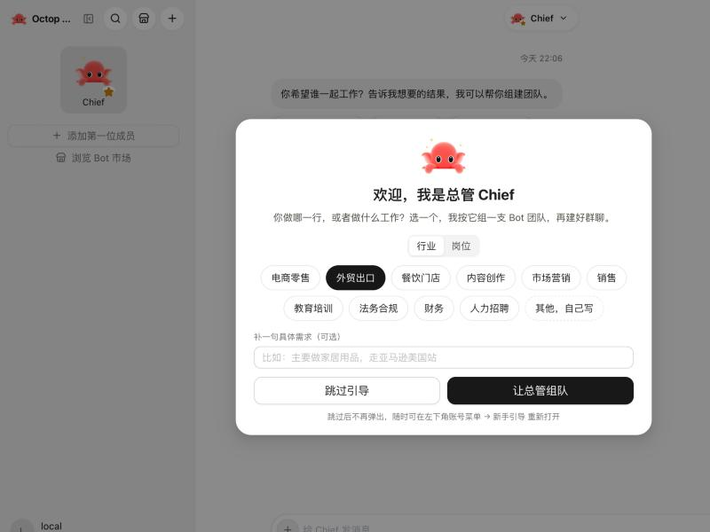 | 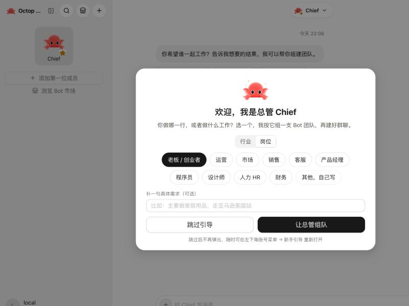 |

标题「欢迎，我是总管 Chief」，下面一句「你做哪一行，或者做什么工作？选一个，我按它组一支 Bot 团队，再建好群聊。」。顶部切换「行业 / 岗位」，默认「行业」。每个选项卡 10 个只写名字的胶囊按钮，最后一个都是「其他，自己写」（选了出现必填输入框「你做哪一行？」或「你做什么工作？」）。原来每张卡片下面的岗位小字去掉了，只留作悬停提示（`title`）。切换选项卡会清掉已选的那一项。

| 行业（10） | 岗位（10） |
|---|---|
| 电商零售、外贸出口、餐饮门店、内容创作、市场营销、销售、教育培训、法务合规、财务、人力招聘 | 老板 / 创业者、运营、市场、销售、客服、产品经理、程序员、设计师、人力 HR、财务 |

数据来源：

- 行业：从 Bot 市场的 `categories.json` 里挑最常用的 8 个（名字照市场的读），加上市场还没有的「外贸出口」「餐饮门店」（`octop_bot.onboarding_industries.*`）。挑哪几个、什么顺序在 `bot_onboarding.ONBOARDING_INDUSTRIES` 里。研发技术、个人生活两类没放上第一屏，选「其他」能写。
- 岗位：和 Bot 市场的「岗位」维度用同一份数据。内容运营在 `feature/bot-market-more` 加了 `bot_market/roles.json`（19 个岗位，`onboarding` 字段 1–10 标出上引导的 10 个和顺序）。那个 PR 进 main 之前，本分支用一份同结构的临时文件 `src/octop/infra/agents/onboarding_roles.json`；进 main 后改读 `catalog.roles` 并删掉临时文件，接口不变。

下面「补一句具体需求（可选）」可以不填。底部两个按钮并排：

- 「跳过引导」：记 `skipped`，关掉卡片，提示在哪里能重开，之后不再自动弹出。
- 「让总管组队」：选了一项才能点。记下选择（`PUT start`），关掉卡片，在总管对话里替用户发出一句话：选行业时是「我做外贸出口。补充：主要做家居用品，走亚马逊美国站。请帮我组一支团队，再建好群聊。」，选岗位时是「我是老板 / 创业者。请帮我组一支团队，再建好群聊。」。这句话用户看得见。

选择先记到服务端，再由总管对话在能发消息时自动发出那句话（路由状态 `autoSend`，只发一次）。本机模式还没接模型时，那句话不会发出，总管首屏照旧显示「连接模型」；接好模型回来后，引导条显示「总管还没建好团队」和「再发一次」，点一下就按已选的行业或岗位重新发出，不用重选。

**为什么这一期仍由总管现编、不直接导入市场模板（D4 第二期）：** 市场模板是一个个独立 Bot，带技能、记忆、例行任务和连接器建议。直接导入会顺带建定时任务（持续花积分）、提示去连连接器，第一次用就太重；模板之间也没有「谁当群管理员、怎么分工」的信息，还得总管来编排。这一期让总管参考同类模板的岗位名（写进引导提示，§6.2）现编 2–4 个 Bot，覆盖面和市场一致，又轻；第二期再加「用模板建」（`octop_bot_create_team` 的 bot 允许带 `template` 字段，导入模板但先不开例行任务）。

左侧边栏此时是空的，显示一行提示「还没有 Bot 和群聊。和总管说一句话，它来帮你组队。」如果总管这一轮没建成团队（比如它反问了一句、或者出错），输入框上方的引导条提示「回答总管的问题，或再说一次你想要什么」，用户在输入框里继续就行。

### 第 2 步：总管组队

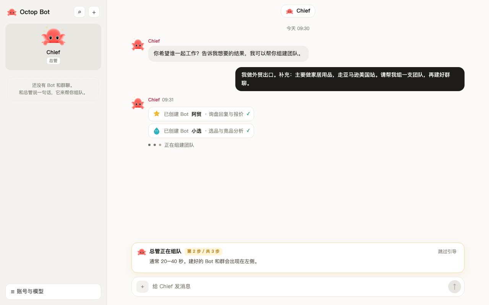

用户发出后，引导条变成「总管正在组队，通常 20–40 秒」。总管按引导模式（§6）一次调用组队工具，对话里出现现有的建 Bot / 建群回执卡片。

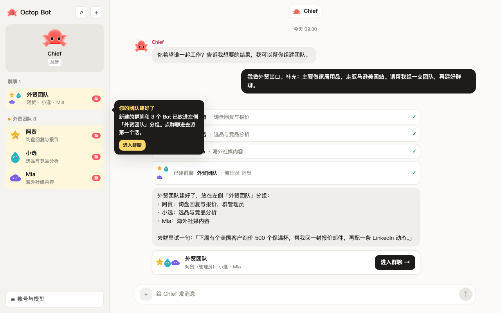

组队完成后：

- 侧栏出现以团队命名的分组，新群和新 Bot 带「新」角标，淡黄色呼吸高亮，分组自动展开。
- 一个提示气泡指向新群：「你的团队建好了……点群聊进去派第一个活」，附「进入群聊」按钮。窄屏或侧栏收起时不显示气泡，靠输入框上方的卡片进群。
- 总管的回复简短列出成员分工，末尾给一句可以直接发到群里的第一条任务；回复下面多一张「进入群聊」卡片。

新群和新 Bot 的淡黄高亮和「新」角标一直留到用户第一次打开它；引导结束（完成或跳过）后全部消失。

### 第 3 步：在群里发第一条消息

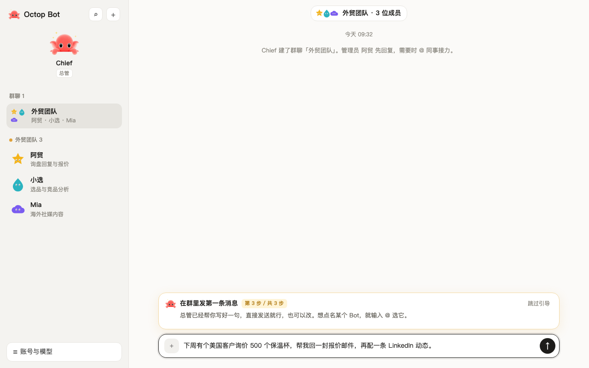

进群后输入框已经填好总管建议的第一条任务，引导条说明：「直接发送就行，也可以改。想点名某个 Bot，就输入 @ 选它。」

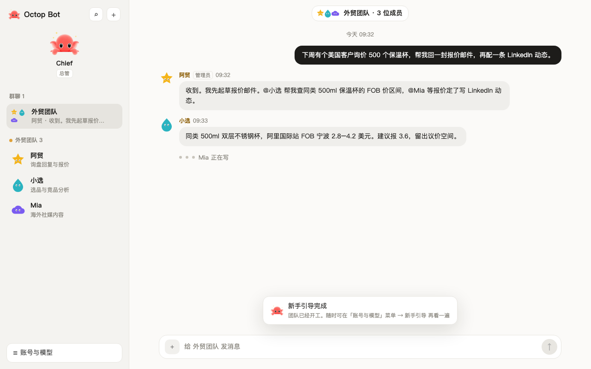

用户发出后记 `done`，底部提示「新手引导完成……随时可在『账号与模型』菜单 → 新手引导 再看一遍」。管理员先接话、@ 同事接力，这是群聊现有的行为，引导不改。

### 跳过和重新打开

- 每一步的「跳过引导」都记 `skipped`，之后不再自动出现。
- 中途关掉窗口、刷新、换设备：状态在服务端，回来接着当前步骤（比如已经建好团队，就直接到高亮那一屏）。
- 「账号与模型」菜单 → 「新手引导」：重置为 `active / welcome`，从欢迎卡重新走。已有的 Bot 和群不动，总管会再组一支新队。设置页「关于」里原来的入口也指向这里。

## 5. 状态和接口

### 5.1 状态

```json
{
  "status": "pending | active | done | skipped",
  "step": "welcome | ask | team_ready | first_message",
  "choice": {
    "kind": "industry",
    "id": "trade",
    "label": "外贸出口",
    "note": "主要做家居用品，走亚马逊美国站。"
  },
  "team": {
    "group_id": "…",
    "bot_ids": ["…"],
    "section": "外贸团队",
    "first_task": "下周有个美国客户询价……"
  },
  "reason": "existing | legacy | null",
  "updated_at": 1764000000
}
```

`pending` 是判定为新用户但还没点「开始」；`active` 表示正在走。只有 `pending` / `active` 时 `show` 为 true。「总管正在组队」不单独记状态，前端看总管这一轮是否还在回复。

### 5.2 接口（挂在现有 `/api/octop-bot` 路由下，需要登录，只操作自己）

| 方法 | 路径 | 说明 |
|------|------|------|
| GET | `/api/octop-bot/onboarding` | 返回 `{show, status, step, choice, team}`。没有记录时按 §3.2 判定并写入。 |
| GET | `/api/octop-bot/onboarding/options` | 第一屏两个选项卡的选项，按用户语言：`{industries: [{id, name, hint}], roles: [{id, name, hint}]}`。`hint` 是悬停提示，也给总管做参考。「其他」由客户端自己加。手机也用它。 |
| PUT | `/api/octop-bot/onboarding` | `{action: "start" \| "step" \| "skip" \| "complete" \| "restart", step?, reason?, industry?, custom?, note?}`。`start` 带上选择：`industry` 是选项 id，选「其他」时 `industry` 为空、`custom` 写用户填的行业；`note` 可选。`step` 只能回到 `ask` 或前进到 `first_message`（要已有团队）。不合法的操作不报错，原样返回当前状态，前端以返回为准。 |

服务端自己推进的一步：总管在 `active` 且步骤为 `welcome` / `ask` 时组队成功（`octop_bot_create_team`，或单独调用 `octop_bot_create_group`），写入 `team` 并把 `step` 改成 `team_ready`。前端不用解析工具输出来猜结果，总管这一轮结束后重新 `GET` 一次就行（现在回执出现后本来就会刷新工作区）。

## 6. 总管的「引导模式」

### 6.1 一次组队工具（D2）

```
octop_bot_create_team(
  team_name: str,                 # 群名，也是侧栏分组名
  bots: list[{name, role, instructions, avatar?}],   # 2–4 个
  admin: str,                     # bots 里某个 name，当群管理员
  first_task: str = "",           # 建议用户在群里发的第一句，引导会拿来预填
  reply_mode: "admin_first" | "all_members" = "admin_first",
) -> {group_id, bot_ids, section, section_error?}
```

内部依次复用现有的 `registry.create(defer_bootstrap=True)`、`set_character / bot_appearance`、`create_group`、`section_action`，所有权检查沿用 `require_owner()`。中途某个 Bot 建失败就停下，返回已经建好的 ID 和错误码，不回滚，总管可以用已有 ID 补建群。上限 6 个，引导模式提示词要求 2–4 个。

### 6.2 每轮附加的引导提示

不改总管存好的系统提示词。当账号状态是 `active` 且步骤在 `welcome` / `ask`、本轮是总管、来自 Bot 客户端时，`_prepare_stream_request` 在附加简报里多拼一段（i18n 键 `octop_bot.onboarding_briefing`，中英两份）。中文稿：

> 新手引导：这是用户第一次让你组队。
> 1. 不要先提问。从这句话推断行业和目标，直接组一支 2–4 个 Bot 的团队。只有完全看不出要做什么时，才问一个问题。
> 2. 用 octop_bot_create_team 一次建好：每个 Bot 起一个简短的名字，写一句分工和具体的角色指令；选最适合对接用户的 Bot 当群管理员；群名和侧栏分组都用团队名。
> 3. 这一轮不要用电脑、浏览器、文件或联网工具，也不要开始做实际业务。
> 4. first_task 写一句用户可以直接发到群里的任务，要能只靠文字完成。
> 5. 回复不超过 6 行：一句说团队建好了，每个成员一行分工，最后一行把 first_task 用「」引出来。
>
> 选行业时：用户在引导第一屏选的行业：{label}。按这个行业直接组队，不要再问做哪一行。同类 Bot 市场模板的岗位可以参考：{hint}。
> 选岗位时：用户在引导第一屏选的岗位：{label}。按这个岗位的日常工作直接组队，不要再问做什么。这个岗位平时主要做：{hint}
> 补了一句时再加：用户补充：{note}

最后一段只在第一屏做了选择时附上（`octop_bot.onboarding_choice.*`、`onboarding_hint.*`、`onboarding_note`）。行业的 `hint` 是该分类下的市场模板名（外贸、餐饮用引导自带的岗位），岗位的 `hint` 是 `roles.json` 的 `blurb`，「其他」没有。有了行业或岗位，总管几乎不需要反问。

组队完成（`team_ready`）后不再附加这段，总管恢复平时的样子。

### 6.3 为什么这样能「一次建好、不啰嗦」

- 一个工具调用代替 4–5 个，模型少了中途停下来确认的机会，也少了几轮模型费用。
- 「不要先提问」「不超过 6 行」写在本轮提示里，只在引导时生效，不影响平时总管多问几句的习惯。
- 第一条任务由总管在工具参数里给出，前端预填，不靠解析自然语言。

## 7. 边界情况

### 7.1 没登录

- 网页 bot.lynxce.cn 必须登录，不存在未登录状态。
- 桌面「使用这台电脑」：没有灵策账号，状态记在本机服务。没接模型时先走模型设置（§4 第 1 步）。之后再登录灵策并搬上云端：本机建过的 Bot 会被搬上去，云端判定为老用户，不再引导；本机跳过了引导、什么都没建就搬上去的，云端会再引导一次（可接受；也可以让搬迁顺带写一条 `done`，属于云端与计费的搬迁代码，第二期再说）。
- 桌面灵策登录（D5）：方案 C 下 Bot 仍在本机，引导照常在本机弹，不再等搬上云端。原来「已连灵策时本机不弹」的判断已去掉。
- 全新安装用灵策登录后的流程（是否跳过选模型页等）等方案 C 的设计定了再改，本 PR 不动。

### 7.2 积分不足

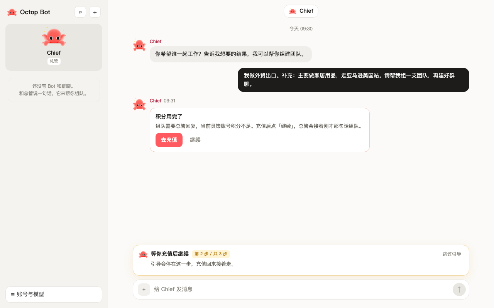

总管回复因为积分不足失败时（`BOT_CLOUD_CREDITS_REQUIRED` / `insufficient_balance`），对话里出现现有的 `CreditsRequiredCard`（去充值 + 继续），引导条换成「等你充值后继续」，步骤停在 `ask`，不记跳过。「继续」重发刚才那句话。欢迎卡上不显示积分数字和价格（价格只由老板定）。

### 7.3 不白白启动云电脑

- **前提**：saas-ui 的 8771b684 把 `/agents/` 加进了对象存储目录（`STORE_DIRS`），之前云端每建一个 Bot 都会顺带开它的云电脑。这个修复现在还不在 main 上，引导要等 saas-ui 合进 main 之后才能在云端上线，否则一次组队就会开 3–4 台云电脑。
- 组队工具用 `defer_bootstrap=True` 建 Bot，不碰云电脑管理器。实现时加一条测试：在云租户下调用 `octop_bot_create_team`，断言没有调用 `ComputerManager.ensure_running`。
- 引导提示禁止本轮用电脑、浏览器、文件工具；建议的第一条任务只用文字完成，群里第一轮也不会去开电脑。
- 浮窗只在电脑已经在运行时出现，引导不会主动打开它。
- 本地测试服务器如果加载了 AGS 凭据，验证完立刻停掉开过的实例。

### 7.4 网络失败和中断

| 情况 | 处理 |
|------|------|
| `GET onboarding` 失败 | 这次不显示引导，也不写任何状态，下次加载再试。 |
| `PUT` 失败 | 界面按本地状态继续，下一步再补发；`skip` / `complete` 失败时在本次会话里不再弹。 |
| 总管这一轮出错或超时 | 走对话现有的错误与重试；引导条停在当前步骤，提供「再说一次」。 |
| 组队做了一半（Bot 建了、群没建） | 状态仍是 `ask`；总管能看到已建的 Bot，重试时补建群。用户也可以直接跳过。 |
| 两台设备同时开着 | 以服务端状态为准，另一台下次 `GET` 时跟上；完成或跳过后两边都不再弹。 |

## 8. 桌面和网页的差异

| | 桌面·本机模式 | 桌面·灵策（已在云端）/ 网页 |
|---|---|---|
| 状态存在哪 | 本机服务 | bot.lynxce.cn |
| 模型 | 没接时先接模型 | 不需要，默认走灵策线路 |
| 积分不足 | 不涉及（用自己的模型） | §7.2 |
| 云电脑 | 不涉及 | §7.3 |
| 「新手引导」菜单入口 | 账号菜单（已有） | 账号菜单（新加，现在网页端藏着） |
| 窄屏（<768px，手机浏览器） | — | 欢迎卡改为底部抽屉；侧栏收起时，高亮改为顶部提示条 + 「进入群聊」按钮 |

Electron 主进程不用改。桌面窗口拖拽区、红绿灯按钮的留白沿用现有组件的处理。

## 9. 移动端对齐要求（由岗位·移动端实现）

手机 App 连云端或自托管服务器，复用同一套接口和状态：

1. 进入首页（Bot 目录）时调 `GET /api/octop-bot/onboarding`，`show` 为 true 才引导；完成、跳过都用 `PUT`，不要在本机另存一份。
2. 步骤和文案与网页一致：欢迎并选行业或岗位（全屏或底部弹层；顶部「行业 / 岗位」切换；「跳过引导」和「让总管组队」并排）→ 在总管对话里替用户发出那句话 → 组队回执 → 目录里新群、新 Bot 带「新」角标并置顶提示 → 进群，输入框预填 `team.first_task`。
3. 两组选项用 `GET /api/octop-bot/onboarding/options`，不要在 App 里写死；每组最后的「其他，自己写」由客户端加。`PUT start` 带 `kind`（`industry` / `role`）和 `option` 或 `custom`。替用户发出的那句话用和网页相同的模板（`dashboard/src/locales/{zh,en}.json` 的 `botOnboarding.guide.request.*`：行业「我做…」，岗位「我是…」）。
4. 设置里加「新手引导」，调用 `PUT {action:"restart"}`。
5. iOS 积分不足走 App 内购，不出现外部充值链接（沿用现有规则）。

## 10. 实现拆分（第二步，批准后做）

分支从 `origin/main` 切（届时如果 saas-ui 还没进 main，先问总管）。

后端：

- `src/octop/infra/agents/bot_onboarding.py`：读写状态、首次判定、组队后推进。
- `src/octop/api/routers/bot_onboarding.py`：GET / PUT，挂进 `bot_workspace.router`，带 summary 和 Pydantic 模型。
- `bot_tools.py`：新增 `octop_bot_create_team`；`octop_bot_create_group` 成功时在引导中记录团队。
- `manager._prepare_stream_request`：引导中给总管附加 `octop_bot.onboarding_briefing`。
- `src/octop/i18n/{zh,en}.json`：引导提示词。
- `docs/api.md`：新接口。

前端：

- `dashboard/src/api/modules/botOnboarding.ts`。
- `pages/OctopBot/onboarding/`：欢迎与选行业卡、引导条、侧栏高亮与提示气泡、群输入框预填；`useOnboarding` 钩子。
- `index.tsx`：去掉跳 `BOT_GUIDE` 的旧逻辑，改由 `useOnboarding` 决定；`BotGettingStarted` 只保留模型一步（D3）；`AccountMenu` 网页端也显示「新手引导」。
- `dashboard/src/locales/{zh,en}.json`：`botOnboarding.*` 新键，两份一致。

测试：

- 后端：首次判定（空工作区 / 有 Bot / 有群 / 私密 Bot）、状态跳转与 409、组队工具（成功、半途失败、超过上限）、组队推进状态、引导提示只在 `active` 且总管轮次附加、云租户组队不启动云电脑、他人无法读写。
- 前端：`useOnboarding` 各状态渲染、跳过与重开、旧 localStorage 迁移、窄屏布局、积分不足时引导条。
- 验证：`make all` 全绿、`cd dashboard && npx tsc -b`、浏览器预览里用新账号把本机模式完整走一遍并截图；云端模式在本地测试服务器上走一遍（不加载 AGS 凭据，或用完立刻停）。

改动范围：不改数据库结构、不改价格、不改登录接口；会改总管每轮提示和新增一个总管工具，合并后需要部署云端并用 `VITE_OCTOP_BOT_WEB=1` 重建前端。

## 11. 实现记录（2026-11-25）

分支 `feature/bot-onboarding`（从 `origin/main` 967fddf1 切）。

后端：

- `src/octop/infra/agents/bot_onboarding.py`：状态读写、首次判定（`get_or_insert`，两个标签页同时打开也只判一次）、`record_team`、`onboarding_briefing`。
- `src/octop/api/routers/bot_onboarding.py`：`GET / PUT /api/octop-bot/onboarding` 和 `GET /api/octop-bot/onboarding/options`，挂在 `bot_workspace.router` 下。
- 行业 / 岗位选项（D6 和之后的选项卡改动）：`onboarding_options()` 给两组，行业读市场的 `categories.json` 和模板名再加外贸出口、餐饮门店，岗位读临时的 `onboarding_roles.json`（等市场的 `roles.json` 进 main 后替换）；`PUT start` 记下 `choice`（`kind`、`id`、`label`、`note`），引导提示按行业或岗位措辞。
- `bot_tools.py`：新增 `octop_bot_create_team`；`octop_bot_create_group` 在引导中建群时也记录团队。
- `manager._prepare_stream_request`：引导中（`active` 且 `welcome` / `ask`）给总管的 Bot 客户端轮次附加 `octop_bot.onboarding_briefing`。
- 测试 `tests/integration/test_octop_bot_onboarding.py`（7 个，含选行业与提示）：新用户全流程、老用户不引导、跳过后不再出现、简报只在该出现时出现、组队参数校验与半途失败、云租户组队不启动云电脑（等后台 bootstrap 跑完再断言）。

前端：

- `dashboard/src/api/modules/botOnboarding.ts`；`pages/OctopBot/onboarding/`：`useOnboarding`（读取、旧 localStorage 迁移、回复结束后刷新）、`OnboardingParts`（欢迎并选行业、引导条与「再发一次」、团队卡、侧栏气泡）。
- 聊天页支持路由状态 `autoSend`：按 `location.key` 只发一次，等这个聊天能发消息时才发。
- `index.tsx`：去掉跳 `/octop-bot/guide` 的旧逻辑，接上欢迎卡、引导条、侧栏高亮、进群预填和完成提示；聊天页加了 `composerTop` 插槽，群聊加了 `guide` / `onSent`。
- `BotGettingStarted` 只留「连接模型」一步（D3）；账号菜单和设置「关于」里的「新手引导」改为重新开始新流程，网页端也有。
- `creationEvents.ts`：认得 `octop_bot_create_team`，每个新 Bot 和群各一张回执。

浏览器实走（本地测试服务器，网页构建 `VITE_OCTOP_BOT_WEB=1`，脚本化的假模型，不连真实模型、不加载云电脑凭据）。假模型日志确认总管那一轮带了引导简报、标题生成那一轮没带。

| 第一屏·行业 | 第一屏·岗位 |
|---|---|
|  |  |

| 替用户发出，组队中 | 团队建好 |
|---|---|
| 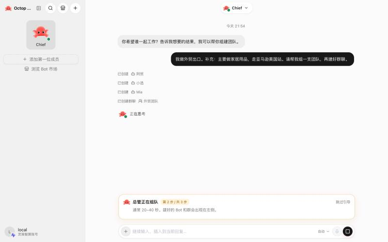 | 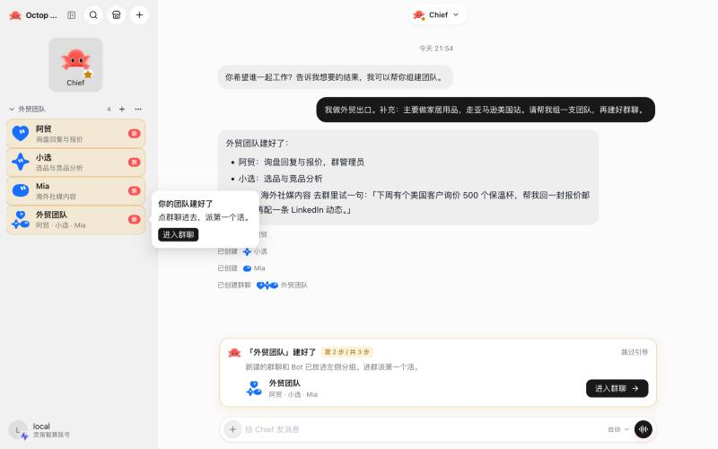 |

| 进群预填 | 发出后完成 |
|---|---|
| 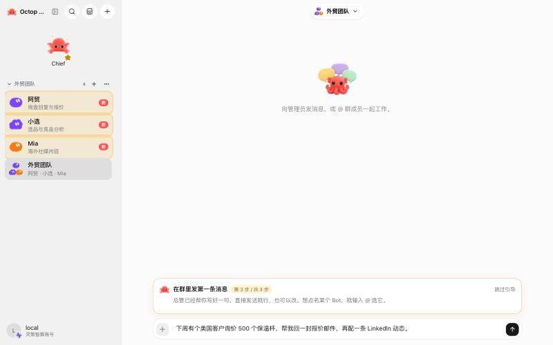 | 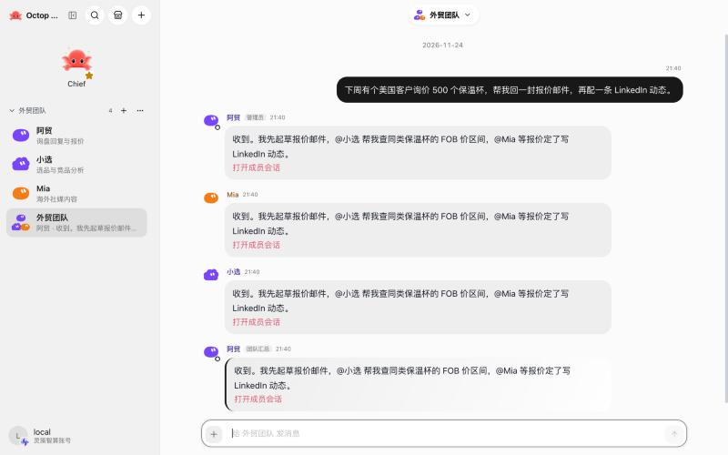 |
