# Octop Bot 的会员、充值、个人中心和更新日志（设计稿）

状态：**定稿**（2026-11-25）。会员、加油包和规则以总管的《会员权益与定价定稿》（团队共享目录，用户授权总管直接定下）为准，本文 §0、§3 照它写。负责：岗位·桌面与 Web。

用户原话：
- 「再给 octop bot 单独在官网做一个充值页和登录以及个人中心体系，帮我设计规划好 octop bot 的会员套餐和积分充值，以及个人中心 ui 那些，可以参考复用部分之前灵策的，然后引导充值也是引导到 octop 这个充值页来。……把 octop bot 设计得更像一个 SaaS 产品、AI 工具一些。」
- 「跟 lobster 的一样」「加油包也跟他一样，团队版暂时不上」「年费也加上去」。
- 「官网的那几个定价的你参考 lobster，跟他们类似，然后我们的根据实际情况来，把视频和作图模型也加进去」。
- 「然后再把所有客户端的充值、积分、余额不足等等各种充值和开通的 ui 交互功能都做好设计好」。

可点原型：[`docs/assets/octop-bot-saas-billing/prototype.html`](assets/octop-bot-saas-billing/prototype.html)（浏览器直接打开，顶部条切换页面；官网部分直接用 `website/assets/site.css`；客户端部分是桌面窗口和手机线框）。原型中的体验积分以本文为准：注册赠送 100 积分，14 天有效，仅限 Octop 使用。

相关文档：
- 灵策侧数据模型、工作量、发版模块：灵策仓库 `team/方案/2026-11-25-OctopBot运营后台设计.md`（2.3、2.4、3 节，下称「运营后台设计」）。
- 灵策现有能力盘点：灵策对接的《灵策能力盘点-官网》（团队共享目录，下称「盘点」）。
- 两套账号：`docs/octop-bot-accounts.md`。

## 0. 已定

| # | 事项 | 结论 |
|------|------|------|
| P1 | 档位 | 体验 / 标准 / 进阶（稳定使用推荐）/ 专业 / 卓越，价格和积分照 LobsterAI；**团队版不上** |
| P2 | 权益怎么表达 | 每月积分 + 加赠 + 签到 + 权益清单，清单写 Octop Bot 实际能力（§3.2） |
| P3 | 价格 | 月付 ¥0 / 69 / 99 / 199 / 699；年付限时 9 折、抹去角分：¥745 / 1,069 / 2,149 / 7,549；「限时」不设截止，运营后台可随时关闭 |
| P4 | 积分有效期 | 月度积分 1 个月、签到当月、体验 14 天、加油包 365 天，第一期就做；先到期的先用 |
| P5 | 续费 | 第一期不做自动续订，页面写「到期前 3 天提醒，手动续费」；同时申请微信、支付宝代扣，开通后第二期上线 |
| P6 | iPhone | 只卖加油包对应的内购积分包（1.0.2 起），不卖会员、不放外链，App 内显示当前套餐 |
| P7 | 新用户 | 通过 Octop Bot 注册的灵策账号自动发 100 积分，14 天有效，仅限 Octop 使用，不和灵策自己的注册奖励叠加 |
| P8 | 加油包 | ¥20 / 50 / 100 / 200 / 500 和自定义 ¥10–5,000，1 元 = 100 积分，365 天有效，可与会员叠加，未订阅也能买 |
| P9 | 体验档限制 | 协同 Bot 3、群聊 1、同步设备 2、标准云电脑同时 1 台、云端文件 1 GB、定时任务 3；本机 Bot 不限 |
| P10 | 登录 | 第一期官网直接调灵策验证码登录；三个子域单点登录以后再做 |
| P11 | 收款主体、发票 | 沿用灵策 |
| P12 | 公开单价 | 文本按 token、作图按张、做视频按秒（读灵策后台），云电脑和磁盘单价写明 |
| P13 | 兑换码 / 邀请 / 首单低价 | 兑换码第二期；邀请返积分、首单低价不做 |
| P14 | 签到 | 付费会员每天 100 积分（约 3,000/月），当月有效，第二期；第一期页面不显示签到那一行 |
| P15 | 加赠 | 标准、进阶每月加赠 10%；专业、卓越只在首个权益月加赠 20% |
| P16 | 模型折扣 | 第一期不做，页面不写 |
| P17 | 客户端「去充值」 | 票据只能换**一次性、5 分钟有效、只能查余额、下单充值和查本会话自己下的订单状态（只读）**的受限会话，不允许换完整网页会话。受限会话上线前，客户端直接打开灵策收银台（Octop Bot 品牌、按接口上线情况预选、回跳）；上线后再开官网免登录直达（§5.3） |
| P18 | 客户端「个人中心」直达 | 个人中心打开 `account.html#code=…`，充值入口打开 `pricing.html#ticket=…`；落地页先读取片段中的码，再用 `history.replaceState` 清除，之后以对应的 `account` 或 `recharge` 作用域通过 POST 兑换，会话只放内存或 `sessionStorage`。兑换失败显示正常登录；改密码、换绑、注销和管理登录设备需要再次验证。接口上线前关闭相关开关（§5.3） |
| P19 | 积分可用范围 | 会员和注册体验积分仅限 Octop 使用；加油包、充值和 iOS 内购积分通用。余额及扣费规则见 §3.4。 |
| P20 | 开卖时间 | 会员和加油包在灵策列车 B 上线后一起开卖，预计 11 月 30 日前后；此前按钮显示「即将开通」，登录和个人中心先上线。 |

## 1. 现状

- **账号**：灵策账号（手机号 / 邮箱验证码、密码、WorkBuddy、微信）。官网的登录和个人中心只管灵策账号这一侧；本机账号和本机 Bot 在官网完全看不到（`octop-bot-accounts.md`）。
- **充值**：客户端调 Octop 后端 `POST /api/octop-bot/wallet/recharge`，后端用灵策 `POST /api/billing/recharge/checkout-link` 换 15 分钟票据，打开灵策收银台。URL 在 `src/octop/infra/auth/lynxce_wallet.py` 精确校验，手机端各有一份同样的校验。
- **iOS**：苹果内购积分包（`/api/octop-bot/wallet/apple/*`）。
- **客户端入口**：设置 → 账号与积分（`CreditsPanel`：余额、30 天用量、充值）、对话里的积分不足卡片（`CreditsRequiredCard`）、余额偏低横幅（`LowCreditsBanner`）、账号菜单里的余额。
- **错误**：`BOT_CLOUD_CREDITS_REQUIRED`（402，文案指向 admin.lynxce.cn/recharge）；模型服务商余额不足走 `stream_errors.insufficient_balance`。
- **单价**（灵策后台，老板已确认）：标准云电脑 1.70 积分/分钟、专业 3.40 积分/分钟、云电脑磁盘 4.80 积分/GB·天；文本模型按模型价目（腾讯云 TokenHub，成本 × 3）；作图、做视频按灵策模型价格（默认作图模型和默认视频模型在灵策后台设置，现在分别是 gpt2.6 和 minimax h3）。
- **官网**：`website/` 下的手写静态站，没有登录、定价和更新日志页；更新说明散在下载页，读 `website/releases.json` 和 dl 上的签名清单。

## 2. 官网页面

### 2.1 导航栏

现在的顶栏有 7 个链接，加两个 GitHub 星标、语言、外观和下载按钮，「下载」出现两次，太挤。改成：

| 位置 | 内容 |
|---|---|
| 左 | 图标 + Octop Bot，点击回首页（去掉单独的「首页」） |
| 中 | 功能 · Bot 市场 · 定价 · 帮助 ▾（使用指南、更新日志、常见问题） |
| 右（未登录） | GitHub 星标：Octop Bot、上游 Octop ｜ 网页版 · EN · 外观 ｜ 登录 · **下载** |
| 右（已登录） | GitHub 星标 ｜ 网页版 · EN · 外观 ｜ 头像 + 积分余额，点开进个人中心 |

- 去掉导航里的「下载」链接，只留右上角的下载按钮。
- 两个 GitHub 星标（Octop Bot 和上游 Octop，带 star 数）留在顶栏右侧；窄屏时只显示图标和数字。
- 当前页加粗；在更新日志页时「帮助」加粗。
- 手机宽度：顶栏只留图标、下载按钮和菜单按钮；菜单按上面的顺序平铺，帮助里的三项直接展开，星标放在菜单底部。

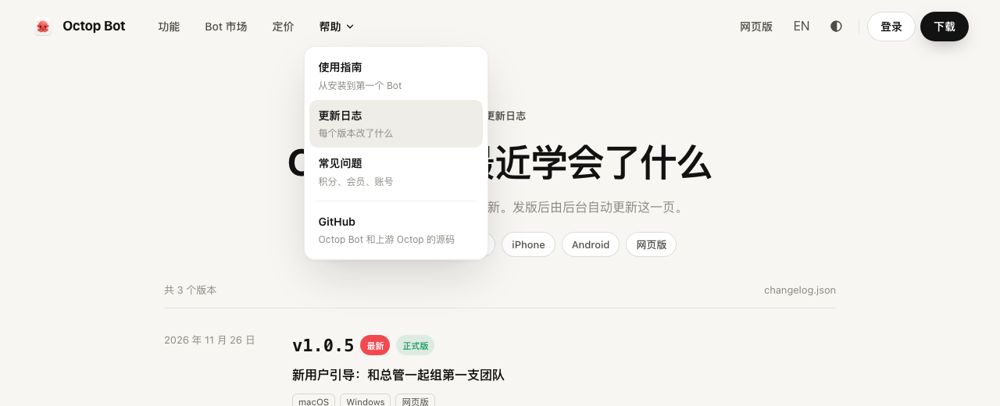

### 2.2 页面

| 页面 | 地址 | 内容 | 原型 |
|------|------|------|------|
| 定价·会员 | `/pricing.html` | 顶部切换「会员套餐 / 加油包」；月付 / 年付（限时 9 折）切换；五档卡片；下面是按量单价和模型价格表（文本 / 作图 / 视频）；常见问题 |  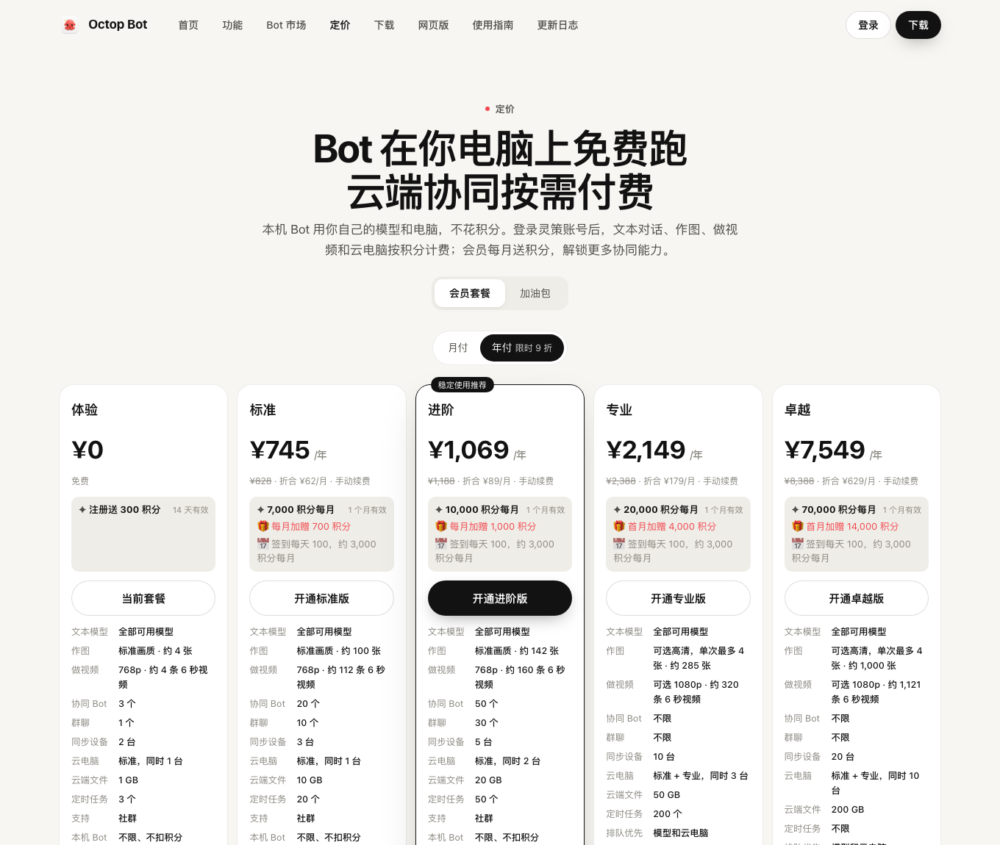 |
| 定价·加油包 | `/pricing.html#credits` | 左边金额卡片（自定义金额按 §5.2 开关显示），右边固定的结算栏（价格、到账、有效期、购买；底部引导看会员）。受限会话上线后，客户端「买加油包」直接打开这一页（§5.3） |  |
| 登录 | `/login.html?next=…` | 和 App 一致的五种方式（§5.1）：手机验证码、邮箱验证码、密码、微信扫码、WorkBuddy；没有账号自动注册（带 `X-Lynxce-Signup-Site: octop-bot`）；登录后回到 `next` | 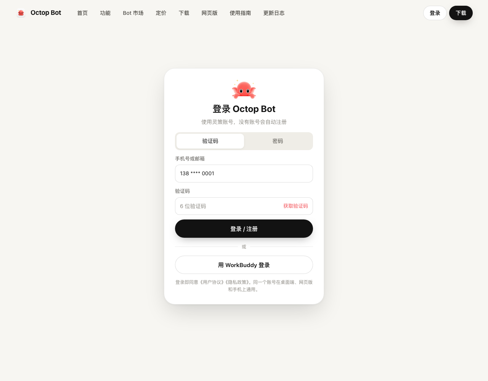 |
| 支付结果 | `/pay/result.html?recharge=paid&order=…` | 到账多少、当前余额；「返回 Octop Bot」和「查看订单」 | 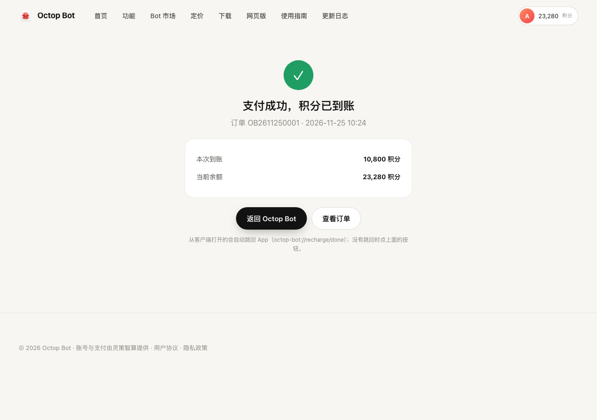 |
| 个人中心·概览 | `/account/` | 本产品可用积分（专属 + 通用），分列明细和 30 天内即将到期的积分，并说明扣费顺序、当前套餐和到期日、本月已用；本月用量按类别、按 Bot；「积分活动」：近一年每天用掉的积分，像 GitHub 贡献图一样按周排成 7 行，颜色越深用得越多，悬停看当天数字，可切换每日 / 每周 / 累计，上方写近一年总量、用过的天数和最长连续天数，「分享」生成一张图 |  |
| 用量明细 | `/account/#usage` | 按月；类别：文本对话、作图、做视频、云电脑、云电脑磁盘；维度切换 Bot / 模型 / 类别；导出 CSV |  |
| 订单与发票 | `/account/#orders` | 汇总（累计支付、可开票、已开票）；订单列表；单张或批量开票 | 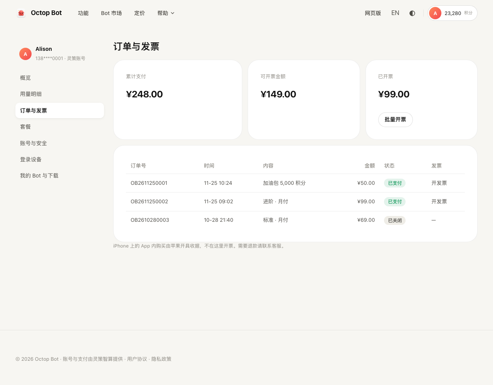 |
| 套餐 | `/account/#plan` | 当前档位和到期日、续费、改年付、升级 | 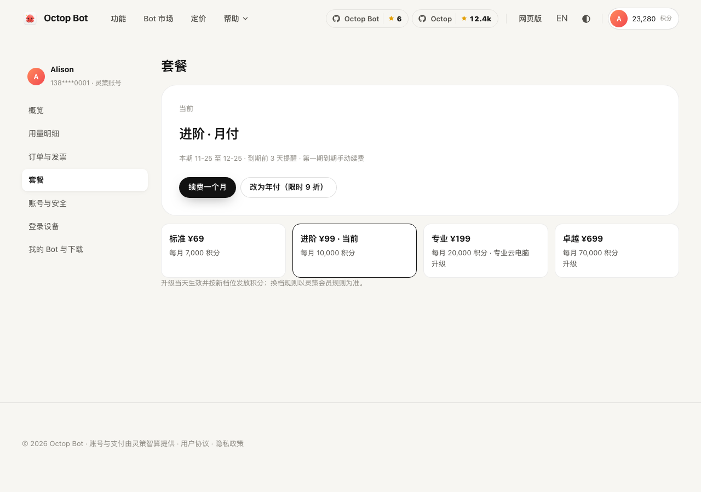 |
| 账号与安全 | `/account/#security` | 手机、邮箱、WorkBuddy、注销（改密码灵策没有，第二期） | 原型里有 |
| 登录设备 | `/account/#devices` | 灵策记录的推送设备和桌面设备（网页会话不在列表里），可删除单台；「全部下线」 | 原型里有 |
| 我的 Bot 与下载 | `/account/#bots` | 协同 Bot 数量、在网页版打开；各平台下载 | 原型里有 |
| 更新日志 | `/changelog.html` | §11 |  |

结账（付款）这一步第一期跳灵策收银台（§5），所以原型里的「结账」页是第二期的样子。

## 3. 会员和加油包

### 3.1 五档会员

| 档位 | tier | 月付 | 年付（限时 9 折） | 每月积分（1 个月有效） | 加赠 | 签到（第二期） |
|---|---|---|---|---|---|---|
| 体验 | `trial` | ¥0 | — | 注册送 100（14 天有效，仅限 Octop 使用） | — | — |
| 标准 | `standard` | ¥69 | ¥745（原 ¥828） | 7,000 | 每月 10%（700） | 每天 100，约 3,000/月 |
| 进阶（稳定使用推荐） | `plus` | ¥99 | ¥1,069（原 ¥1,188） | 10,000 | 每月 10%（1,000） | 同上 |
| 专业 | `pro` | ¥199 | ¥2,149（原 ¥2,388） | 20,000 | 首月 20%（4,000） | 同上 |
| 卓越 | `max` | ¥699 | ¥7,549（原 ¥8,388） | 70,000 | 首月 20%（14,000） | 同上 |

年付一次付清 12 个月，积分按月到账。每张卡片：档位名、价格（年付时显示年价、原价划线和折合月价）、「到期前 3 天提醒，手动续费」、灰底积分块（每月积分 + 有效期、加赠）、购买按钮、权益清单。

### 3.2 权益清单

| | 体验 | 标准 | 进阶 | 专业 | 卓越 |
|---|---|---|---|---|---|
| 文本模型 | 全部可用模型 | 全部 | 全部 | 全部 | 全部 |
| 作图（默认模型，现为 image2.6） | 标准画质 | 标准画质 | 标准画质 | 可选高清，单次最多 4 张 | 可选高清，单次最多 4 张 |
| 做视频（默认模型，现为 MiniMax H3） | 768p | 768p | 768p | 可选 1080p | 可选 1080p |
| 协同 Bot（☁） | 3 | 20 | 50 | 不限 | 不限 |
| 群聊 | 1 | 10 | 30 | 不限 | 不限 |
| 同步设备 | 2 | 3 | 5 | 10 | 20 |
| 云电脑 | 标准，同时 1 台 | 标准，同时 1 台 | 标准，同时 2 台 | 标准 + 专业，同时 3 台 | 标准 + 专业，同时 10 台 |
| 云端文件空间 | 1 GB | 10 GB | 20 GB | 50 GB | 200 GB |
| 定时任务 | 3 | 20 | 50 | 200 | 不限 |
| 排队优先 | — | — | — | ✓ | ✓ |
| 支持 | 社群 | 社群 | 社群 | 工单优先 | 专属顾问 |
| 本机 Bot（🔒） | 不限、免费、不扣积分 | 同左 | 同左 | 同左 | 同左 |

- **作图和做视频的数量换算**：卡片上写「本档每月积分约可生成 N 张图」「约 N 条 6 秒视频」。官网读灵策后台当前的默认作图模型、默认视频模型和它们的单价，作图用「积分 ÷ 每张单价」、视频用「积分 ÷（每秒单价 × 6）」实时算，向下取整；体验档按 100 积分算。模型名也读后台，不写死。按现价（作图 70 积分/张，768p 视频 10.4 积分/秒）：体验 1 张 / 1 条，标准 100 / 112，进阶 142 / 160，专业 285 / 320，卓越 1,000 / 1,121（只算月度积分）。价格接口是灵策公开的 `GET https://api.lynxce.cn/api/models/pricing-catalog`，`imageModels[0]`、`videoModels[0]` 即默认模型；官网浏览器直接调需要灵策放行跨域，放行前在构建时拉取或经 bot.lynxce.cn 转发。
- 数量上限（协同 Bot、群聊、设备、云电脑并发、文件空间、定时任务）和作图高清、视频 1080p 的档位开关，页面写数字；第一期客户端先不拦，第二期强制执行（§8.4）。
- 成本核对：会员积分按面值消耗，消耗时文本是成本 × 3、云电脑和磁盘是成本 × 2，积分全部用完时成本在面值的 33%–50%。

### 3.3 加油包

| 价格 | 到账积分 |
|---|---|
| ¥20 | 2,000 |
| ¥50 | 5,000 |
| ¥100 | 10,000 |
| ¥200 | 20,000 |
| ¥500 | 50,000 |
| 自定义 ¥10–5,000 的整数 | 金额 × 100 |

一次性购买，到账即用，365 天有效，可与会员叠加，未订阅也能买。

### 3.4 积分可用范围和扣费

- 会员积分（每月积分、首月加赠、年付按月到账）和注册体验积分只能在 Octop 使用。
- 加油包、充值和 iOS 内购买的积分是通用积分，可在 Octop 和灵策使用；在 Octop 购买的积分有效期为 365 天。
- 扣费时，在本产品可用的专属积分和通用积分中先用到期早的；没有补扣，Octop 专属积分和灵策专属积分互不动用。
- 灵策列车 B 上线前已有的余额全部视为通用积分，永久有效。
- 余额显示「本产品可用 = 专属 + 通用」，分开列出明细和 30 天内即将到期的积分；具体字段名随列车 B 给出。
- 会员到期不续时，不再发下一期积分，已发积分按各自的有效期过期，不收回。余额不足时，当前回合跑完这一步停下，云电脑暂停并保留文件，见 §8.3。

## 4. 公开单价

定价页「按量单价」和模型价格表都从灵策读，不写死在页面里：

| 类别 | 计价 | 来源 |
|---|---|---|
| 文本对话 | 积分 / 百万 token，分输入、输出、缓存命中 | 灵策模型价格，`product=octop_bot` 可用的模型 |
| 作图 | 积分 / 张 | 灵策后台的默认作图模型和价格，现为 image2.6（`gpt-image-2.6-flare`），标准和高清同价 70 积分/张 |
| 做视频 | 积分 / 秒（按分辨率） | 灵策后台的默认视频模型和价格，现为 MiniMax H3（`ucloud/MiniMax-H3`）：480p 5.2、720p 10.4、1080p 19.76 积分/秒；默认 768p 按 720p 档计，最高 1080p |
| 标准云电脑 | 1.70 积分 / 分钟，暂停不收 | 灵策 `octop_compute` 配置 |
| 专业云电脑 | 3.40 积分 / 分钟 | 同上 |
| 云电脑磁盘 | 4.80 积分 / GB·天 | 同上 |

模型价格表照 LobsterAI 的结构：文本 / 作图 / 视频三个切换，列出能不能看图、能不能深度思考。价格读灵策公开的 `pricing-catalog`（§6），不写死。

## 5. 登录和付款链路

### 5.1 登录（第一期）

- 官网直接调灵策的验证码 / 密码登录接口（`/api/auth/phone-code` + `phone-login`、`email-code` + `email-login`、`password-login`），拿到灵策的 Bearer 会话令牌，存在官网自己的 `localStorage`（和灵策网页端一样），刷新走 `POST /api/auth/refresh`。注册来源带 `X-Lynxce-Signup-Site: octop-bot`（灵策中台的应用 id，带连字符，和 Octop 客户端一致），并带 `X-Lynxce-App: octopbot`。
- 前提：灵策的跨域白名单加 `https://octop-bot.lynxce.cn`（改生产环境变量，0.5 小时）。
- 「用灵策登录」（OIDC）的令牌只能调 userinfo，个人中心用不了，不用它。
- 官网、bot.lynxce.cn、admin.lynxce.cn 各登各的。三站单点要灵策种 `.lynxce.cn` 的 HttpOnly 刷新 Cookie，碰登录、高风险（3–5 天），放到以后。
- 微信扫码登录要灵策把官网加进微信中转白名单（0.5–1 天）。

**登录方式**（用户 11-25 定，和 App 一致；样式等桌面客户端的登录改版定稿后对齐）：

| 方式 | 说明 | 官网怎么接 |
|---|---|---|
| 手机验证码 | 没有账号自动注册 | `phone-code` + `phone-login` |
| 邮箱验证码 | 没有账号自动注册；新邮箱首次登录要同时设密码 | `email-code` + `email-login` |
| 密码 | 手机号或邮箱加密码 | `password-login` |
| 微信扫码 | 网页标准扫码登录 | 走灵策中转，不用在微信开放平台加回调域（灵策分支 `feat/octopbot-wechat-relay`，按 11-28 前上线排），流程见下 |
| WorkBuddy | 官方图标 | 灵策加 WorkBuddy 站点 `octop-bot`（总管 11-25 定做，和微信中转同车，11-28 前），流程见下 |

灵策还不支持的方式先把界面做好，用开关关着，支持后打开。

**微信扫码流程**（官网直接调 api.lynxce.cn，依赖跨域白名单 `cors-octop-bot`，已批，等列车）：

1. `GET https://api.lynxce.cn/api/auth/wechat-web/config?site=octop-bot`（带 `X-Lynxce-Client: web`），返回 `{enabled, appId, redirectUri, state}`；`enabled=false` 时隐藏微信按钮。
2. 用这三个值打开微信扫码页 `open.weixin.qq.com/connect/qrconnect`（`scope=snsapi_login`），不引入第三方脚本。
3. 扫码后微信回到灵策中转页，再 302 到官网静态页 `/auth/wechat-callback.html#code=…&state=…`；只有 `state` 没有 `code` 表示用户取消，提示重新扫码。
4. 回调页从片段读取参数并先用 `history.replaceState` 清除，再调 `POST /api/auth/wechat-web/login {code, state}`（带 `X-Lynxce-Client: web`、`X-Lynxce-Signup-Site: octop-bot`）。直接成功返回会话；新微信号返回 `needBindPhone` 和 10 分钟有效的 `bindToken`，先 `POST /api/auth/phone-code {phone}`，再 `POST /api/auth/wechat-web/bind-phone {bindToken, phone, code, password?}`（新号可以不设密码，设了要 ≥8 位）。
5. `state` 一次性，刷新回调页会失败，提示重新扫码。
6. 防登录 CSRF（Codex 提醒）：发起扫码时把 `state` 存进 `sessionStorage`；回调页先拿 URL 里的 `state` 和存的比对，不一致就不调 `wechat-web/login`，提示重新扫码；比对完删掉存的 `state`。灵策服务端会校验 `state` 的签名并一次性作废，但「是不是本浏览器发起的」只能由官网核对。

**WorkBuddy 流程**（复用灵策智算的 WorkBuddy 应用，同一个 WorkBuddy 用户在官网和桌面登录的是同一个灵策账号）：

1. `GET https://api.lynxce.cn/api/oauth/workbuddy/config?site=octop-bot` → `{enabled}`，`false` 就隐藏按钮。
2. 发起登录时生成 32 字节随机数，编码为 base64url 的 `clientState` 并存入 `sessionStorage`；跳转到灵策 WorkBuddy 登录入口时带上 `clientState` 和站内相对路径 `returnTo`。`returnTo` 必须以 `/` 开头，不能以 `//` 或 `/login` 开头，否则按 `/` 处理。
3. 授权后回到官网 WorkBuddy 落地页，优先从 `#code=` 读取交接码；兼容旧回调时，片段里没有码再从查询参数读取。用户拒绝或出错时显示原因并提示重试。
4. 落地页读取交接码后，先用 `history.replaceState` 清除地址中的码，再用 `POST /api/oauth/workbuddy/session` 发送请求体 `{code, clientState}` 换会话；交接码有效期为 120 秒。核对不匹配时灵策返回 401 `workbuddy_client_state_mismatch`。成功后跳到 `next`，只接受本站路径。灵策上线后将强制核对 `clientState`，并把回调切到片段。
5. 新 WorkBuddy 用户自动建灵策账号，注册来源记 `octop-bot`，不用绑手机号。

- 邮箱：新邮箱首次验证码登录要带 `password`，否则返回 400 `signup_password_required`，界面在这时补出密码框。
- WorkBuddy 图标：WorkBuddy 开放平台的公开渠道查不到品牌或按钮使用规范；灵策自己的登录页用的是通用登录图标加「WorkBuddy 一键进入」，没用 WorkBuddy 的 logo。总管 11-25 定：照用户要求用 WorkBuddy、微信的官方 logo 原文件，不用通用图标。
- 找回或设置密码：没有单独接口，用「发验证码，再带验证码和新密码调 `email-login` 或 `phone-login`」实现；密码登录时的「忘记密码」走这条路。
- 登录后顶栏的头像读 `GET /api/user/profile` 的 `data.avatarUrl`（公开地址），没有头像时显示名字首字。

微信、WorkBuddy 按钮带官方图标（用户 11-25 要求）：微信用微信官网（weixin.qq.com）公开的图标原文件（用户定），WorkBuddy 用 WorkBuddy 官网的站点图标原文件，都不改动、不自己画。桌面客户端取素材，放在团队共享目录的「登录页改版-方案/品牌图标」，官网 PR-C 复用，换掉稿里的占位。


**登录页设计**（沿用桌面客户端登录改版的方向 B，等用户选定 App 的方向后对齐；可点稿 [`login-b.html`](assets/octop-bot-saas-billing/login-b.html)）：

- 顶部是官网导航；左边是 Chief 舞台（大标题、三条卖点、团队头像轮动展示 Bot 刚干完的活），右边是不加卡片框的表单。手机上舞台缩成顶部横幅，只留 Chief 和标题。
- 从定价、个人中心、结账跳来时，表单上方有一个「登录后回到「定价」」的提示，登录后回到原页面（`next` 参数，只接受本站路径）。
- 登录和注册是同一页，不单独做注册：验证码登录对没有账号的手机号或邮箱自动注册，页面写明这一点；密码登录时写「没有账号或忘了密码？用验证码登录」。理由是注册和登录分开会多一步选择，而灵策的验证码本来就是登录即注册。
- 排法和 App 一致（用户 11-25 定的排法 B）：一个「手机号或邮箱」输入框，自动识别是手机还是邮箱，加验证码（「获取验证码」收在输入框里）；「用密码登录」是一个文字链接，点了把验证码框换成密码框；下面「其他方式」并排两个半宽按钮：微信登录、WorkBuddy，都用官方图标。点微信登录，表单原地换成扫码流程。
- 没有「仅在本机使用」入口（官网只对应灵策账号）。底部写「登录即表示同意灵策智算《服务条款》和《隐私政策》」，链到灵策的两页。
- 图标和组件和桌面客户端共用一套：微信用微信官方站点的 apple-touch-icon（`wechat.png`，180×180），WorkBuddy 用其官网站点图标（`workbuddy.svg`），原文件、来源和校验和在团队共享目录的「登录页改版-方案/品牌图标」；按原样缩放，不改色、不裁切、不加描边。

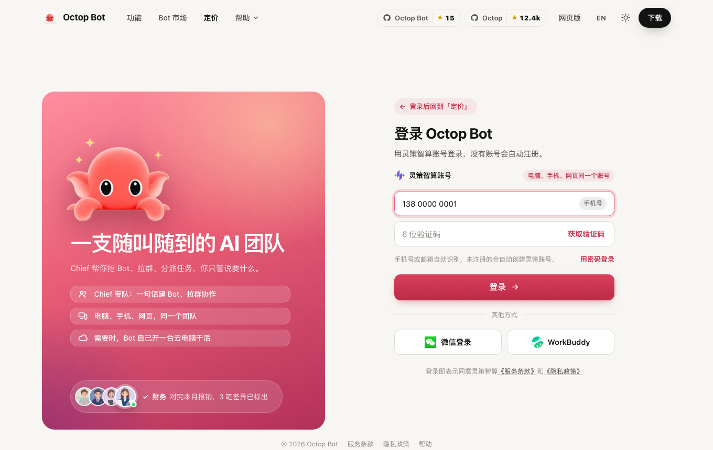
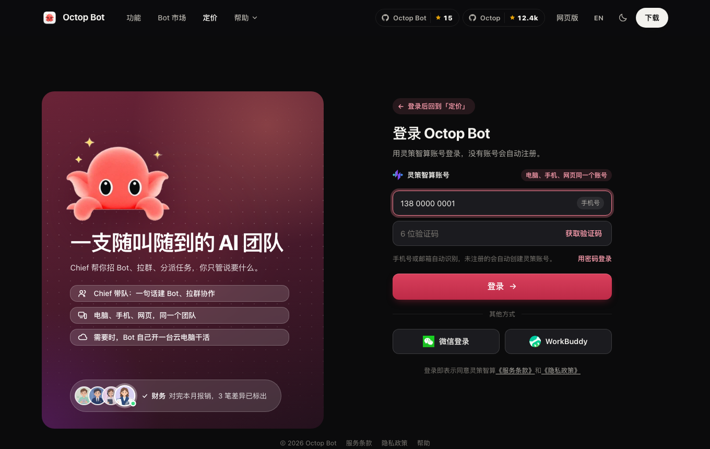
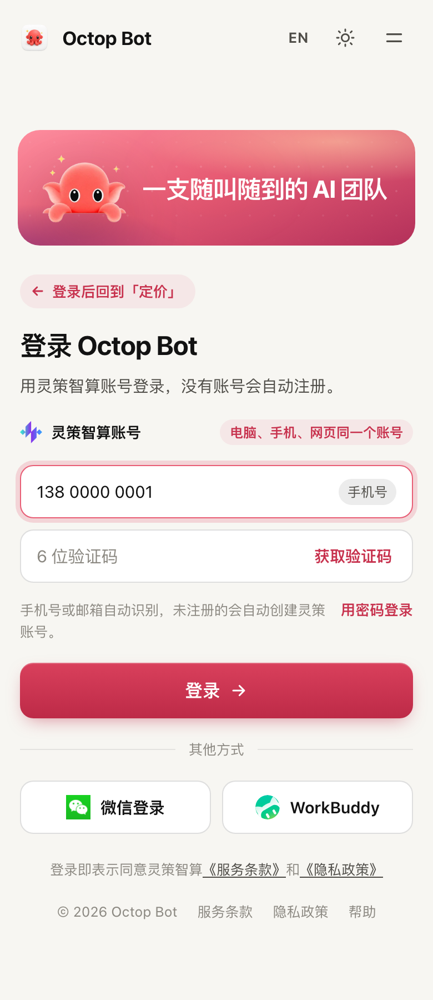

**安全要求**（安全审计 3.5、3.6，PR-C 起执行）：

- 全站不用内联脚本（现有页面头部的主题和语言初始化挪到本站 js 文件），接口和数据文件里的文本一律用 `textContent`，不用 `innerHTML`。
- CSP：`script-src 'self'`；`connect-src 'self' https://dl.lynxce.cn https://api.lynxce.cn https://api.github.com`（下载页读签名清单、登录和个人中心调灵策、GitHub 星标数）；宣传片和图片如果放在别的域名，`img-src`、`media-src` 要加上。打开登录开关之前，必须先用 `Content-Security-Policy-Report-Only` 跑一天，没有报错后正式启用 CSP。
- `account.html`、`pricing.html` 加 `Referrer-Policy: no-referrer`。由于登录会话存于 `localStorage`，官网任何页面永远不引入第三方脚本。
- 回跳参数 `from`、`next` 只接受白名单值和本站固定路径；官网不转发验证码接口，不持有服务端密钥。

### 5.2 付款（第一期跳灵策收银台）

灵策所有下单接口只认 checkout 票据，票据换出来的又是一整套网页会话，不适合在官网里自己做收银台。第一期：

```
官网定价页选好档位或加油包（已登录）
  → 官网用 Bearer 调 POST /api/billing/recharge/checkout-link {site:"octopbot", returnUrl}
  → 跳返回的 admin.lynxce.cn/recharge 地址（换成 Octop Bot 品牌），积分充值加 &tab=boost 直接停在积分充值页签
  → 付款（微信 / 支付宝 / 银行卡）
  → 「返回 Octop Bot」回到 returnUrl，灵策在后面追加 recharge=paid&order=<订单号>；官网查 GET /api/user/purchase-orders/:id/status，刷新余额并显示结果
  → 从客户端来的：结果页「返回 Octop Bot」打开 octop-bot://recharge/done
```

- 收银台品牌和回跳：灵策已开发完（分支 `feat/octopbot-checkout-brand`，等上车）。充值站点 id 是 `octopbot`（没有连字符，灵策只认这个值，填 `octop-bot` 返回 400）；它和注册来源 `signupSite` 是两个字段，后者见 §12；`returnUrl` 只允许 `octop-bot.lynxce.cn` 下的 https 地址（非生产环境可以 `http://localhost`），其它地址返回 400 `return_url_not_allowed`。
- 收银台支持微信、支付宝和银行卡，官网文案写「支持微信、支付宝、银行卡（Visa / Mastercard 等）」。银行卡走 Stripe，以人民币标价、澳元收款，Stripe 自动换算成用户当地货币；官网不单独接 Stripe，也不显示美元价。
- `checkout-link` 请求体除 `site`、`returnUrl` 外，可二选一传入 `packageId` 或 `amountYuan`。`packageId` 是从 `GET /api/billing/recharge/packages?product=octop_bot` 取得的字符串，不存在时不报错，只是不预选；`amountYuan` 是 10–5000 的整数。同时传入两个字段返回 400；灵策尚未上线某字段时传入该字段也返回 400。
- `packageId` 随下一趟灵策列车上线，`amountYuan` 跟列车 B 一起或排在其后。分别用 `checkoutPackageId` 和 `checkoutAmount` 开关控制；相应能力上线前不发送字段，开卖后、相应预选能力上线前，官网按钮显示「去收银台选择金额」，并隐藏自定义金额。
- 会员和加油包等灵策列车 B 上线后一起开卖，预计 11 月 30 日前后；上线前购买按钮显示「即将开通」，登录和个人中心先上线。
- 第二期再评估在官网自己做收银台（原型里的「结账」页），前提是受限会话（§5.3）已经上线。

### 5.3 从客户端进来

票据规则（P17）：客户端拿到的票据只能换**一次性、5 分钟有效、只能查余额、下单充值和查本会话自己下的订单状态（只读）**的受限会话，换过一次就作废，不能换完整的灵策网页会话。灵策现在的 checkout-link 换出来的是整套网页会话，所以受限会话是灵策要新做的（§6 第 2 条）。分两步走：

**现在（受限会话上线前）：客户端直接打开灵策收银台**

```
客户端 ──POST /api/octop-bot/wallet/recharge {intent, need?, reason?, from}──► Octop 后端
Octop 后端 ──POST /api/billing/recharge/checkout-link {site:"octopbot", returnUrl}──► 灵策  ◄── {url}
Octop 后端返回灵策给的 admin.lynxce.cn/recharge 地址（Octop Bot 品牌），intent=credits 时加 &tab=boost
客户端用系统浏览器打开（Android 用 Custom Tabs）
付完 → 回到 returnUrl（官网 /pay/result.html?from=…，灵策追加 recharge=paid&order=…）→ 桌面打开 octop-bot://recharge/done
```

- 客户端在 `wallet/recharge` 请求体里带 `from`（desktop / web / android），Octop 后端把它拼进 `returnUrl`（例如 `https://octop-bot.lynxce.cn/pay/result.html?from=desktop`）；不在这三个值里就不带。老客户端不传 `from`，结果页按网页处理：只显示结果，不尝试打开 `octop-bot://`。返回给客户端的地址仍指向原有灵策收银台，已发布的客户端照常能打开。

- 收银台的票据和现在一样只在灵策自己的页面里用，不经过官网。
- 官网这时只负责结果页（查订单状态、显示到账和余额、回到客户端），列车 B 上线后，用户在官网点「充值」时照 §5.2 登录后跳收银台。

**以后（受限会话上线后）：官网免登录直达**

```
Octop 后端返回 pricing.html?from=desktop&need=1200&reason=image#ticket=…
官网从 location.hash 读取票据 → 先用 history.replaceState 清除 → POST /api/auth/login-codes/redeem，请求体带码和 scope=recharge
受限会话只放内存或 sessionStorage
用户在官网选加油包 → 用受限会话下单充值 → 跳收银台付款 → 回跳结果页；购买会员需正常登录
```

- 受限会话只能查余额、下单充值，以及只读地查本会话自己下的订单状态（结果页用，`/recharge/orders/:id/status`），不开放订单列表；个人中心的其它页面（用量、订单、发票、安全）仍要正常登录。

**一次性登录码**（灵策方案《P17 一次性登录码》，灵策侧还没做）：同一个接口 `POST /api/auth/login-codes/redeem`，按用途换不同的令牌：

| 用途 | 落地页 | 换到什么 |
|---|---|---|
| `recharge` | `pricing.html#ticket=…` | 5 分钟受限令牌：只能查余额、下单充值、只读查询本会话自己下的订单状态 |
| `account` | `account.html#code=…` | 网页会话；改密码、换绑、注销、管理登录设备要再验证一次（P18） |
| `server` | 云端用 | 和官网无关 |

落地页均先从 `location.hash` 读取码，调用 `history.replaceState` 清除后再通过 POST 兑换，码放在请求体中；`account.html` 带 `scope=account`，`pricing.html` 带 `scope=recharge`。兑换所得会话只放内存或 `sessionStorage`。

**参数**（两步都一样，只是落点不同）

| 参数 | 必填 | 含义 |
|---|---|---|
| `intent` | 是 | `credits`：落在加油包；`plan`：落在会员（开通、续费、升级）。列车 B 上线前会员和加油包都不开卖，购买按钮显示「即将开通」 |
| `from` | 是 | `desktop` / `web` / `android`，决定付完怎么回到客户端（§8.5）。iOS 不走这条路，只有内购 |
| `need` | 否 | 还差多少积分（正整数）：支持预选后选中第一个不小于缺口的加油包，页面顶部写「还差 1,200 积分」 |
| `reason` | 否 | 只用于文案：`text` / `image` / `video` / `computer` / `disk` / `plan_limit`，和 §8.4 错误码的类别一致 |
| `code` / `ticket` | 以后 | 一次性码只在第二步出现，个人中心使用片段参数 `code`，充值页使用片段参数 `ticket`；兑换时将码放在请求体中。 |

服务端现已接受这四个字段，当前仅追加 `tab=boost`；`need` 和 `reason` 留给后续价格页使用。

- Octop 后端和 Android 对打开地址的校验改成精确匹配：现在是 `admin.lynxce.cn/recharge`，受限会话上线后换成官网 `pricing.html`。

## 6. 复用灵策（按盘点）

来源：灵策对接的《灵策能力盘点-官网》§6–7（灵策 main d5b69a459 只读核对，回答了 8 个计费能力问题），以及 11-25 的补充回复（默认模型、单价、公开价格接口、用量类别）。

| 能力 | 灵策现状 | 官网第一期怎么用 |
|---|---|---|
| 登录注册（手机 / 邮箱验证码、密码、Apple） | 现成 | 直接调；跨域要放行 |
| 微信扫码登录 | 回调域只登记了 web.lynxce.cn | 第一期不放，或灵策加中转白名单 |
| 余额 `GET /api/user/quota`、积分汇总 | 现成 | 概览页；专属、通用和 30 天内到期明细由列车 B 提供 |
| 会员目录 `GET /api/billing/subscription-plans` | 现成，按 `X-Lynxce-App` 过滤 | 要加 `product=octop_bot`（运营后台设计 2.3.3） |
| 加油包 `GET /api/billing/recharge/packages` | 现成，没有售卖端字段 | 要加 `product` |
| 下单（微信 native / h5 / jsapi、支付宝、会员） | 收银台支持微信、支付宝和银行卡 | 第一期不直接调，跳收银台（§5.2） |
| checkout-link | 现成，15 分钟票据 | 品牌、回跳和预选按 §5.2 的上线节奏接入 |
| 订单 `GET /api/user/purchase-orders`、状态、续付 | 现成，没有来源字段 | 要加 `product` |
| 发票 `GET /api/user/invoice-requests/orders`、`GET/POST /api/user/invoice-requests` | 现成 | 直接用 |
| 用量 `GET /api/user/usage-ledger`、`usage-overview`、`usage-trend` | 现成，不能按类别或来源筛，不返回 `subjectId`。作图、视频记为 `subjectType=media`，`metadata.type` 是 `image` 或 `video`，带 `metadata.model` 和 `apiKeyId` | 要加 `product` 和类别筛选（作图、视频直接按 `metadata.type` 归类）；Bot 维度要 Octop 带 `X-Lynxce-Bot-Id`（模型）和 `botId`（云电脑、磁盘） |
| 模型价格 `GET https://api.lynxce.cn/api/models/pricing-catalog` | 现成、公开、不用密钥。返回文本、作图、视频模型；每类第一个即默认模型（灵策自己的 MCP 工具也这么取）。作图单价在 `creditsPerImage`，视频在 `videoPricingTiers` 和 `defaultResolution`，另有可直接显示的 `pricingDescription`。不分账号（带用户密钥的 `/v1/models` 会按账号过滤，目前第一个一致） | 定价页和单价表直接读；跨域放行前构建时拉一份，或经 bot.lynxce.cn 转发 |
| 登录设备 `GET /api/user/login-devices`、`DELETE …/:id`、`POST /api/user/logout-all` | 现成；JWT 无状态，不能逐个网页会话下线 | 设备页列推送和桌面设备，另给「全部下线」 |
| 注销、换绑手机、绑定邮箱 | 现成 | 账号与安全页直接用 |
| 用户自助改密码 / 忘记密码 | 没有，只有运营后台重置 | 第二期（灵策约 1 天，碰登录） |
| 签到 | 有全站统一签到，和会员无关 | 会员专属每月 3,000 要新做（第二期） |
| 自动续订 | 只有 App Store | 第一期写「到期手动续费」 |
| 退款 | 用户不能自助 | 个人中心不放退款按钮，FAQ 写联系客服 |

灵策要新做的（汇总盘点 §5 和运营后台设计 2.3.6，第一期会员约 14–19 个开发日，全部走 Codex 评审和灵策总管列车）：

1. 跨域白名单加官网（0.5 小时）。官网直接调登录、余额、价格接口都靠这一项，必须做。
2. 收银台支持 Octop Bot 品牌和回跳（已开发，`feat/octopbot-checkout-brand` 等上车）；票据换受限会话：一次性、5 分钟、只能查余额、下单充值和查本会话自己下的订单状态（只读），不开放订单列表（P17，上线后才开官网直达）。
3. 套餐、加油包、订阅、订单、流水、密钥加 `product`；`Subscription` 唯一约束改为 `(organizationId, product)`。这也是区分 Octop Bot 用量的唯一可靠办法：现在 Octop 的调用在灵策记成 `appId=cn.lynxce.app`，认不出来。
4. 会过期积分 `CreditLot`：发放、到期、先扣快到期的。
5. 五档会员和年付套餐、首月加赠、体验档发放。
6. Octop Bot 加油包（单独建，带有效期）。
7. 用量按 `product`、类别筛选的用户接口；模型流水写 `product` 和 Bot；云电脑、磁盘流水写 Bot。
8. 权益接口 `GET /api/billing/octop-bot/entitlements`（第一期只返回档位、周期、到期日、积分）。
9. 按 §5.2 接入收银台支付方式和预选开关。
10. 第二期：签到（会员专属）、兑换码、自助改密码、权益 `limits`。
11. 以后：三站单点、签约代扣（正在向微信、支付宝申请，《自动续费服务协议》挂在官网 `auto-renew.html`）、自助退款、对公转账。
12. 发版模块写 `changelog.json`（§11）。

Octop 侧要做的（总管 11-25 派给灵策对接，它熟悉这几处接口）：模型调用带 `X-Lynxce-Bot-Id`、云电脑和磁盘计费带 `botId`；在密钥标上 `product=octop_bot` 之前，调用先带 `X-Lynxce-App: octopbot`，让灵策能认出来源；作图、视频的默认模型每次按「价格目录里该类第一个」取，不写死；`wallet/recharge` 按 §5.3 的参数返回地址（现在是灵策收银台，受限会话上线后是官网）。

## 7. 视觉

- 官网沿用 `site.css`（颜色、圆角、按钮、深浅色），和首页、Bot 市场是一套；原型直接引用它。
- 定价页参考 LobsterAI 的信息结构，也参考 Cursor、Claude、Notion 的清晰度：顶部两个切换、卡片先写积分再写权益、推荐档高亮、下面单价和模型价格表、最后 FAQ。
- 个人中心：左侧短导航，右侧数字卡片 + 条形图，数字用等宽数字。
- 总管章鱼只出现在登录卡片顶部和「在别的设备上接着聊」卡片里。

## 8. 客户端内的充值与开通（网页、桌面、Android、iOS）

网页版（bot.lynxce.cn）和桌面端是同一套前端（`dashboard/src/pages/OctopBot`），由我做；Android 和 iOS 由移动端按本节实现，交互和文案一致。原型「客户端」几页：桌面窗口两屏、手机线框一屏。


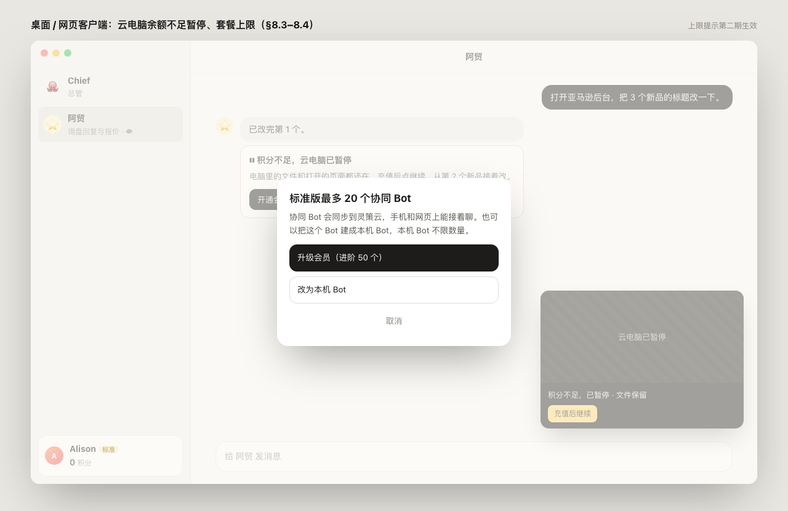
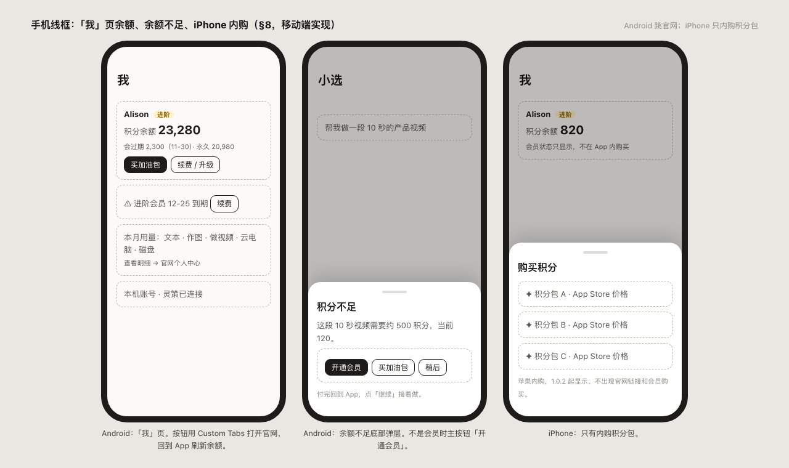

### 8.1 余额展示

| 位置 | 内容 | 点了以后 |
|---|---|---|
| 桌面 / 网页：侧栏底部账号卡片 | 头像、档位徽标（体验 / 标准 / 进阶 / 专业 / 卓越）、积分余额 | 打开账号菜单 |
| 账号菜单顶部 | 显示本产品可用余额，分列专属积分、通用积分和 30 天内即将到期的积分；档位和到期日；按钮「买加油包」「开通会员 / 续费」 | 按钮走 §8.5；「查看明细」在一次性码接口上线后免登录打开官网个人中心，此前正常登录 |
| 设置 → 账号与积分 | 同上，加最近 30 天按类别的用量（文本对话、作图、做视频、云电脑、磁盘） | 同上 |
| Android：「我」页顶部卡片 | 同账号菜单 | 同上 |
| iOS：「我」页顶部卡片 | 余额和档位（只读）；「买积分」按钮打开内购弹层 | 内购（§8.5） |

没登录灵策（只用本机账号）时，这些位置显示「本机账号 · 未连接灵策」，按钮是「登录灵策，用云端和灵策模型」。

### 8.2 预警

| 条件 | 提示 | 位置 | 关闭 |
|---|---|---|---|
| 余额低于 1,000 积分（约 50–100 次对话） | 「积分快用完了，剩 820」+「买加油包」 | 对话顶部横幅（现有 `LowCreditsBanner`） | 关掉后 24 小时内不再出现 |
| 3 天内有积分到期 | 「11-30 有 2,300 积分到期」 | 账号菜单里的一行；到期前 1 天在对话顶部横幅提醒一次 | 同上 |
| 会员 3 天内到期（手动续费） | 「进阶会员 11-28 到期，到期后不再发月度积分」+「续费」 | 横幅 + 账号菜单 | 同上 |
| 新用户体验积分 3 天内到期 | 「体验积分还有 3 天到期」+「开通会员」 | 横幅 | 同上 |

阈值写在客户端常量里，以后需要可以改成从权益接口读。

### 8.3 余额不足

所有情况都用同一个卡片组件（现有 `CreditsRequiredCard` 扩展），按场景换标题和说明。按钮规则：**不是会员**时主按钮「开通会员」、次按钮「买加油包」；**已经是会员**时主按钮「买加油包」、次按钮「升级会员」；都附「继续」（充值后重试刚才那一步）。

| 场景 | 什么时候判断 | 提示 |
|---|---|---|
| 文本对话 | 回合开始前预扣失败，或中途扣不动 | 对话里一张卡片：「积分不足，这一步没做完。充值后点继续，从这里接着做」 |
| 作图 | 调作图工具前预扣失败 | 工具卡片：「作图需要约 45 积分，余额 12」 |
| 做视频 | 同上 | 「这段 10 秒视频需要约 500 积分，余额 120」 |
| 云电脑开机 | 开机前预扣 5 分钟失败 | 云电脑卡片和浮窗：「开机至少需要 9 积分」，开机按钮置灰 |
| 云电脑运行中 | 5 分钟预扣失败 | **先暂停电脑**（文件保留），浮窗和对话里提示：「积分不足，云电脑已暂停，文件都还在。充值后点继续」 |
| 云电脑磁盘 | 每日结算扣不动 | 设置 → 云电脑里红色提示：「磁盘费扣不动了，欠费 30 天后会释放这台电脑（保留快照）」，并在账号菜单显示一行；欠费天数节点按 `octop-bot-cloud-plan.md` §7.4 |
| 模型服务商余额不足（自带 Key） | 服务商返回余额不足 | 不是我们的积分，卡片写「你的 API Key 余额不足，请到服务商充值」，不出现我们的充值按钮 |

### 8.4 达到套餐上限（第二期，权益接口有 `limits` 以后）

| 场景 | 提示 | 选项 |
|---|---|---|
| 新建协同 Bot 超出 | 「标准版最多 20 个协同 Bot」 | 「改为本机 Bot」「升级会员」 |
| 新建协同群聊超出 | 「标准版最多 10 个协同群聊」 | 「改为本机群聊」「升级会员」 |
| 新设备登录、同步设备超出 | 「已同步 3/3 台设备」 | 选一台断开；「升级会员」 |
| 选择专业云电脑（非专业 / 卓越） | 「专业云电脑需要专业版」 | 「用标准云电脑」「升级会员」 |

上限只影响协同（云端），本机 Bot 永远不限。

### 8.5 开通和充值流程

| 端 | 买加油包 | 开通 / 续费 / 升级会员 | 付完以后 |
|---|---|---|---|
| 网页 bot.lynxce.cn | 新标签打开 `wallet/recharge` 返回的地址：现在是灵策收银台（预选按 §5.2 的开关控制），受限会话上线后是官网 `pricing.html#ticket=…`（§5.3） | 同上，`intent=plan` | 回到网页版标签页时刷新余额，成功后提示「已到账 +5,000 积分」 |
| 桌面 | 系统浏览器打开同上地址 | 同上 | 官网结果页打开 `octop-bot://recharge/done`，客户端刷新余额并提示；没有回跳时，窗口回到前台也会刷新 |
| Android | Custom Tabs 打开同上地址 | 同上 | 回到 App（`onResume`）刷新余额并提示 |
| iOS | 内购积分包弹层（1.0.1 隐藏，1.0.2 打开） | **不出现**会员购买和外链，只显示当前档位 | 苹果交易确认后刷新余额 |

### 8.6 新用户、首次付费、签到

- 新用户第一次登录灵策：「已到账 100 体验积分，14 天内有效，仅限 Octop 使用」（toast），账号菜单显示到期日。
- 第一次碰到余额不足：卡片下面多一行小字对比「加油包一次性买 / 会员每月送积分」，帮用户选。
- 签到（第二期）：账号菜单里「签到领积分」一行；付费会员每天 100 积分，当月有效，月底清零。

### 8.7 错误码和文案

服务端统一返回，客户端统一组件显示。新增的码按 `infra/errors.py` 和 i18n 的规矩加（后端 `errors.*` 和前端 `apiErrors.*` 中英文一致）。

| 码 | HTTP | 什么时候 | 附带 `details` | 中文 | English |
|---|---|---|---|---|---|
| `BOT_CLOUD_CREDITS_REQUIRED`（已有，改文案） | 402 | 积分不足：对话、作图、视频 | `need`、`balance`、`kind`（`text` / `image` / `video`） | 积分不足，这一步需要约 {need} 积分，当前 {balance}。 | Not enough credits: this step needs about {need}, you have {balance}. |
| `BOT_COMPUTER_CREDITS_REQUIRED`（新） | 402 | 云电脑开机预扣失败 | `need`、`balance`、`spec` | 开机至少需要 {need} 积分。 | Starting the computer needs at least {need} credits. |
| `BOT_COMPUTER_PAUSED_NO_CREDITS`（新） | 402 | 运行中扣不动，已暂停 | `computer_id`、`balance` | 积分不足，云电脑已暂停，文件都还在。 | Out of credits, so the computer is paused. Your files are kept. |
| `BOT_DISK_OVERDUE`（新，提醒用） | — | 磁盘费欠费 | `days`、`release_at` | 磁盘费欠费 {days} 天，{release_at} 会释放这台电脑。 | Disk fees are {days} days overdue; the computer will be released on {release_at}. |
| `BOT_PLAN_LIMIT`（新，第二期） | 403 | 协同 Bot / 群聊 / 设备 / 专业电脑超出 | `limit`（`bots` / `groups` / `devices` / `pro_computer`）、`max`、`tier`、`upgrade_to` | {tier}最多 {max} 个协同 Bot。 | {tier} includes up to {max} synced bots. |
| `stream_errors.insufficient_balance`（已有） | — | 自带 Key 的服务商余额不足 | — | 你的 API Key 余额不足，请到服务商充值。 | Your API key's balance is too low. Top it up with the provider. |

客户端组件：网页和桌面一个 `CreditsPrompt`（卡片、横幅两种形态，按 `kind` 和会员状态换按钮）；手机各做一个同样行为的组件。`BOT_CLOUD_CREDITS_REQUIRED` 现在的文案指向 admin.lynxce.cn/recharge，改成上面这句，按钮负责跳转。

## 9. 风险

- **价格**：价格和积分数以《会员权益与定价定稿》为准，页面和客户端都从灵策读，不写死。
- **自动续订**：第一期写「到期前 3 天提醒，手动续费」，不能写「自动续订」。
- **iOS 审核**：iOS 内不出现官网链接和会员购买。
- **票据**：官网接客户端票据要灵策评审同意（§5.3）。
- **两套账号**：官网只显示灵策账号的数据；文案里不要暗示「登录官网能看到你电脑上的 Bot」。
- **权益未生效**：第一期定价页写了各档数量上限，客户端第二期才强制执行（§3.2）。

## 10. 参考 LobsterAI

2026-11-25 看了 LobsterAI 的公开定价页、更新日志页和个人中心（个人中心只看了结构，没有记录任何账号信息，也没有登录任何账号）。档位、价格和积分数照用户的决定沿用；文案、图片和品牌元素不照搬。

### 10.1 借鉴什么

| LobsterAI 的做法 | 我们怎么用 |
|---|---|
| 定价页顶部分段切换「订阅套餐 / 加油包 / 团队版」 | 采用，去掉团队版：「会员套餐 / 加油包」 |
| 月付 / 年付切换，年付写限时折扣 | 采用：年付限时 9 折 |
| 每张卡片的灰底积分块：每月积分 + 有效期、加赠、签到；下面才是权益清单 | 采用，权益清单换成我们的（§3.2） |
| 加油包：可选金额卡片 + 自定义金额，右侧固定结算栏，底部引导订阅 | 采用 |
| 定价页下半部分的模型价格表：文本 / 图片 / 视频切换，输入、输出、缓存命中、能力 | 采用：文本 / 作图 / 视频，价格读灵策；另加云电脑和磁盘单价 |
| 个人中心左侧短导航，右侧数字卡片 + 每日用量图 | 采用 |
| 积分额度：可用总积分、当前订阅、加油包记录（总量、已用、剩余、到期）、「查看消耗顺序」 | 采用：专属和通用明细、30 天内到期积分及扣费顺序 |
| 账单与发票：累计支付、可开票、已开票，单张和批量开票 | 采用 |
| 兑换中心、邀请好友 | 兑换码第二期；邀请不做 |
| 更新日志：左侧日期、版本号 +「最新」、一句话标题、条目列表、共多少个版本 | 采用，另加平台标签、正式版 / 测试版和分组 |

### 10.2 我们不一样的地方

- **卖的是一支 Bot 团队。** 用量按 Bot 拆，权益里有协同 Bot 数和群聊数。
- **有云电脑。** 云电脑按分钟、磁盘按 GB·天计费，定价页和用量页单独讲。
- **两套账号。** 本机 Bot 用自己的模型和电脑，不花积分、不上云，在官网看不到。定价页第一句就讲这个。
- **多端同步。** 有登录设备页和同步设备数。
- **签到只做简单版。** 会员每月领积分，不做连续天数之类的花样。

## 11. 更新日志页和发版

### 11.1 页面

- 地址 `/changelog.html`，导航加「更新日志」（原来指向下载页 `#changelog` 的链接改到这里）。
- 标题、一句说明、平台筛选（全部 / macOS / Windows / iPhone / Android / 网页版）、「共 N 个版本」。每个版本：左侧日期（北京时间），右侧版本号、「最新」「正式版 / 测试版」、一句话标题、平台标签、按「亮点 / 新增 / 改进 / 修复」分组的条目；只涉及部分平台的条目后面跟平台小标签。中英双语跟官网现有的语言切换。
- 下载页的更新说明读同一份数据，只显示最近几个版本，链接到更新日志页。

### 11.2 数据：`changelog.json`

由运营后台的发版模块写入 `https://dl.lynxce.cn/releases/octop-bot/changelog.json`（和签名清单 `manifest.json` 同目录，已有 `CORS *`；后台只拿得到能写这一个对象的凭据，碰不到清单）。官网前端直接读，发版后不用重新部署官网。格式（已和灵策对接对齐）：

```json
{
  "schemaVersion": 2,
  "product": "octop-bot",
  "updatedAt": "2026-11-26T10:00:00+08:00",
  "hidden": ["ios"],
  "releases": [
    {
      "version": "1.0.5",
      "channel": "stable",
      "date": "2026-11-26",
      "platforms": ["darwin", "win32", "web"],
      "title": { "zh": "新用户引导：和总管一起组第一支团队", "en": "Build your first team with Chief" },
      "items": [
        { "type": "highlight", "zh": "…", "en": "…" },
        { "type": "fixed", "zh": "修复 Windows 上偶尔无法退出登录", "en": "…", "platforms": ["win32"] }
      ],
      "tag": "octop-bot-v1.0.5"
    }
  ]
}
```

- `channel`：`stable` / `beta`。`platforms`：`darwin`、`win32`、`linux`、`ios`、`android`、`web`、`server`。
- `items[].type`：`highlight`、`new`、`improved`、`fixed`；`items[].platforms` 省略表示适用于这个版本的全部平台。
- `hidden`：暂不对外提供的平台。
- 安装包和校验值不放这里，仍以签名清单为准；更新日志不签名。
- 旧数据迁移：把 `website/releases.json`（schemaVersion 1）一次性转换，旧条目归到 `improved`；之后 `releases.json` 只作 `changelog.json` 读不到时的兜底。

### 11.3 后台发版

```
运营后台「Octop Bot → 发版」
  填版本号、渠道、日期、平台、中英标题、条目；选这次的安装包
  发布 → 写 changelog.json（版本记录存后台，可编辑、可撤回）
官网更新日志页和下载页下次打开就是新的
```

签名清单仍由离线私钥签（发版脚本），第一期后台不碰签名。

## 12. 和运营后台的口径（以运营后台设计 2.4 为准）

| 概念 | 定义 |
|---|---|
| Octop Bot 用户 | 注册来源 `signupSite IN ('octop-bot', 'octopbot')`，或名下有 `product=octop_bot` 的密钥、订阅或订单。线上两种值都有：客户端注册带的 `X-Lynxce-Signup-Site` 是中台应用 id `octop-bot`；只带 `X-Lynxce-App: octopbot` 时兜底记成 `octopbot`。老灵策用户登录 Octop Bot 不会改 `signupSite` |
| 积分 | 本产品可用 = 专属 + 通用；按 §3.4 分列明细和 30 天内到期积分，在本产品可用积分中先扣到期早的 |
| 用量 | 流水 `product=octop_bot`。类别：文本对话 `model`、作图 `image`、做视频 `video`、`computer_standard`、`computer_pro`、`disk`（作图、视频的类别名和灵策对接再确认）；维度：Bot、模型、日期；按北京时间自然日、自然月汇总 |
| 订单 | `product=octop_bot`；状态 `pending` / `paid` / `cancelled` / `expired` / `refunded`（`cancelled` 和 `expired` 都显示「已关闭」）；金额 `amountCents`（分）；会员单 `period` 为 `monthly` / `yearly` |
| 套餐 | `tier`：`trial` / `standard` / `plus` / `pro` / `max`；权益 `GET /api/billing/octop-bot/entitlements`（第一期只有档位、周期、到期日和积分） |
| 版本 | `changelog.json` 和签名清单里的版本号、渠道、日期 |

## 13. 分期、岗位和工作量

### 第一期

| 岗位 | 做什么 | 估时 |
|---|---|---|
| 桌面与 Web（我） | 官网：定价（会员 / 加油包、月付年付、单价、模型价格表）、登录、支付结果、个人中心（概览、用量、订单与发票、套餐、账号与安全、登录设备、我的 Bot 与下载）、更新日志页和旧数据迁移 | 6–8 天 |
| 桌面与 Web（我） | 网页 / 桌面客户端：余额展示、预警横幅、`CreditsPrompt`（§8.3）、按 §5.3 打开充值地址（带 `intent`、`from`、`need`、`reason`）、回跳刷新、新用户提示、错误码和中英文案 | 4–5 天 |
| 灵策对接 | §6 第 1–9、12 条（会员约 14–19 个开发日） | 见运营后台设计 |
| 云端与计费 | 模型调用带 `X-Lynxce-Bot-Id`；云电脑和磁盘计费带 `botId`；新错误码在云电脑管理器里抛出 | 1–2 天 |
| 移动端 | §8 的 Android / iOS 部分 | 移动端估 |
| 内容运营 | 定价页文案、FAQ、购买须知、协议里的付费条款 | |
| 质量与发版 | 官网部署、端到端验收（客户端积分不足 → 官网买 → 回到 App 余额刷新） | |

### 第二期

签到、兑换码、自助改密码、权益 `limits` 和 §8.4 升级提示、在官网自己做收银台（需要受限会话，§5.3）。

### 以后

三站单点、签约代扣（自动续订）、自助退款、对公转账。

### 和两套账号第 1 期的先后（给总管的建议）

- 两套账号第 1 期（首启设本地账号和密码、补设密码、Bot 的 🔒 / ☁ / ⚠ 标、账户菜单）：我估 4–6 天，**没有外部依赖**，也是方案 C 第 2 期的前提。
- 官网第一期：前端 6–8 天，但**登录、余额、订单、用量都要等灵策**（跨域 0.5 小时可以马上做；`product` 字段、会过期积分、会员套餐、收银台回跳要 14–19 个开发日，走列车）。
- 建议：**先做两套账号第 1 期**；同时请灵策先上跨域白名单和收银台回跳。之后做官网第一期，顺序是更新日志页（只依赖 `changelog.json`，读不到时用 `releases.json` 兜底，可以最早上线）→ 登录 + 个人中心（概览、订单、发票，字段先按本文口径对接）→ 会员和加油包（等灵策列车 B 上线后一起开卖）。客户端的余额不足卡片和错误码跟着加油包一起上。
