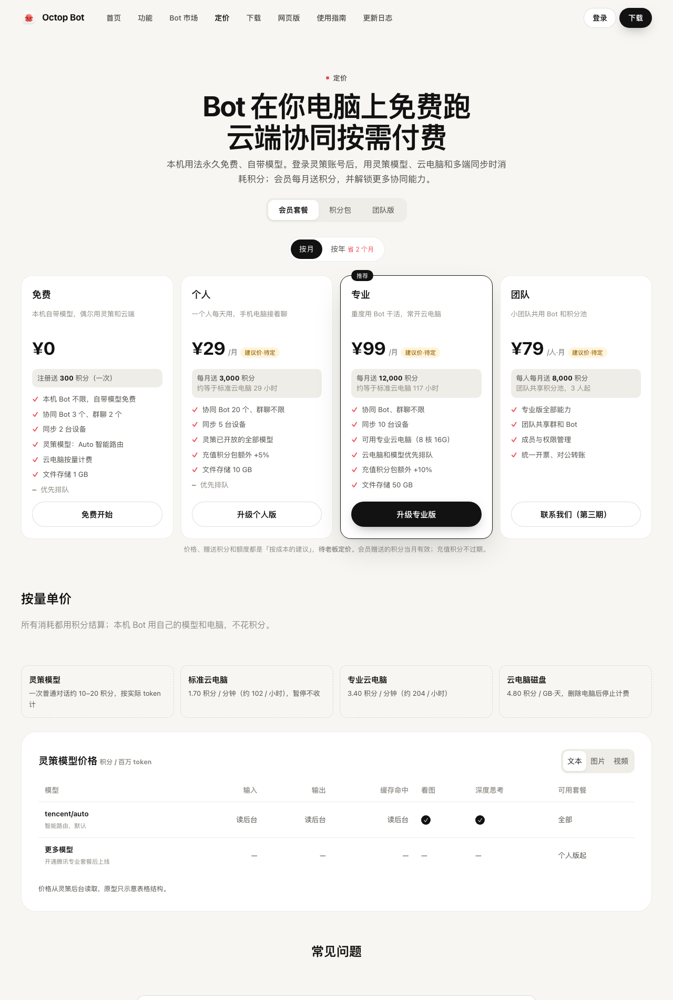
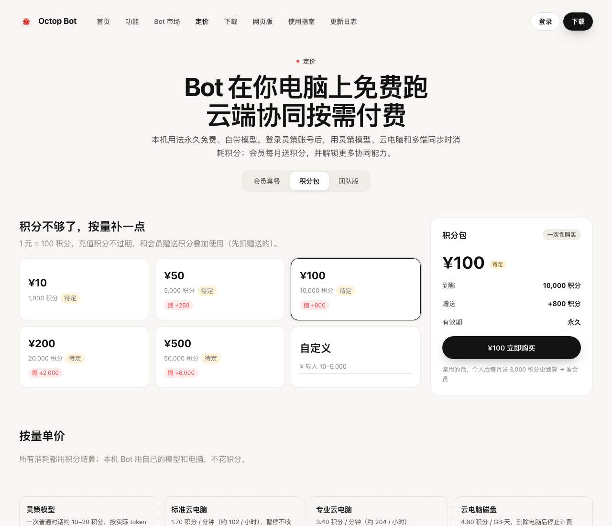
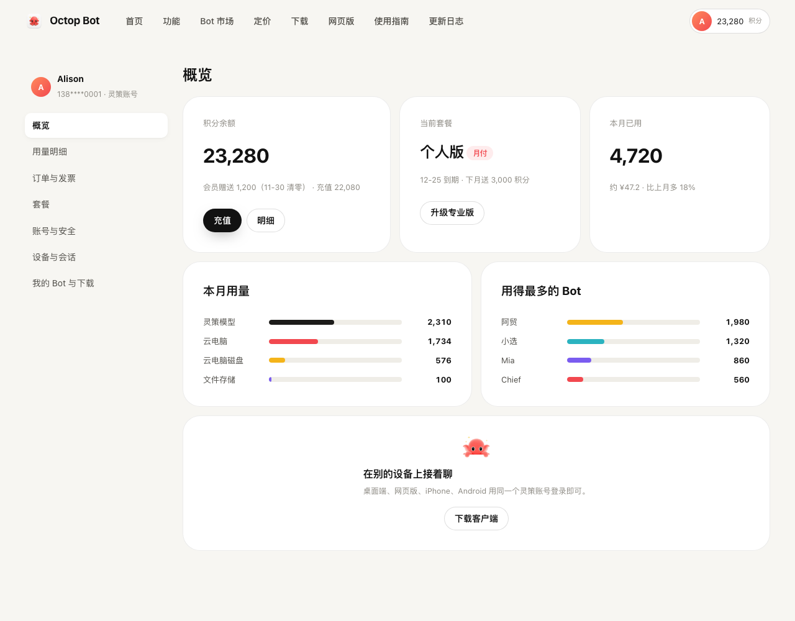
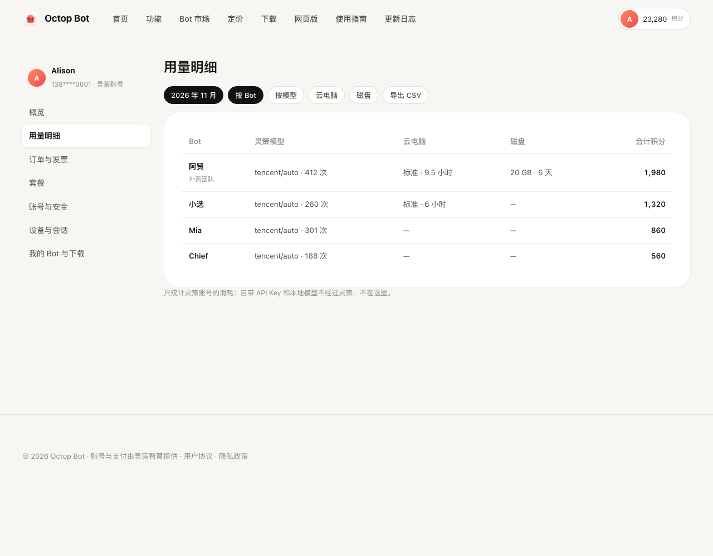
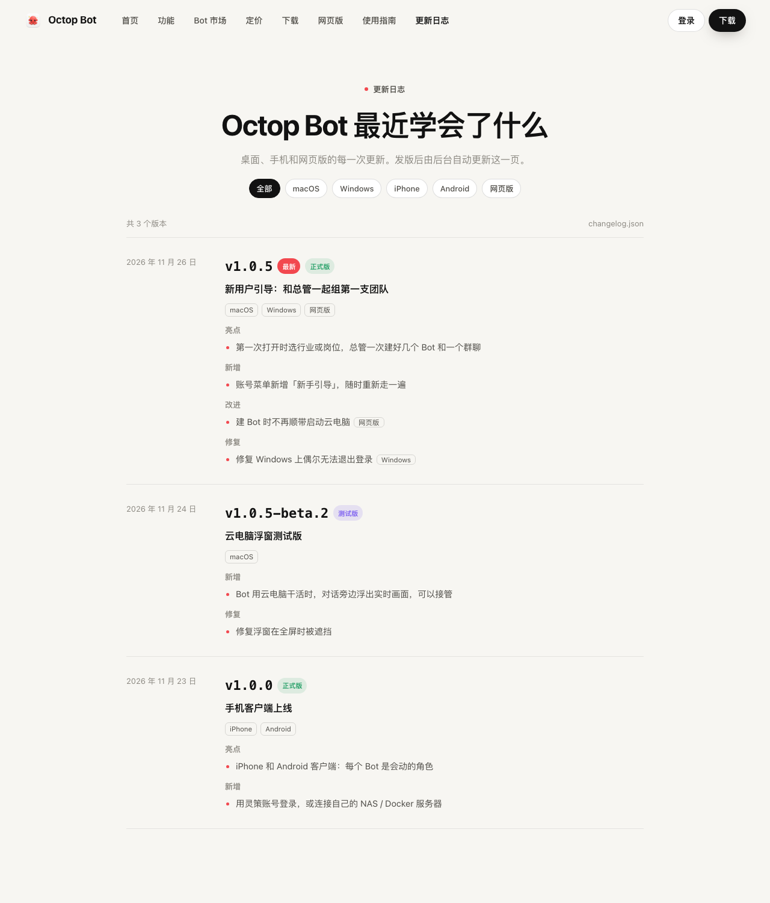
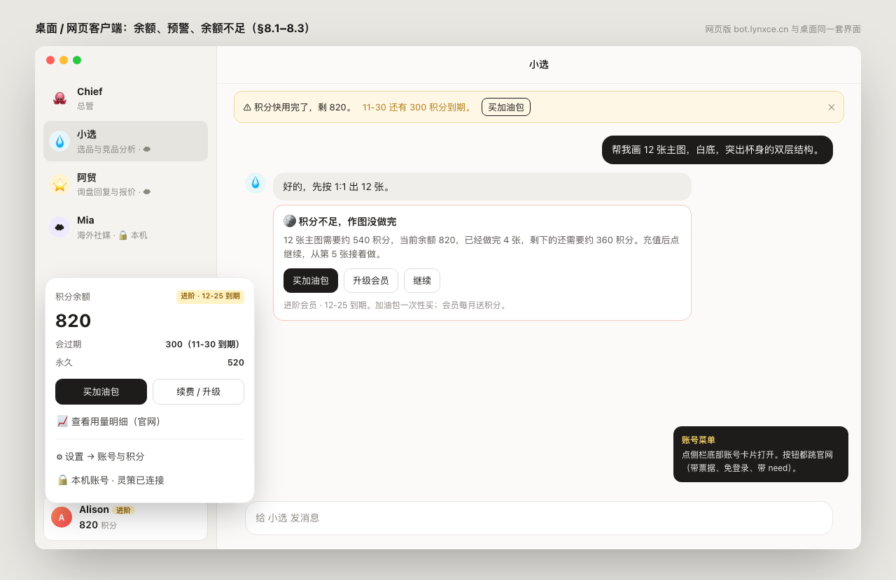

# Octop Bot 的会员、充值、个人中心和更新日志（设计稿）

状态：**定稿**（2026-11-25，用户已定的写在 §0；灵策侧的 6 处细节以灵策运营后台设计 2.3.1 为准）。负责：岗位·桌面与 Web。

用户原话：
- 「再给 octop bot 单独在官网做一个充值页和登录以及个人中心体系，帮我设计规划好 octop bot 的会员套餐和积分充值，以及个人中心 ui 那些，可以参考复用部分之前灵策的，然后引导充值也是引导到 octop 这个充值页来。……把 octop bot 设计得更像一个 SaaS 产品、AI 工具一些。」
- 「跟 lobster 的一样」「加油包也跟他一样，团队版暂时不上」「年费也加上去」。
- 「官网的那几个定价的你参考 lobster，跟他们类似，然后我们的根据实际情况来，把视频和作图模型也加进去」。
- 「然后再把所有客户端的充值、积分、余额不足等等各种充值和开通的 ui 交互功能都做好设计好」。

可点原型：[`docs/assets/octop-bot-saas-billing/prototype.html`](assets/octop-bot-saas-billing/prototype.html)（浏览器直接打开，顶部条切换页面；官网部分直接用 `website/assets/site.css`；客户端部分是桌面窗口和手机线框）。

相关文档：
- 灵策侧数据模型、工作量、发版模块：灵策仓库 `team/方案/2026-11-25-OctopBot运营后台设计.md`（2.3、2.4、3 节，下称「运营后台设计」）。
- 灵策现有能力盘点：`/Users/alex/Desktop/octop-bot-team/灵策能力盘点-官网.md`（下称「盘点」）。
- 两套账号：`docs/octop-bot-accounts.md`。

## 0. 已定和待定

| # | 事项 | 结论 | 谁定的 |
|---|------|------|------|
| P1 | 档位 | 体验 / 标准 / 进阶 / 专业 / 卓越 五档，档位和每月积分、加赠照 LobsterAI；**团队版不上** | 用户 |
| P2 | 权益怎么表达 | 照 LobsterAI 的结构：每月积分 + 加赠 + 签到 + 权益清单；清单写我们实际能给的（§3.2） | 用户 |
| P3 | 价格 | 月付 ¥0 / 69 / 99 / 199 / 699；年付限时 9 折（月价 × 12 × 0.9） | 用户 |
| P4 | 积分有效期 | 会员每月积分从发放起 1 个月；体验 300 积分 14 天；同一个灵策钱包，**先扣快到期的** | 用户 + 灵策对接 |
| P5 | 自动续订 | 灵策第一期做不到（微信、支付宝签约代扣都没有）。**第一期写「到期手动续费」**，不写「自动续订」 | 灵策对接核实 |
| P6 | iPhone | 只卖苹果内购积分包（1.0.1 隐藏、1.0.2 打开），不卖会员、不放外链 | 已定 |
| P7 | 新用户 | 体验档 300 积分，14 天有效 | 用户 |
| P8 | 加油包 | 照 LobsterAI：¥20 / 50 / 100 / 200 / 500 和自定义金额（§3.3） | 用户 |
| P9 | 免费（体验）限制 | 按我们的实际成本：协同 Bot 3、群聊 2、同步设备 2；本机 Bot 不限 | 用户（按建议） |
| P10 | 登录 | **第一期官网直接调灵策验证码登录**拿会话令牌；三个子域单点登录不做（要动灵策登录，3–5 天、高风险） | 灵策对接核实 |
| P11 | 收款主体、发票 | 沿用灵策 | 用户 |
| P12 | 公开单价 | 公开云电脑、磁盘、文本模型、作图、做视频的积分单价；单价读灵策，不写死 | 用户 |
| P13 | 兑换码 / 邀请 | 兑换码第二期；邀请返积分先不做 | 用户（按建议） |
| P14 | 首单低价 | 第一期不做 | 用户（按建议） |
| P15 | 签到 | 要做，第二期。第一期上线时签到还没做，定价页**不显示**签到那一行 | 用户 |

还待用户在灵策侧确认的 6 处细节（运营后台设计 2.3.1）：年付价是否取整、「限时」截止日；标准和进阶「加赠 10%」是每月还是只首月；签到怎么领、签到积分是否过期；体验档自动发还是点领取、和灵策注册奖励是否叠加；加油包积分有效期（LobsterAI 写 365 天，见 §3.3）；「自动续订」改为「到期手动续费」。

## 1. 现状

- **账号**：灵策账号（手机号 / 邮箱验证码、密码、WorkBuddy、微信）。官网的登录和个人中心只管灵策账号这一侧；本机账号和本机 Bot 在官网完全看不到（`octop-bot-accounts.md`）。
- **充值**：客户端调 Octop 后端 `POST /api/octop-bot/wallet/recharge`，后端用灵策 `POST /api/billing/recharge/checkout-link` 换 15 分钟票据，打开灵策收银台 `admin.lynxce.cn/recharge?token=…`。URL 在 `src/octop/infra/auth/lynxce_wallet.py` 精确校验，手机端各有一份同样的校验。
- **iOS**：苹果内购积分包（`/api/octop-bot/wallet/apple/*`）。
- **客户端入口**：设置 → 账号与积分（`CreditsPanel`：余额、30 天用量、充值）、对话里的积分不足卡片（`CreditsRequiredCard`）、余额偏低横幅（`LowCreditsBanner`）、账号菜单里的余额。
- **错误**：`BOT_CLOUD_CREDITS_REQUIRED`（402，文案指向 admin.lynxce.cn/recharge）；模型服务商余额不足走 `stream_errors.insufficient_balance`。
- **单价**（灵策后台，老板已确认）：标准云电脑 1.70 积分/分钟、专业 3.40 积分/分钟、云电脑磁盘 4.80 积分/GB·天；文本模型按模型价目（腾讯云 TokenHub，成本 × 3）；作图、做视频按灵策模型价格（默认作图模型和默认视频模型在灵策后台设置，现在分别是 gpt2.6 和 minimax h3）。
- **官网**：`website/` 下的手写静态站，没有登录、定价和更新日志页；更新说明散在下载页，读 `website/releases.json` 和 dl 上的签名清单。

## 2. 官网页面

官网导航加「定价」「更新日志」，右上角加「登录」。登录后右上角换成「头像 + 积分余额」，点开进个人中心。

| 页面 | 地址 | 内容 | 原型 |
|------|------|------|------|
| 定价·会员 | `/pricing.html` | 顶部切换「会员套餐 / 加油包」；月付 / 年付（限时 9 折）切换；五档卡片；下面是按量单价和模型价格表（文本 / 作图 / 视频）；常见问题 |   |
| 定价·加油包 | `/pricing.html#credits` | 左边金额卡片（含自定义金额），右边固定的结算栏（价格、到账、有效期、购买；底部引导看会员）。客户端「买加油包」打开这一页 |  |
| 登录 | `/login.html?next=…` | 验证码 / 密码两个标签，WorkBuddy；没有账号自动注册（带 `X-Lynxce-Signup-Site: octopbot`）；登录后回到 `next` |  |
| 支付结果 | `/pay/result.html?order=…` | 到账多少、当前余额；「返回 Octop Bot」和「查看订单」 |  |
| 个人中心·概览 | `/account/` | 积分余额（会过期 / 永久，最近到期日，扣费顺序说明）、当前套餐和到期日、本月已用；本月用量按类别、按 Bot |  |
| 用量明细 | `/account/#usage` | 按月；类别：文本对话、作图、做视频、云电脑、云电脑磁盘；维度切换 Bot / 模型 / 类别；导出 CSV |  |
| 订单与发票 | `/account/#orders` | 汇总（累计支付、可开票、已开票）；订单列表；单张或批量开票 |  |
| 套餐 | `/account/#plan` | 当前档位和到期日、续费、改年付、升级 |  |
| 账号与安全 | `/account/#security` | 手机、邮箱、WorkBuddy、注销（改密码灵策没有，第二期） | 原型里有 |
| 登录设备 | `/account/#devices` | 灵策记录的推送设备和桌面设备（网页会话不在列表里），可删除单台；「全部下线」 | 原型里有 |
| 我的 Bot 与下载 | `/account/#bots` | 协同 Bot 数量、在网页版打开；各平台下载 | 原型里有 |
| 更新日志 | `/changelog.html` | §11 |  |

结账（付款）这一步第一期跳灵策收银台（§5），所以原型里的「结账」页是第二期的样子。

## 3. 会员和加油包

### 3.1 五档会员（用户已定）

| 档位 | tier | 月付 | 年付（限时 9 折） | 每月积分（1 个月有效） | 加赠 | 签到（第二期） |
|---|---|---|---|---|---|---|
| 体验 | `trial` | ¥0 | — | 新用户一次性 300（14 天有效） | — | — |
| 标准 | `standard` | ¥69 | ¥745.20 | 7,000 | 每月加赠 10%（700）* | 3,000/月 |
| 进阶（稳定使用推荐） | `plus` | ¥99 | ¥1,069.20 | 10,000 | 每月加赠 10%（1,000）* | 3,000/月 |
| 专业 | `pro` | ¥199 | ¥2,149.20 | 20,000 | 首月加赠 20%（4,000） | 3,000/月 |
| 卓越 | `max` | ¥699 | ¥7,549.20 | 70,000 | 首月加赠 20%（14,000） | 3,000/月 |

\* 「每月」还是「只首月」待用户在灵策侧确认（§0）。年付也是每月发一次积分，共 12 次。

每张卡片的结构照 LobsterAI：档位名、价格（年付时显示年价和折合月价）、「到期手动续费」、灰底积分块（每月积分 + 有效期、加赠、签到）、购买按钮、权益清单。文案自己写，不照搬。

### 3.2 权益清单（我们实际能给的）

| | 体验 | 标准 | 进阶 | 专业 | 卓越 |
|---|---|---|---|---|---|
| 本机 Bot（自带模型和电脑，不花积分） | 不限 | 不限 | 不限 | 不限 | 不限 |
| 文本对话（腾讯云 TokenHub，智能路由） | ✓ | ✓ | ✓ | ✓ | ✓ |
| 更多文本模型（腾讯专业套餐开通后上线） | — | ✓ | ✓ | ✓ | ✓ |
| 作图（默认模型由灵策后台设定） | ✓ | ✓ | ✓ | ✓ | ✓ |
| 做视频（默认模型由灵策后台设定） | ✓ | ✓ | ✓ | ✓ | ✓ |
| 云电脑 | 标准版 | 标准版 | 标准版 | 标准 + 专业版 | 标准 + 专业版 |
| 协同 Bot | 3 | 20 | 50 | 不限 | 不限 |
| 协同群聊 | 2 | 10 | 不限 | 不限 | 不限 |
| 同步设备 | 2 | 3 | 5 | 10 | 20 |
| 优先排队（模型和云电脑） | — | — | — | ✓ | ✓ |

- 作图、做视频、云电脑都按积分扣，档位只管能不能用和上限；单价对所有档位一样（读灵策，不写死）。
- **协同 Bot、群聊、设备、专业云电脑、优先排队这几项要等权益接口返回 `limits` 才能卡**（灵策第一期的权益接口只返回档位、周期、到期日和积分，运营后台设计 2.4）。第一期定价页照写，客户端先不拦（§8.4 的升级提示随第二期上线）；运营上需要的话可以先只拦「专业云电脑」。
- 成本核对：会员积分按面值消耗，消耗时文本是成本 × 3、云电脑和磁盘是成本 × 2，所以就算积分全部用完，成本也在面值的 33%–50% 之间；签到每月 3,000 积分的成本上限约 ¥15/人。

### 3.3 加油包（照 LobsterAI）

| 价格 | 到账积分 | 有效期 |
|---|---|---|
| ¥20 | 2,000 | 365 天（LobsterAI 写法，待确认） |
| ¥50 | 5,000 | 同上 |
| ¥100 | 10,000 | 同上 |
| ¥200 | 20,000 | 同上 |
| ¥500 | 50,000 | 同上 |
| 自定义 ¥10–5,000 的整数 | 金额 × 100 | 同上 |

- 2026-11-25 在 LobsterAI 公开页读到：上面 5 档和自定义金额；选中 ¥50 时右侧写「一次性购买，可与订阅叠加」「到账 5,000 积分，有效期 365 天」。**没逐个点开其它档位确认有效期**，也没看到加赠。灵策对接建议加油包永久有效，和 LobsterAI 的 365 天不同，由用户在灵策侧拍板。
- 一次性购买，可以和会员叠加。原来建议的 ¥10 / 50 / 100 / 500 充值包作废。

### 3.4 积分怎么扣（灵策钱包规则）

- 只有一个灵策钱包。界面上分两类显示：**会过期的积分**（会员月度积分、体验积分、签到积分，显示最近一次到期的日期和数量）和**永久积分**（加油包按用户最终定的有效期归类、灵策原有余额）。
- 扣费顺序：先扣最快到期的，最后扣加油包和灵策原有余额。
- Octop Bot 会员积分在灵策其它地方也能用，反过来也一样（运营后台设计 2.3.3）。
- 会员到期不续：不再发下一期，已发的积分按各自的有效期过期，不收回。
- 欠费（余额为 0）：当前回合跑完这一步停下；云电脑暂停（文件保留），见 §8.3。

## 4. 公开单价

定价页「按量单价」和模型价格表都从灵策读，不写死在页面里：

| 类别 | 计价 | 来源 |
|---|---|---|
| 文本对话 | 积分 / 百万 token，分输入、输出、缓存命中 | 灵策模型价格，`product=octop_bot` 可用的模型 |
| 作图 | 积分 / 张（按分辨率） | 灵策模型价格，默认作图模型现为 gpt2.6 |
| 做视频 | 积分 / 秒（按分辨率） | 灵策模型价格，默认视频模型现为 minimax h3 |
| 标准云电脑 | 1.70 积分 / 分钟，暂停不收 | 灵策 `octop_compute` 配置 |
| 专业云电脑 | 3.40 积分 / 分钟 | 同上 |
| 云电脑磁盘 | 4.80 积分 / GB·天 | 同上 |

模型价格表照 LobsterAI 的结构：文本 / 作图 / 视频三个切换，列出能不能看图、能不能深度思考。读价格的公开接口要和灵策对接确认（盘点里没写到模型价格的公开接口，见 §6 第 15 条）。

## 5. 登录和付款链路

### 5.1 登录（第一期）

- 官网直接调灵策的验证码 / 密码登录接口（`/api/auth/phone-code` + `phone-login`、`email-code` + `email-login`、`password-login`），拿到灵策的 Bearer 会话令牌，存在官网自己的 `localStorage`（和灵策网页端一样），刷新走 `POST /api/auth/refresh`。注册来源带 `X-Lynxce-Signup-Site: octopbot`，并带 `X-Lynxce-App: octopbot`。
- 前提：灵策的跨域白名单加 `https://octop-bot.lynxce.cn`（改生产环境变量，0.5 小时）。
- 「用灵策登录」（OIDC）的令牌只能调 userinfo，个人中心用不了，不用它。
- 官网、bot.lynxce.cn、admin.lynxce.cn 各登各的。三站单点要灵策种 `.lynxce.cn` 的 HttpOnly 刷新 Cookie，碰登录、高风险（3–5 天），放到以后。
- 微信扫码登录要灵策把官网加进微信中转白名单（0.5–1 天），第一期可不做。

### 5.2 付款（第一期跳灵策收银台）

灵策所有下单接口只认 checkout 票据，票据换出来的又是一整套网页会话，不适合在官网里自己做收银台。第一期：

```
官网定价页选好档位或加油包（已登录）
  → 官网用 Bearer 调 POST /api/billing/recharge/checkout-link {product:"octop_bot", item, returnUrl}
  → 跳灵策收银台 admin.lynxce.cn/recharge?token=…（带 Octop Bot 品牌参数，预选商品）
  → 付款（微信 / 支付宝）
  → 收银台回跳官网 /pay/result.html?order=…，官网查 GET /api/user/purchase-orders/:id/status
  → 从客户端来的：结果页「返回 Octop Bot」打开 octop-bot://recharge/done
```

- 灵策要做：收银台支持 `product=octop_bot` 品牌、预选商品和回跳（票据里签进来源和回跳地址，白名单校验，约 1 天，碰钱）。
- 会员下单现在只有微信；支付宝要接中台收银台（登记 `octop-web` 产品，2–4 小时）。
- 第二期再评估在官网自己做收银台（原型里的「结账」页），前提是灵策提供只能下单、不能干别的的受限令牌。

### 5.3 从客户端进来

```
客户端 ──POST /api/octop-bot/wallet/recharge {intent: credits|plan, need}──► Octop 后端
Octop 后端 ──POST /api/billing/recharge/checkout-link──► 灵策  ◄── {token, expiresAt}
Octop 后端返回 https://octop-bot.lynxce.cn/pricing.html?ticket=…&from=desktop&need=1200#credits
客户端用系统浏览器打开（Android 用 Custom Tabs）
```

- 官网用 ticket 换灵策会话（官网是我们自己的一方页面），换完立即 `history.replaceState` 去掉 URL 里的票据，令牌只放内存，不写 `localStorage`。这样从客户端过来免登录。**这一步要灵策评审同意**；不同意就退回：客户端直接打开灵策收银台（加 Octop Bot 品牌和回跳），官网只负责结果页。
- `need`：预选第一个不小于缺口的加油包，页面顶部写「还差 1,200 积分」。
- Octop 后端和 Android 的 URL 校验改成精确匹配新地址。

## 6. 复用灵策（按盘点）

| 能力 | 灵策现状 | 官网第一期怎么用 |
|---|---|---|
| 登录注册（手机 / 邮箱验证码、密码、Apple） | 现成 | 直接调；跨域要放行 |
| 微信扫码登录 | 回调域只登记了 web.lynxce.cn | 第一期不放，或灵策加中转白名单 |
| 余额 `GET /api/user/quota`、积分汇总 | 现成 | 概览页；「会过期 / 永久」两类要灵策新做（`CreditLot`） |
| 会员目录 `GET /api/billing/subscription-plans` | 现成，按 `X-Lynxce-App` 过滤 | 要加 `product=octop_bot`（运营后台设计 2.3.3） |
| 加油包 `GET /api/billing/recharge/packages` | 现成，没有售卖端字段 | 要加 `product` |
| 下单（微信 native / h5 / jsapi、支付宝、会员） | 现成，只认 checkout 票据；微信 H5 和支付宝的生产开关没核实 | 第一期不直接调，跳收银台（§5.2） |
| checkout-link | 现成，15 分钟票据 | 要加品牌、预选、回跳 |
| 订单 `GET /api/user/purchase-orders`、状态、续付 | 现成，没有来源字段 | 要加 `product` |
| 发票 `GET /api/user/invoice-requests/orders`、`GET/POST /api/user/invoice-requests` | 现成 | 直接用 |
| 用量 `GET /api/user/usage-ledger`、`usage-overview`、`usage-trend` | 现成，不能按类别或来源筛，不返回 `subjectId` | 要加 `product` 和类别筛选；Bot 维度要 Octop 带 `X-Lynxce-Bot-Id`（模型）和 `botId`（云电脑、磁盘） |
| 登录设备 `GET /api/user/login-devices`、`DELETE …/:id`、`POST /api/user/logout-all` | 现成；JWT 无状态，不能逐个网页会话下线 | 设备页列推送和桌面设备，另给「全部下线」 |
| 注销、换绑手机、绑定邮箱 | 现成 | 账号与安全页直接用 |
| 用户自助改密码 / 忘记密码 | 没有，只有运营后台重置 | 第二期（灵策约 1 天，碰登录） |
| 签到 | 有全站统一签到，和会员无关 | 会员专属每月 3,000 要新做（第二期） |
| 自动续订 | 只有 App Store | 第一期写「到期手动续费」 |
| 退款 | 用户不能自助 | 个人中心不放退款按钮，FAQ 写联系客服 |

灵策要新做的（汇总盘点 §5 和运营后台设计 2.3.6，第一期会员约 14–19 个开发日，全部走 Codex 评审和灵策总管列车）：

1. 跨域白名单加官网（0.5 小时）。
2. 收银台支持 Octop Bot 品牌、预选、回跳（约 1 天）。
3. 套餐、加油包、订阅、订单、流水、密钥加 `product`；`Subscription` 唯一约束改为 `(organizationId, product)`。
4. 会过期积分 `CreditLot`：发放、到期、先扣快到期的。
5. 五档会员和年付套餐、首月加赠、体验档发放。
6. Octop Bot 加油包（单独建，带有效期）。
7. 用量按 `product`、类别筛选的用户接口；模型流水写 `product` 和 Bot；云电脑、磁盘流水写 Bot。
8. 权益接口 `GET /api/billing/octop-bot/entitlements`（第一期只返回档位、周期、到期日、积分）。
9. 中台收银台登记 `octop-web`（支付宝）。
10. 第二期：签到（会员专属）、兑换码、自助改密码、权益 `limits`、受限下单令牌。
11. 以后：三站单点、签约代扣（要先向微信、支付宝申请）、自助退款、对公转账。
12. 发版模块写 `changelog.json`（§11）。
13. 模型价格的公开读取接口（文本、作图、视频），如果现在没有。

Octop 自己要做的：模型调用带 `X-Lynxce-Bot-Id`、云电脑和磁盘计费带 `botId`（云端与计费，各约半天）；`wallet/recharge` 改成返回官网地址（我）。

## 7. 视觉

- 官网沿用 `site.css`（颜色、圆角、按钮、深浅色），和首页、Bot 市场是一套；原型直接引用它。
- 定价页参考 LobsterAI 的信息结构，也参考 Cursor、Claude、Notion 的清晰度：顶部两个切换、卡片先写积分再写权益、推荐档高亮、下面单价和模型价格表、最后 FAQ。
- 个人中心：左侧短导航，右侧数字卡片 + 条形图，数字用等宽数字。
- 总管章鱼只出现在登录卡片顶部和「在别的设备上接着聊」卡片里。

## 8. 客户端内的充值与开通（网页、桌面、Android、iOS）

网页版（bot.lynxce.cn）和桌面端是同一套前端（`dashboard/src/pages/OctopBot`），由我做；Android 和 iOS 由移动端按本节实现，交互和文案一致。原型「客户端」几页：桌面窗口两屏、手机线框一屏。




### 8.1 余额展示

| 位置 | 内容 | 点了以后 |
|---|---|---|
| 桌面 / 网页：侧栏底部账号卡片 | 头像、档位徽标（体验 / 标准 / 进阶 / 专业 / 卓越）、积分余额 | 打开账号菜单 |
| 账号菜单顶部 | 余额大字；下面两行：「会过期 2,300（11-30 到期）」「永久 21,000」；档位和到期日；按钮「买加油包」「开通会员 / 续费」 | 按钮走 §8.5；「查看明细」打开官网个人中心（带票据，免登录） |
| 设置 → 账号与积分 | 同上，加最近 30 天按类别的用量（文本对话、作图、做视频、云电脑、磁盘） | 同上 |
| Android：「我」页顶部卡片 | 同账号菜单 | 同上 |
| iOS：「我」页顶部卡片 | 余额和档位（只读）；「买积分」按钮打开内购弹层 | 内购（§8.5） |

没登录灵策（只用本机账号）时，这些位置显示「本机账号 · 未连接灵策」，按钮是「登录灵策，用云端和灵策模型」。

### 8.2 预警

| 条件 | 提示 | 位置 | 关闭 |
|---|---|---|---|
| 余额低于 1,000 积分（约 50–100 次对话） | 「积分快用完了，剩 820」+「买加油包」 | 对话顶部横幅（现有 `LowCreditsBanner`） | 关掉后 24 小时内不再出现 |
| 3 天内有积分到期 | 「11-30 有 2,300 积分到期」 | 账号菜单里的一行；到期前 1 天在对话顶部横幅提醒一次 | 同上 |
| 会员 3 天内到期（手动续费） | 「进阶会员 11-28 到期，到期后不再发月度积分」+「续费」 | 横幅 + 账号菜单 | 同上 |
| 新用户体验积分 3 天内到期 | 「体验积分还有 3 天到期」+「开通会员」 | 横幅 | 同上 |

阈值写在客户端常量里，以后需要可以改成从权益接口读。

### 8.3 余额不足

所有情况都用同一个卡片组件（现有 `CreditsRequiredCard` 扩展），按场景换标题和说明。按钮规则：**不是会员**时主按钮「开通会员」、次按钮「买加油包」；**已经是会员**时主按钮「买加油包」、次按钮「升级会员」；都附「继续」（充值后重试刚才那一步）。

| 场景 | 什么时候判断 | 提示 |
|---|---|---|
| 文本对话 | 回合开始前预扣失败，或中途扣不动 | 对话里一张卡片：「积分不足，这一步没做完。充值后点继续，从这里接着做」 |
| 作图 | 调作图工具前预扣失败 | 工具卡片：「作图需要约 45 积分，余额 12」 |
| 做视频 | 同上 | 「这段 10 秒视频需要约 500 积分，余额 120」 |
| 云电脑开机 | 开机前预扣 5 分钟失败 | 云电脑卡片和浮窗：「开机至少需要 9 积分」，开机按钮置灰 |
| 云电脑运行中 | 5 分钟预扣失败 | **先暂停电脑**（文件保留），浮窗和对话里提示：「积分不足，云电脑已暂停，文件都还在。充值后点继续」 |
| 云电脑磁盘 | 每日结算扣不动 | 设置 → 云电脑里红色提示：「磁盘费扣不动了，欠费 30 天后会释放这台电脑（保留快照）」，并在账号菜单显示一行；欠费天数节点按 `octop-bot-cloud-plan.md` §7.4 |
| 模型服务商余额不足（自带 Key） | 服务商返回余额不足 | 不是我们的积分，卡片写「你的 API Key 余额不足，请到服务商充值」，不出现我们的充值按钮 |

### 8.4 达到套餐上限（第二期，权益接口有 `limits` 以后）

| 场景 | 提示 | 选项 |
|---|---|---|
| 新建协同 Bot 超出 | 「标准版最多 20 个协同 Bot」 | 「改为本机 Bot」「升级会员」 |
| 新建协同群聊超出 | 「标准版最多 10 个协同群聊」 | 「改为本机群聊」「升级会员」 |
| 新设备登录、同步设备超出 | 「已同步 3/3 台设备」 | 选一台断开；「升级会员」 |
| 选择专业云电脑（非专业 / 卓越） | 「专业云电脑需要专业版」 | 「用标准云电脑」「升级会员」 |

上限只影响协同（云端），本机 Bot 永远不限。

### 8.5 开通和充值流程

| 端 | 买加油包 | 开通 / 续费 / 升级会员 | 付完以后 |
|---|---|---|---|
| 网页 bot.lynxce.cn | 新标签打开官网 `pricing.html#credits?ticket…&need=…` | `pricing.html?ticket…` | 回到网页版标签页时刷新余额，成功后提示「已到账 +5,000 积分」 |
| 桌面 | 系统浏览器打开同上地址 | 同上 | 官网结果页打开 `octop-bot://recharge/done`，客户端刷新余额并提示；没有回跳时，窗口回到前台也会刷新 |
| Android | Custom Tabs 打开同上地址 | 同上 | 回到 App（`onResume`）刷新余额并提示 |
| iOS | 内购积分包弹层（1.0.1 隐藏，1.0.2 打开） | **不出现**会员购买和外链，只显示当前档位 | 苹果交易确认后刷新余额 |

### 8.6 新用户、首次付费、签到

- 新用户第一次登录灵策：「已到账 300 体验积分，14 天内有效」（toast），账号菜单显示到期日。
- 第一次碰到余额不足：卡片下面多一行小字对比「加油包一次性买 / 会员每月送积分」，帮用户选。
- 签到（第二期）：账号菜单里「签到领积分」一行；会员专属，每月封顶 3,000（具体规则灵策侧待定）。

### 8.7 错误码和文案

服务端统一返回，客户端统一组件显示。新增的码按 `infra/errors.py` 和 i18n 的规矩加（后端 `errors.*` 和前端 `apiErrors.*` 中英文一致）。

| 码 | HTTP | 什么时候 | 附带 `details` | 中文 | English |
|---|---|---|---|---|---|
| `BOT_CLOUD_CREDITS_REQUIRED`（已有，改文案） | 402 | 积分不足：对话、作图、视频 | `need`、`balance`、`kind`（`text` / `image` / `video`） | 积分不足，这一步需要约 {need} 积分，当前 {balance}。 | Not enough credits: this step needs about {need}, you have {balance}. |
| `BOT_COMPUTER_CREDITS_REQUIRED`（新） | 402 | 云电脑开机预扣失败 | `need`、`balance`、`spec` | 开机至少需要 {need} 积分。 | Starting the computer needs at least {need} credits. |
| `BOT_COMPUTER_PAUSED_NO_CREDITS`（新） | 402 | 运行中扣不动，已暂停 | `computer_id`、`balance` | 积分不足，云电脑已暂停，文件都还在。 | Out of credits, so the computer is paused. Your files are kept. |
| `BOT_DISK_OVERDUE`（新，提醒用） | — | 磁盘费欠费 | `days`、`release_at` | 磁盘费欠费 {days} 天，{release_at} 会释放这台电脑。 | Disk fees are {days} days overdue; the computer will be released on {release_at}. |
| `BOT_PLAN_LIMIT`（新，第二期） | 403 | 协同 Bot / 群聊 / 设备 / 专业电脑超出 | `limit`（`bots` / `groups` / `devices` / `pro_computer`）、`max`、`tier`、`upgrade_to` | {tier}最多 {max} 个协同 Bot。 | {tier} includes up to {max} synced bots. |
| `stream_errors.insufficient_balance`（已有） | — | 自带 Key 的服务商余额不足 | — | 你的 API Key 余额不足，请到服务商充值。 | Your API key's balance is too low. Top it up with the provider. |

客户端组件：网页和桌面一个 `CreditsPrompt`（卡片、横幅两种形态，按 `kind` 和会员状态换按钮）；手机各做一个同样行为的组件。`BOT_CLOUD_CREDITS_REQUIRED` 现在的文案指向 admin.lynxce.cn/recharge，改成上面这句，按钮负责跳转。

## 9. 风险

- **价格**：价格和积分数是用户定的（照 LobsterAI），页面和客户端都从灵策读，不写死。
- **自动续订**：第一期写「到期手动续费」，不能写「自动续订」。
- **iOS 审核**：iOS 内不出现官网链接和会员购买。
- **票据**：官网接客户端票据要灵策评审同意（§5.3）。
- **两套账号**：官网只显示灵策账号的数据；文案里不要暗示「登录官网能看到你电脑上的 Bot」。
- **权益未生效**：第一期定价页写的协同 Bot 数等上限，客户端还不拦（§3.2），要在 FAQ 里写清楚「上限将于近期生效」或第一期先不写数字，由总管定。

## 10. 参考 LobsterAI

2026-11-25 看了 LobsterAI 的公开定价页、更新日志页和个人中心（个人中心只看了结构，没有记录任何账号信息，也没有登录任何账号）。档位、价格和积分数照用户的决定沿用；文案、图片和品牌元素不照搬。

### 10.1 借鉴什么

| LobsterAI 的做法 | 我们怎么用 |
|---|---|
| 定价页顶部分段切换「订阅套餐 / 加油包 / 团队版」 | 采用，去掉团队版：「会员套餐 / 加油包」 |
| 月付 / 年付切换，年付写限时折扣 | 采用：年付限时 9 折 |
| 每张卡片的灰底积分块：每月积分 + 有效期、加赠、签到；下面才是权益清单 | 采用，权益清单换成我们的（§3.2） |
| 加油包：可选金额卡片 + 自定义金额，右侧固定结算栏，底部引导订阅 | 采用 |
| 定价页下半部分的模型价格表：文本 / 图片 / 视频切换，输入、输出、缓存命中、能力 | 采用：文本 / 作图 / 视频，价格读灵策；另加云电脑和磁盘单价 |
| 个人中心左侧短导航，右侧数字卡片 + 每日用量图 | 采用 |
| 积分额度：可用总积分、当前订阅、加油包记录（总量、已用、剩余、到期）、「查看消耗顺序」 | 采用：会过期 / 永久两类和扣费顺序 |
| 账单与发票：累计支付、可开票、已开票，单张和批量开票 | 采用 |
| 兑换中心、邀请好友 | 兑换码第二期；邀请不做 |
| 更新日志：左侧日期、版本号 +「最新」、一句话标题、条目列表、共多少个版本 | 采用，另加平台标签、正式版 / 测试版和分组 |

### 10.2 我们不一样的地方

- **卖的是一支 Bot 团队。** 用量按 Bot 拆，权益里有协同 Bot 数和群聊数。
- **有云电脑。** 云电脑按分钟、磁盘按 GB·天计费，定价页和用量页单独讲。
- **两套账号。** 本机 Bot 用自己的模型和电脑，不花积分、不上云，在官网看不到。定价页第一句就讲这个。
- **多端同步。** 有登录设备页和同步设备数。
- **签到只做简单版。** 会员每月领积分，不做连续天数之类的花样。

## 11. 更新日志页和发版

### 11.1 页面

- 地址 `/changelog.html`，导航加「更新日志」（原来指向下载页 `#changelog` 的链接改到这里）。
- 标题、一句说明、平台筛选（全部 / macOS / Windows / iPhone / Android / 网页版）、「共 N 个版本」。每个版本：左侧日期（北京时间），右侧版本号、「最新」「正式版 / 测试版」、一句话标题、平台标签、按「亮点 / 新增 / 改进 / 修复」分组的条目；只涉及部分平台的条目后面跟平台小标签。中英双语跟官网现有的语言切换。
- 下载页的更新说明读同一份数据，只显示最近几个版本，链接到更新日志页。

### 11.2 数据：`changelog.json`

由运营后台的发版模块写入 `https://dl.lynxce.cn/releases/octop-bot/changelog.json`（和签名清单 `manifest.json` 同目录，已有 `CORS *`；后台只拿得到能写这一个对象的凭据，碰不到清单）。官网前端直接读，发版后不用重新部署官网。格式（已和灵策对接对齐）：

```json
{
  "schemaVersion": 2,
  "product": "octop-bot",
  "updatedAt": "2026-11-26T10:00:00+08:00",
  "hidden": ["ios"],
  "releases": [
    {
      "version": "1.0.5",
      "channel": "stable",
      "date": "2026-11-26",
      "platforms": ["darwin", "win32", "web"],
      "title": { "zh": "新用户引导：和总管一起组第一支团队", "en": "Build your first team with Chief" },
      "items": [
        { "type": "highlight", "zh": "…", "en": "…" },
        { "type": "fixed", "zh": "修复 Windows 上偶尔无法退出登录", "en": "…", "platforms": ["win32"] }
      ],
      "tag": "octop-bot-v1.0.5"
    }
  ]
}
```

- `channel`：`stable` / `beta`。`platforms`：`darwin`、`win32`、`linux`、`ios`、`android`、`web`、`server`。
- `items[].type`：`highlight`、`new`、`improved`、`fixed`；`items[].platforms` 省略表示适用于这个版本的全部平台。
- `hidden`：暂不对外提供的平台。
- 安装包和校验值不放这里，仍以签名清单为准；更新日志不签名。
- 旧数据迁移：把 `website/releases.json`（schemaVersion 1）一次性转换，旧条目归到 `improved`；之后 `releases.json` 只作 `changelog.json` 读不到时的兜底。

### 11.3 后台发版

```
运营后台「Octop Bot → 发版」
  填版本号、渠道、日期、平台、中英标题、条目；选这次的安装包
  发布 → 写 changelog.json（版本记录存后台，可编辑、可撤回）
官网更新日志页和下载页下次打开就是新的
```

签名清单仍由离线私钥签（发版脚本），第一期后台不碰签名。

## 12. 和运营后台的口径（以运营后台设计 2.4 为准）

| 概念 | 定义 |
|---|---|
| Octop Bot 用户 | 注册来源 `signupSite=octopbot`，或名下有 `product=octop_bot` 的密钥、订阅或订单 |
| 积分 | 同一个灵策钱包；显示成「会过期的积分」（带最近到期日）和「永久积分」；先扣快到期的，最后扣加油包和灵策原有余额 |
| 用量 | 流水 `product=octop_bot`。类别：文本对话 `model`、作图 `image`、做视频 `video`、`computer_standard`、`computer_pro`、`disk`（作图、视频的类别名和灵策对接再确认）；维度：Bot、模型、日期；按北京时间自然日、自然月汇总 |
| 订单 | `product=octop_bot`；状态 `pending` / `paid` / `cancelled` / `expired` / `refunded`（`cancelled` 和 `expired` 都显示「已关闭」）；金额 `amountCents`（分）；会员单 `period` 为 `monthly` / `yearly` |
| 套餐 | `tier`：`trial` / `standard` / `plus` / `pro` / `max`；权益 `GET /api/billing/octop-bot/entitlements`（第一期只有档位、周期、到期日和积分） |
| 版本 | `changelog.json` 和签名清单里的版本号、渠道、日期 |

## 13. 分期、岗位和工作量

### 第一期

| 岗位 | 做什么 | 估时 |
|---|---|---|
| 桌面与 Web（我） | 官网：定价（会员 / 加油包、月付年付、单价、模型价格表）、登录、支付结果、个人中心（概览、用量、订单与发票、套餐、账号与安全、登录设备、我的 Bot 与下载）、更新日志页和旧数据迁移 | 6–8 天 |
| 桌面与 Web（我） | 网页 / 桌面客户端：余额展示、预警横幅、`CreditsPrompt`（§8.3）、跳官网带票据和 `need`、回跳刷新、新用户提示、错误码和中英文案 | 4–5 天 |
| 灵策对接 | §6 第 1–9、12、13 条（会员约 14–19 个开发日） | 见运营后台设计 |
| 云端与计费 | 模型调用带 `X-Lynxce-Bot-Id`；云电脑和磁盘计费带 `botId`；新错误码在云电脑管理器里抛出 | 1–2 天 |
| 移动端 | §8 的 Android / iOS 部分 | 移动端估 |
| 内容运营 | 定价页文案、FAQ、购买须知、协议里的付费条款 | |
| 质量与发版 | 官网部署、端到端验收（客户端积分不足 → 官网买 → 回到 App 余额刷新） | |

### 第二期

签到、兑换码、自助改密码、权益 `limits` 和 §8.4 升级提示、在官网自己做收银台（需要受限下单令牌）。

### 以后

三站单点、签约代扣（自动续订）、自助退款、对公转账。

### 和两套账号第 1 期的先后（给总管的建议）

- 两套账号第 1 期（首启设本地账号和密码、补设密码、Bot 的 🔒 / ☁ / ⚠ 标、账户菜单）：我估 4–6 天，**没有外部依赖**，也是方案 C 第 2 期的前提。
- 官网第一期：前端 6–8 天，但**登录、余额、订单、用量都要等灵策**（跨域 0.5 小时可以马上做；`product` 字段、会过期积分、会员套餐、收银台回跳要 14–19 个开发日，走列车）。
- 建议：**先做两套账号第 1 期**；同时请灵策先上跨域白名单和收银台回跳。之后做官网第一期，顺序是更新日志页（只依赖 `changelog.json`，读不到时用 `releases.json` 兜底，可以最早上线）→ 登录 + 个人中心（概览、订单、发票，字段先按本文口径对接）→ 加油包 → 会员（等灵策会员上线）。客户端的余额不足卡片和错误码跟着加油包一起上。
